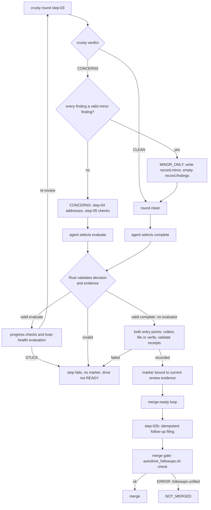

# Auto Drive To Merge Reference

> [Home](../index.md) > Reference > Auto Drive To Merge

`auto-drive-to-merge` wraps [`default-workflow`](../../amplifier-bundle/recipes/default-workflow.yaml)
and drives the pull request it produces all the way to a merge. It encodes the
method of using the `crusty-old-engineer` skill as the maintainer's proxy:
iterate on the PR until crusty's verdict is `CLEAN`, or lists minor findings
only, then iterate until every merge-ready criterion holds, then merge behind
an evidence gate. Each minor finding left at the end of the crusty loop is
filed as a follow-up issue linked to the plan task before the PR can merge
([#1979](#minor-findings-end-the-crusty-loop-1979)).

It is invocable as a recipe or as the [`auto-drive-to-merge`
skill](../../amplifier-bundle/skills/auto-drive-to-merge/SKILL.md).

For a small change, [`auto-drive-light`](auto-drive-light.md) builds in one
agent session and uses the same crusty loop, merge loop and gate. It hands the
PR to this recipe when the change exceeds its eligibility rules.

## Contents

- [The three phases](#the-three-phases)
- [PR head and worktree resolution](#pr-head-and-worktree-resolution)
- [Finalization hand-off from phase 1 (#1714)](#finalization-hand-off-from-phase-1-1714)
- [Why there is no iteration cap](#why-there-is-no-iteration-cap)
- [Structured verdicts](#structured-verdicts)
- [Crusty completion decision contract](autodrive-crusty-completion.md)
- [Minor findings end the crusty loop (#1979)](#minor-findings-end-the-crusty-loop-1979)
- [How the merge round applies merge-ready](#how-the-merge-round-applies-merge-ready)
- [Reading step outputs](#reading-step-outputs)
- [Reading the loop-health line](#reading-the-loop-health-line)
- [Two absolute prohibitions](#two-absolute-prohibitions)
- [No silent merge](#no-silent-merge)
- [Expected checks at the head (#2186)](#expected-checks-at-the-head-2186)
- [Merges outside the gate are refused (#1551)](#merges-outside-the-gate-are-refused-1551)
- [Exit code 79 is terminal](#exit-code-79-is-terminal)
- [Orphaned rounds](#orphaned-rounds)
- [Usage limits are not STUCK](#usage-limits-are-not-stuck)
- [No-progress stop and usage budget](#no-progress-stop-and-usage-budget)
- [Recursion context propagation](#recursion-context-propagation)
- [Resumability](#resumability)
- [The run report](#the-run-report)
- [No short timeouts](#no-short-timeouts)
- [Where phases 2 and 3 run](#where-phases-2-and-3-run)
- [Files](#files)
- [Tests](#tests)
- [Dependency on PR #1347](#dependency-on-pr-1347)
- [Related references](#related-references)

## The three phases

| Phase | Brick | What it does |
| --- | --- | --- |
| 0. Prerequisites | `auto-drive-to-merge.yaml` step `autodrive-prerequisites` | Where criterion 1 needs `gadugi-test` (a Node repository, or `AUTODRIVE_QA_SCENARIO_DIR` set), stops the run with `ERROR: gadugi-test-not-installed` when it is not on `PATH`, before the build and the crusty loop spend hours. A Rust CLI or Python repository does not need it. |
| 1. Build | `autodrive-build.yaml` | Runs `default-workflow` with `no_merge: "true"` to produce a PR. Never merges. A build that ends `BLOCKED_CI`, or `FAILED_IMPLEMENTATION` on a confirmed open PR, hands that PR to phases 2 and 3 instead of ending the run ([#1714](#finalization-hand-off-from-phase-1-1714)). |
| 2. Crusty loop | `autodrive-crusty-loop.yaml` over `autodrive-crusty-round.yaml` | Reviews and remediates until an evidence-valid `CLEAN` or `MINOR_ONLY` completes iteration without evaluating loop health. Files or verifies every required minor follow-up before recording phase completion ([completion contract](autodrive-crusty-completion.md)). |
| 3. Merge-ready loop | `autodrive-merge-loop.yaml` over `autodrive-merge-round.yaml` | Before each round, sends code commits made after the clean crusty round back to the crusty loop (`autodrive_crusty_rereview.sh`). Syncs the base, runs the repository tests and, where criterion 1 needs them, the `gadugi-test` scenarios, waits for CI, applies the `merge-ready` criteria read from the skill's files, clears blockers, repeats, then merges behind the gate. |

Phase 1 is a no-op when an open PR already exists for the branch, and the whole
workflow short-circuits when the PR is already merged.

Phases 2 and 3 resolve the pull request's linked worktree before their first
round, and every round edits, commits and pushes there, never in the launch
checkout. See [Where phases 2 and 3 run](#where-phases-2-and-3-run).

## PR head and worktree resolution

Every evidence step measures the PR head, whichever directory the run starts
from. A run launched from the repository's main checkout does not record the
main checkout's HEAD as `head_sha`, and does not run QA on the main
checkout's tree. That holds whether the operator named the PR with
`pr_number` or phase 1 built it.

```bash
# Launched from the main checkout; feat/x is checked out in worktrees/feat/x.
amplihack recipe run auto-drive-to-merge -c pr_number=1543 -c existing_branch=feat/x -c repo_path=.
# Launched from the main checkout; default-workflow builds the PR in its own
# worktree (workflow-worktree, step-04) and leaves the main checkout on main.
amplihack recipe run auto-drive-to-merge -c task_description="..." -c repo_path=.
```

### When resolution runs

Resolution runs in step-01 (the preflight) of `autodrive-crusty-loop.yaml` and
`autodrive-merge-loop.yaml` when both of these hold:

- the loop was handed a PR number. The composer passes the build phase's PR
  as `pr_number` (`{{build_result.pr}}`) and the operator's own `pr_number`
  as `autodrive_pr_input`, which its first step, `autodrive-pr-input`, records
  before any phase runs. Either one is enough. Both name the PR from the
  platform's side, and the worktree is then found through the PR's
  `headRefName`, not through the launch checkout;
- the phase is going to run (`should_run` would be `true`).

The PR number used is `PR_NUMBER`, or `autodrive_pr_input` when `PR_NUMBER`
is empty or not numeric. A `pr_number` the operator gave that is not a
positive number, with no `PR_NUMBER` to override it, is refused before
resolution:

```
ERROR: pr_number 'abc' is not a pull request number; refusing to enter the crusty loop (#1543)
```

Only when the loop was handed no PR number at all, which happens when a loop
recipe is run on its own without `pr_number`, does the preflight fall back to
`gh pr view` in `${REPO_PATH:-.}`. That number is a guess from the launch
checkout, so it never turns resolution on: the loop uses `${REPO_PATH:-.}`,
calls no `gh` head lookup, and never refuses on these grounds.

The operator's value travels separately as `autodrive_pr_input` because the
recipe runner copies a sub-recipe's whole context back into the parent when
it returns, and the crusty loop is given `pr_number={{build_result.pr}}`, so
after phase 2 `pr_number` holds the build phase's PR. `autodrive_pr_input`,
which no sub-recipe changes, keeps the operator's value, and is what makes a
non-numeric operator `pr_number` a refusal rather than a silent fallback.

When resolution does run, `REPO_PATH` may be absolute or relative to the
directory the run started in. The preflight changes into `REPO_PATH` and
passes the resulting `$PWD` to the resolver. A `REPO_PATH` the preflight
cannot enter is refused before resolution; the loop never falls back to the
current directory:

```
ERROR: cannot cd to REPO_PATH='sub'; refusing to enter the crusty loop (#1543)
```

### The resolver

`amplifier-bundle/tools/autodrive_pr_head.sh` is read-only. It never creates,
fetches into, checks out, commits in, or otherwise changes any worktree.

```bash
amplifier-bundle/tools/autodrive_pr_head.sh --pr 1543 --branch feat/x --repo .
```

On success it prints one JSON line on stdout. Values in angle brackets are
placeholders:

```json
{"pr":"1543","head_sha":"<40-hex headRefOid>","head_ref":"feat/x","worktree":"<repo>/worktrees/feat/x","worktree_head":"<40-hex HEAD>","head_matches":"true","worktree_relation":"same","remedy":"","reason":"ok"}
```

| Argument | Required | Meaning |
| --- | --- | --- |
| `--pr N` | yes | PR number. Must match `^[1-9][0-9]*$`. |
| `--branch B` | no | The run's `existing_branch`. When given it must equal the PR's `headRefName`, or the tool refuses with exit `5`. |
| `--repo R` | no | Repository to search. Defaults to `.`. |

The tool reads `headRefOid`, `headRefName` and `state` with one
`gh pr view N --json` call, then checks and picks the worktree in this order:

1. If `B` is given and is not `headRefName`, refuse (`branch-mismatch`). A
   worktree on another branch would be measured, and the round would push
   from it.
2. `R` itself, if `git branch --show-current` there equals `headRefName`.
   This covers a main checkout that has the PR branch checked out.
3. The `git -C R worktree list --porcelain` entry whose branch is
   `refs/heads/<headRefName>`. Prunable and bare entries are skipped, and so
   is any entry whose git common dir is not `R`'s.
4. Otherwise, refuse.

Branch names are compared as literal strings. A branch called `--force` is
compared, not passed to `git` as an option.

On success the tool prints exactly one JSON line on stdout and exits `0`.
On failure, stdout is **empty**. The tool writes one line to stderr in the form
`autodrive_pr_head: <reason>: <detail>`, sometimes followed by more lines, and
exits non-zero. The preflight acts on the exit code alone. It never parses a
failure from stdout, so there is no failure JSON for the resolver and the
preflight to disagree about.

| Field | Meaning |
| --- | --- |
| `head_sha` | The PR's `headRefOid` on GitHub. |
| `head_ref` | The PR's `headRefName`. |
| `worktree` | Absolute, symlink-resolved path of the chosen worktree. |
| `worktree_head` | `git rev-parse HEAD` in that worktree. |
| `head_matches` | `"true"` when `worktree_head` equals `head_sha`, else `"false"`. |
| `worktree_relation` | `same`, `behind`, `ahead`, `diverged` or `unfetched`; see [A worktree that is not at the PR head](#a-worktree-that-is-not-at-the-pr-head). |
| `remedy` | The command that brings the worktree to the PR head for that relation, with the worktree path and branch shell-quoted (`printf %q`) so it can be pasted as printed even when the path contains a space. Empty when `head_matches` is `"true"`. |

| Exit | `reason` | Cause |
| --- | --- | --- |
| `0` | `ok` (in the JSON) | Worktree found. |
| `2` | `usage` (on stderr) | Bad or missing arguments. |
| `3` | `no-pr-worktree` (on stderr) | No worktree has the PR branch checked out. |
| `3` | `ambiguous-pr-worktree` (on stderr) | More than one worktree matches. Each matching path follows on its own stderr line. |
| `4` | `pr-lookup-failed` (on stderr) | `gh pr view` failed, or returned an empty `headRefName` or a `headRefOid` that is not 40 or 64 hex characters. A `gh` failure is summarised as `gh pr view failed (rc=N)`. `gh`'s own output is never echoed, so auth errors and tokens do not reach the log. |
| `5` | `branch-mismatch` (on stderr) | `--branch` is not the PR's `headRefName`. |

### Refusal

When resolution fails, the preflight exits non-zero before it emits
`should_run`. Neither the round steps nor the merge gate run. There is no
fallback to the current directory. Each message names the loop that refused:
`merge loop` from `autodrive-merge-loop.yaml`, `crusty loop` from
`autodrive-crusty-loop.yaml`. The crusty loop runs first, so on a fresh run you
normally see the crusty-loop wording.

The resolver's own stderr line comes first, then the preflight's `ERROR`.

**No worktree** (resolver exit `3`, `no-pr-worktree`):

```
autodrive_pr_head: no-pr-worktree: PR #1543 head branch 'feat/x' has no worktree (searched --repo '<repo>' and git worktree list)
ERROR: PR #1543 head branch 'feat/x' has no single worktree (searched REPO_PATH=<repo> and git worktree list); refusing to enter the crusty loop (#1543)
```

To recover, check the branch out in a worktree and re-run. Local state is
kept, so finished phases are not redone:

```bash
git worktree add worktrees/feat/x feat/x
amplihack recipe run auto-drive-to-merge -c pr_number=1543 -c existing_branch=feat/x -c repo_path=.
```

**Ambiguous worktree** (resolver exit `3`, `ambiguous-pr-worktree`). Each
matching path is listed:

```
autodrive_pr_head: ambiguous-pr-worktree: PR #1543 branch 'feat/x' is checked out in 2 worktrees; check another branch out in all but one, or remove the extras
  <repo>/worktrees/feat/x
  <repo>/worktrees/feat/x-copy
ERROR: PR #1543 head branch 'feat/x' has no single worktree (searched REPO_PATH=<repo> and git worktree list); refusing to enter the crusty loop (#1543)
```

To recover, check another branch out in all but one of the listed worktrees,
or remove the extras with `git worktree remove <path>`, then re-run.

**Branch mismatch** (resolver exit `5`, `branch-mismatch`). `existing_branch`
names a branch other than the PR's head branch:

```
autodrive_pr_head: branch-mismatch: --branch 'feat/x-2' is not PR #1543's head branch 'feat/x'; pass existing_branch=feat/x or leave it empty
ERROR: PR #1543 head resolution refused (autodrive_pr_head exit 5; reason on the line above); refusing to enter the crusty loop (#1543)
```

To recover, re-run with `existing_branch` set to the PR's head branch, or
without it.

**Any other resolver failure** (fail closed, exits non-zero with the reason):

- the resolver is missing from the tools directory the state helper was found in;
- it exits non-zero for any other reason, including `2` (usage) and `4`
  (`pr-lookup-failed`, reported as `gh pr view failed (rc=N)` with no `gh` or
  auth output);
- it exits `0` but stdout is not one parseable JSON line, `worktree` is empty,
  or `head_sha` is not 40 or 64 hex characters.

```
autodrive_pr_head: pr-lookup-failed: gh pr view failed (rc=1) for PR #1543
ERROR: PR #1543 head resolution refused (autodrive_pr_head exit 4; reason on the line above); refusing to enter the crusty loop (#1543)
```

### A worktree that is not at the PR head

If the worktree's HEAD is not `headRefOid`, the resolver does not refuse. It
sets `head_matches` to `"false"`, works out which way the worktree differs
from the PR head with read-only commands (`git cat-file -e` and
`git merge-base --is-ancestor`), and prints both SHAs, the relation and the
remedy for that relation on stderr. The decision belongs to its caller, and
both loop preflights refuse by name before the loop starts:

```
WARNING: worktree <repo>/worktrees/feat/x is at <worktree_head>, PR #1543 head is <head_sha> (worktree behind); run: git -C <repo>/worktrees/feat/x pull --ff-only
ERROR: pr-worktree-stale: worktree <repo>/worktrees/feat/x is at <worktree_head>, PR #1543 head is <head_sha> (worktree behind); run: git -C <repo>/worktrees/feat/x pull --ff-only, then re-run. Refusing to enter the crusty loop: every crusty round would refuse with crusty-local-head-not-pr-head (#1543)
```

The remedy depends on `worktree_relation`:

| `worktree_relation` | Meaning | Remedy printed |
| --- | --- | --- |
| `behind` | The worktree's HEAD is an ancestor of the PR head. | `git -C <wt> pull --ff-only` |
| `ahead` | The PR head is an ancestor of the worktree's HEAD: the worktree holds commits the PR does not have. | `git -C <wt> push origin <head_ref>` |
| `diverged` | Each side has commits the other lacks. | `git -C <wt> pull --no-rebase`, then `git -C <wt> push origin <head_ref>` |
| `unfetched` | The PR head is not in the local object store, so the worktree cannot be ahead of it; it is behind or diverged. | `git -C <wt> pull --ff-only`; if git refuses, follow the `diverged` remedy |

`ahead` is the usual result of a previous run whose `git push` failed. The
round treats a failed push as a warning (see below), and a push that fails on
authentication or the network has the same effect: the round's fix commits
stay in the worktree only. For that case `pull --ff-only` prints
"Already up to date" and changes nothing, so the preflight tells the operator
to push instead.

The loop is not entered because it cannot succeed on that tree. Every crusty
round refuses with `crusty-local-head-not-pr-head`, and the merge gate refuses
every merge round's evidence, so the loop would end in an opaque `STUCK`
after paying for a `loop-health-evaluator` call per round. The rest of this
section explains why nothing in the run would close the gap if the preflight
let it in.

Evidence records the worktree's real `git rev-parse HEAD`, never `headRefOid`.

Nothing in the run closes the gap. The round's base-sync step fetches and
merges only the **base** branch and then runs `git push`. It never pulls the PR
branch. On a stale worktree that push fails as a non-fast-forward, which is
only a warning. Base-merge commits and crusty-fix commits then land on the
stale head, so the worktree diverges further from the PR.

The merge gate also refuses evidence whose `head_sha` is not the PR head it
is about to merge (see [No silent merge](#no-silent-merge)). It is the last
line, not the first: the preflight refusal comes before any round runs. Run
the printed remedy and re-run. For a worktree behind the PR head:

```bash
git -C worktrees/feat/x pull --ff-only
amplihack recipe run auto-drive-to-merge -c pr_number=1543 -c existing_branch=feat/x -c repo_path=.
```

The remedies never discard local commits. Resetting the worktree onto
`origin/feat/x` also clears the refusal, but it throws away every commit the
worktree has that the PR does not, including unpushed crusty-fix commits. Use
it only when those commits are not wanted.

### What uses the resolved worktree

The preflight adds `repo` (the worktree) to its JSON. It does not emit
`head_sha`: nothing downstream would read it, because each round takes its own
`git rev-parse HEAD` in `repo`. What binds `repo` to the PR head is the
`pr-worktree-stale` refusal above. Every path string in that JSON is escaped, so a worktree path containing `"` cannot forge
`should_run` or any other field.

| Step | Uses `repo` for |
| --- | --- |
| step-02, both loops | The starting point of the [#1528 resolution](#where-phases-2-and-3-run): `review-dir "$REPO"` and `autodrive_pr_worktree.sh resolve --repo "$REPO"`, whose result is `autodrive_loop.sh --repo` and `--context repo_path=`. It reads `repo` as `${RECIPE_VAR_repo:-}`, the same way as `state_dir`. If `repo` is missing, the step refuses to run; it never falls back to `REPO_PATH`. Every round step therefore runs in the PR worktree: base sync, `qa-team` run and its `head_sha`, CI wait, crusty review and fixes, round records, loop baseline. |
| merge-loop step-04, crusty-loop step-03 | **Nothing.** These steps write only inside `state_dir`, so they do not depend on the working directory. |
| merge-loop step-03 (merge gate) | **Nothing.** The gate stays on the launch side and binds to `headRefOid` from `gh`. Resolver output never reaches it. |

Tools are still looked up from the launch side. If `AMPLIHACK_HOME` is unset,
step-02 sets it to the tree it took `autodrive_loop.sh` from: the launch
checkout, `~/.copilot` or `~/.amplihack`. The rounds' tool lookups therefore
never fall through to an `amplifier-bundle/tools/` that the PR branch adds,
and tools on the PR branch cannot produce the QA evidence the gate reads. An
`AMPLIHACK_HOME` that is already set is never changed.

**Recipes come from the launch side too.** `amplihack recipe run <name>
--working-dir <dir>` searches `<dir>`'s own `amplifier-bundle/recipes/` before
`AMPLIHACK_HOME`. With the PR worktree as the working directory, a PR that
ships `amplifier-bundle/recipes/` (any PR to amplihack-rs) would otherwise run
its own `autodrive-merge-round.yaml`, which sets `merge_ready_verdict`, and its
own `loop-health-evaluator.yaml`, which decides when the loop stops. The PR
would judge its own readiness (PR #1588 review). So:

- Step-02 of each loop passes the round recipe as an absolute path,
  `$(dirname "$LOOP_HELPER")/../recipes/autodrive-<x>-round.yaml`, the tree it
  took `autodrive_loop.sh` from. If that file is missing, the step refuses with
  `autodrive-recipe-not-found` before the loop starts.
- `autodrive_loop.sh` resolves the round recipe with `autodrive_launch_recipe`
  (in `autodrive_state.sh`). A bare name, as the crusty re-review passes,
  resolves only to the `recipes/` directory beside the driver. An absolute path
  is accepted only when it is that same file. Anything else exits 2, with
  `"loop_result":"UNTRUSTED_RECIPE"` on stdout, before a round runs.
- The driver's `loop-preflight` (`autodrive_worktree_guard.sh`, #1528) then
  resolves the round recipe again by name and `loop-health-evaluator`, and
  refuses with `UNTRUSTED_RECIPE` when that bundle lies inside `--repo` (the
  driver was itself taken from the tree under review).
- The runner searches a recipe's own directory first (`build_search_dirs`), so
  sub-recipes reached from a round also come from the launch side.

`test-issue-1543-pr-head-worktree.sh` T23 runs the real driver against a PR
worktree whose round and evaluator always pass, and checks that neither runs.
The round steps still run the PR's own code by design (tests, hooks,
`qa-team`), so drive only PRs whose code you are prepared to run.

## Finalization hand-off from phase 1 (#1714)

`default-workflow` fails closed when finalization cannot prove the run
complete. Run on its own, that is correct, because a standalone run must never
report success it cannot prove. Inside auto-drive it ended the whole run at
phase 1 even when a published, open PR existed, although phases 2 and 3 exist
to review that PR and fix what keeps it from merging. Two cases were reported
in #1714:

1. The PR's checks were red, so finalization ended `BLOCKED_CI`.
2. A merge of main had been pushed to the PR from another checkout, so the PR
   head was a fast-forward of the local HEAD rather than equal to it. The
   open-PR check found no signal and the run ended `FAILED_IMPLEMENTATION`.

Case 2 has two parts. First, both checks that decide whether an open PR is
this run's PR now treat a PR head that is a fast-forward of the local HEAD as
the same PR:

- the terminal-state probe that `workflow-finalize` runs first
  (`finalize-terminal-state`, with `accept_pr_head_ahead: "true"`; see
  [A PR ahead of local HEAD](./workflow-terminal-state.md#a-pr-ahead-of-local-head-is-the-same-pr-1714));
- the open-PR check in the finalization validator (see
  [the open-PR check](./default-workflow-agentic-finalization.md#resumed-runs-open-pr-success-path-1641)).

Both use one shared test, `_finalization_pr_head_descends` in
[`workflow_pr_head_fetch.sh`](../../amplifier-bundle/tools/workflow_pr_head_fetch.sh),
so the fix holds whenever the merge reached the PR: before finalization
started (another checkout, or GitHub's "Update branch" button) or during it.
With green checks such a run succeeds as `EXISTING_OPEN_PR`. A PR head that
does not contain the local HEAD, or a remote rewound behind a commit this
checkout saw on `origin/<branch>`, is still stale metadata
(`FAILED_INVALID_INPUT`), which is never handed off. When the probe accepts a
head that is ahead, `step-20-sync-pr-head` fast-forwards the worktree to it
before any agent step edits the tree, and step-20b pulls before it pushes
whether or not the branch had an upstream (see
[A PR ahead of local HEAD](./workflow-terminal-state.md#a-pr-ahead-of-local-head-is-the-same-pr-1714)). Second, under auto-drive, a `FAILED_IMPLEMENTATION` on a PR that the
open-PR check confirmed (open, same repository, on the run branch, head at or
a fast-forward of the local HEAD) is handed to the crusty loop and the
merge-ready loop, as `BLOCKED_CI` is. A `FAILED_REPORTING` on such a PR is
handed on in the same way.

The hand-off is decided from typed data only: the `terminal_state` and
`handoff` fields of `workflow_result`, and the PR number step-03 resolves
itself. No step reads log text, stderr or the finalizer narrative to decide
it.

### Which states are handed on

`BLOCKED_CI`, `FAILED_IMPLEMENTATION` and `FAILED_REPORTING` are handed on. The list is defined once, in
`finalization_handoff_allowed`
([`workflow_finalization_handoff.sh`](../../amplifier-bundle/tools/workflow_finalization_handoff.sh)),
as an exact `case` match with no globs and no case folding. The finalization
validator and `autodrive-build` step-03 both source that file; neither holds
its own copy.

| State | Handed on? | Reason |
| --- | --- | --- |
| `BLOCKED_CI` | Yes | A PR exists and only its checks are failing, which is the merge-ready loop's work. |
| `FAILED_IMPLEMENTATION` | Only on a PR the open-PR check confirmed | The PR is open, on the run branch and contains every local commit, but this run's own evidence does not prove the work complete. Reviewing that PR is the crusty loop's work. Without a confirmed PR the run ends. |
| `FAILED_DIRTY_WORKTREE`, `FAILED_WRONG_BRANCH` | No | The local checkout is not the PR's, so nothing ties the PR to this build. |
| `FAILED_CLOSED_UNMERGED` | No | The PR is closed. |
| `FAILED_PR_METADATA_UNAVAILABLE` | No | No PR could be identified. |
| `FAILED_MEANINGFUL_DIFF` | No | There is no diff worth reviewing. |
| `FAILED_INVALID_INPUT`, `FAILED_INVALID_EVIDENCE`, `FAILED_MISSING_TERMINAL_EVIDENCE`, `FAILED_MISSING_TOOLING` | No | The evidence or tooling cannot be read, so the build cannot be trusted. |
| `FAILED_REPORTING` | Only on a PR the open-PR check confirmed | Implementation and verification succeeded and only the reporting step failed. The reporting narrative has no effect on the PR, which the loops review and fix. Without a confirmed PR the run ends. |
| `HOLLOW_SUCCESS`, `INCOMPLETE` | No | The agent output is empty or unfinished, so the PR may be too. |
| `EXISTING_OPEN_PR`, `IMPLEMENTED_VERIFIED` and the other success states | Not applicable | They already succeed and need no hand-off. |

When the reporting step failed, the validator runs the open-PR check before
both reporting-failure exits (`FAILED_REPORTING`, and `FAILED_IMPLEMENTATION`
when the evidence is incomplete), but only when the hand-off flag is on. A
standalone run makes no extra `gh` call and fails closed as before. On these
exits the check can only hand a confirmed PR to the loops; even a PR with
every check green does not turn a reporting failure into success.

`blocked_ci`, ` BLOCKED_CI`, `BLOCKED_CI` followed by a newline,
`failed_implementation`, `failed_reporting`, `BLOCKED_*` and `FAILED_*` are
all rejected.

### How the flag reaches finalization

| Recipe | Setting | Effect |
| --- | --- | --- |
| `autodrive-build.yaml` step-02 | `finalization_handoff: "true"` in the sub-recipe `context:` | The only setter in the bundle. |
| `autodrive-build.yaml` | `finalization_handoff: ""` in `context:` | Off for autodrive-build's own steps. Step-03 sources the brick that reads the key, so it is declared (#1561); step-02's `"true"` overrides it for the sub-recipe only. |
| `default-workflow.yaml` | `finalization_handoff: ""` in `context:`, beside `no_merge: ""` | Every standalone run, and every other caller of `default-workflow`, starts with the hand-off off, even when `RECIPE_VAR_finalization_handoff` is set in the environment. |
| `workflow-finalize.yaml` | Not declared | Inherits the value from `default-workflow`, as it does `no_merge`. |

`finalization_handoff_flag` prints `true` only when `RECIPE_VAR_finalization_handoff`
is exactly `true`. `1`, `yes`, `TRUE`, ` true` and an empty value all print
`false`. Unlike `no_merge_flag` it has no bare-environment fallback, so an
exported `FINALIZATION_HANDOFF` is ignored. No recipe declares
`output: "finalization_handoff"`, so no step can switch it on at run time.

### What finalization does under the flag

`workflow_finalization_validate.sh` has two `BLOCKED_CI` exits: the
prior-state probe (`prior_terminal_state=BLOCKED_CI`) and the open-PR check
(an open PR for the run branch with a failing check). Both call
`finalization_fail_or_handoff` in place of `fail_result`. When the state is
`BLOCKED_CI`, the flag is on and `pr_number` is numeric, it emits the same
failure result as before, adds one field and exits `0`:

```json
{"terminal_success":"false","terminal_failure":"true","terminal_state":"BLOCKED_CI","pr_number":"134","pr_url":"https://github.com/rysweet/amplihack-rs/pull/134","handoff":"merge_ready_loop"}
```

The object above shows only the fields this section concerns; the full
result keeps all 19 canonical keys. `terminal_success` stays `"false"` in
`workflow_result`, in `workflow_completion` and in every flattened alias, so
no consumer can read the build as a success. stderr gets one line for
people, which no code reads:

```text
INFO: #1714: BLOCKED_CI handed to the merge-ready loop (PR #134)
```

The default `FAILED_IMPLEMENTATION` exit calls
`finalization_fail_or_handoff_open_pr` instead. It hands off only when the
open-PR check earlier in the same validation confirmed a PR (checks pending or
absent, and no `verification_completed` from this run, so it could not
succeed). The result then names the confirmed PR and records its facts in
`evidence_used`, for example
`pr_state=OPEN,pr_head_matches_branch=true,pr_head_sha_matches=false,pr_head_fast_forwards_local_head=true,pr_number=134,all_checks=pending`,
and stderr gets `INFO: #1714: FAILED_IMPLEMENTATION handed to the merge-ready loop (PR #134)`.
A `pr_number` the open-PR check did not confirm (gh failed, the PR is closed,
or its head diverged from the local HEAD) is never handed off.

In every other case, including a `BLOCKED_CI` with an empty or non-numeric
`pr_number`, the helper calls `fail_result` and the run exits `1` as before;
a failed `FAILED_IMPLEMENTATION` keeps the run's own PR evidence, not the
confirmed PR's. A result that is not handed off has no `handoff` key at
all; it is never `""`. The result is written under `pipefail`, so if `jq`
fails while adding `handoff` the validator exits `1` rather than `0` with
partial output.

### What step-03 does with the result

When step-02 has left a `workflow_result`, `autodrive-build.yaml` step-03
sources `recipe_var.sh` and `workflow_finalization_handoff.sh` only from an
absolute `AMPLIHACK_HOME`, never from `REPO_PATH`, the working directory or
`~/.copilot`. When either is missing, or `AMPLIHACK_HOME` is relative, it
stops:

```text
ERROR: #1714: workflow_finalization_handoff.sh not found under AMPLIHACK_HOME; cannot decide the finalization hand-off [autodrive-build/step-03]
```

After its usual PR resolution (see
[How step-03 finds phase 1's pull request](#how-step-03-finds-phase-1s-pull-request)),
and before the `phase 1 finished without a pull request` error, step-03 calls
`autodrive_build_handoff "$PR"`. A resumed run that skipped step-02 has no
`workflow_result`, so step-03 neither loads the brick nor calls it, and
continues as before with `handed_off` `"false"`. The function reads `workflow_result` through
`rv_field` only, and applies these rules in order:

| # | `workflow_result` | Outcome |
| --- | --- | --- |
| R1 | Set, but no readable `terminal_state` (not one JSON object, or the field is missing) | Exit `1`: `ERROR: #1714: workflow_result is set but has no readable terminal_state; cannot decide the finalization hand-off [autodrive-build/step-03]`. An empty `workflow_result` never reaches this table (see above). |
| R2 | `terminal_success` is `"true"` | Continue as before; `handed_off` is `"false"`. |
| R3 | State passes `finalization_handoff_allowed` and `handoff` is `merge_ready_loop` | Check the PR (below). If every check passes, continue with `handed_off` `"true"`. |
| R4 | R3's state and field, but a PR check fails | Exit `1` with the matching error below. |
| R5 | Anything else, including `BLOCKED_CI` with no `handoff` field | Exit `1`, naming the state. |

The PR is step-03's own resolution, called A here. `workflow_result.pr_number`,
called B, may only confirm A; it is never adopted in A's place. This stops
the merge loop from taking over an unrelated open PR supplied through a
low-trust value such as a bare `PR_NUMBER`.

| Check | Error (all on stderr, then exit `1`) |
| --- | --- |
| A is empty or not all digits | `ERROR: #1714: BLOCKED_CI was reported with no published open PR to hand to the merge-ready loop [autodrive-build/step-03]` |
| B is non-empty and differs from A | `ERROR: #1714: workflow_result names PR #99 but phase 1 resolved PR #134; refusing the hand-off [autodrive-build/step-03]`. When B is not all digits, `#99` is replaced by `<invalid>`. |
| `autodrive_pr_state A` is not `OPEN` (one retry on `UNKNOWN`) | `ERROR: #1714: PR #134 is CLOSED, not OPEN; BLOCKED_CI cannot be handed to the merge-ready loop [autodrive-build/step-03]` |
| R5 | `ERROR: #1714: default-workflow ended BLOCKED_CI without a merge-ready hand-off; auto-drive stops here [autodrive-build/step-03]` |

The messages name the state that was reported, `BLOCKED_CI` or
`FAILED_IMPLEMENTATION`. Step-03 repeats the open check because the
prior-state path in finalization never asked `gh` whether the PR is open, and
the PR may have closed since. A `gh` failure reads as `UNKNOWN`,
so it can never count as `OPEN`. B appears in the E3 message only after it is
known to be all digits; a non-empty B that is not all digits is printed as
`<invalid>`. A state outside the 20-entry `terminal_vocabulary` is printed as
`<unrecognised>`. Neither placeholder lets a crafted value write its own log
line.

R5 does not arise from a normal failing build. Every failed state other than a
handed-off `BLOCKED_CI` or `FAILED_IMPLEMENTATION` makes `default-workflow` exit `1`, so phase 1 stops
before step-03 runs. R5 applies when step-03 finds a failed `workflow_result`
with no `handoff` field, for example one left from an earlier run and read on
resume, or a `BLOCKED_CI` or `FAILED_IMPLEMENTATION` result produced while
the flag was off.

### The build result

`build_result` is built with `jq -n --arg` and gains two fields. The existing
`pr`, `pr_url`, `state_dir` and `merged_before_run` fields are unchanged.

```json
{"pr":"134","pr_url":"https://github.com/rysweet/amplihack-rs/pull/134","state_dir":"/home/ryan/.amplihack/state/auto-drive/https___github.com_rysweet_amplihack-rs_feat_issue-1714-fix-issue-1714-on-auto","merged_before_run":"false","terminal_state":"BLOCKED_CI","handed_off":"true"}
```

| Field | Values |
| --- | --- |
| `terminal_state` | The `workflow_result.terminal_state` when it is one of the 20 `terminal_vocabulary` strings, otherwise `""`. Empty when `workflow_result` is empty (a resumed run). |
| `handed_off` | `"true"` after R3, otherwise `"false"`. |

The loops already take `pr_number: "{{build_result.pr}}"`, so the composer's
control flow is unchanged. Neither `autodrive-crusty-loop.yaml` nor
`autodrive-merge-loop.yaml` has a condition that skips a handed-off build.
The merge gate stays the only merge control: `autodrive_merge_gate.sh` and the
merge and crusty recipes never read `terminal_state` or `handed_off`, and the
merge-ready loop checks CI itself before it merges. The
[run report](#the-run-report) shows both fields.

### Example: a build that ends with red CI

Phase 1 publishes PR 134 and finalization finds a failing check:

```text
INFO: #1714: BLOCKED_CI handed to the merge-ready loop (PR #134)
```

`default-workflow` exits `0`, step-03 confirms PR 134 is open and writes
`"terminal_state":"BLOCKED_CI","handed_off":"true"`, and the crusty loop
starts on PR 134. The same `BLOCKED_CI` from
`amplihack recipe run default-workflow` run on its own still exits `1`.

### Example: a merge of main pushed from another checkout

The local HEAD is `5174029`. The PR head is `50e41db`, a merge of main whose
first parent is `5174029`. The terminal-state probe, and then the open-PR
check, fetch `50e41db` if it is not in the local object store, confirm that
`5174029` is its ancestor, and treat the PR as this run's. This holds whether
the merge was pushed before finalization began or while it ran. With green checks the run ends `EXISTING_OPEN_PR` and
succeeds. With checks still pending and no verification evidence from this
run, auto-drive gets:

```text
INFO: #1714: FAILED_IMPLEMENTATION handed to the merge-ready loop (PR #138)
```

and the crusty loop starts on PR 138. A standalone `default-workflow` still
exits `1` with `FAILED_IMPLEMENTATION`.

## Why there is no iteration cap

Neither loop has a `max_rounds` or a "backstop" integer. Integer caps fail in
both directions:

- **A cap cuts off work that was about to converge.** Round 12 of a loop
  steadily resolving concerns is the round you least want to kill.
- **A cap lets a genuinely stuck loop burn the whole budget first.** The waste
  happens *before* the counter fires.

The signal acted on for unresolved work is **absence of progress**, not
number of attempts. After writing a Crusty round record, an agent first
judges whether the review objective is complete. Evidence-valid `CLEAN` and
`MINOR_ONLY` complete iteration without a loop-health evaluator call, even
when prior rounds have the same verdict. Follow-up finalization still gates
phase completion.

Unresolved Crusty reviews and the merge-ready loop invoke the
[`loop-health-evaluator`](loop-health-evaluator.md), which reads measured
progress and answers `CONTINUE`, `DONE`, or `STUCK`. The
[completion contract](autodrive-crusty-completion.md) specifies the shared
Rust dispatch path for primary reviews and merge-ready rereviews.

Two stops sit in front of the evaluator and are decided in code (#1743). A
round that is not clean and leaves both the PR head and its open items as
they were in the previous round stops the loop as `STUCK` without an
evaluator run. A per-run usage budget, set by the operator and resumable,
stops the loop as `BUDGET_EXHAUSTED`. The budget is a cost ceiling, not the
convergence terminator, and `BUDGET_EXHAUSTED` is never success. See
[No-progress stop and usage budget](#no-progress-stop-and-usage-budget).

`autodrive_loop.sh` carries a round **label** (`round-3`) for reports and the
round's file names. Nothing compares it to a limit and no branch reads it. A
loop's first label is one past the highest `round-N` the same loop already has
in the state directory, counting both files named `<loop>-round-N…` and the
labels in `<loop>-records.tsv`. So when the crusty re-review starts the crusty
loop again on phase 2's directory, or a resumed run starts a loop on the
directory a dead run left, no earlier round's record, findings or logs are
rewritten, and every manifest row still names the record it hashed. Starting
again at `round-1` rewrote phase 2's `crusty-round-1.json` and left its row
pointing at a different file (PR #1520 review). The guard test
`no_numeric_iteration_cap_anywhere` fails the build if a cap is ever
reintroduced — it rejects `$ROUND` and `${ROUND}` next to any of `-ge`, `-gt`,
`-le`, `-lt`, `-eq`, `-ne`, and the arithmetic comparisons, so a cap cannot
sneak in through the operator that was not on the list.

### The terminator is resolved before round 1

Because the terminator is a separate recipe, a bundle where
`loop-health-evaluator` does not resolve would otherwise cost a **full round**
— a crusty review and a builder fix pass, with commits pushed — before the
loop stopped with "returned STUCK (or an unreadable verdict)", which blames the
loop for a missing dependency. `autodrive_loop.sh` therefore resolves
`loop-health-evaluator.yaml` beside itself and runs `amplihack recipe show` on
that path before the first round and, if it does not resolve, refuses with `loop_result: MISSING_DEPENDENCY` and a message
naming the recipe. Zero rounds are spent. Crusty preflight also checks
compatibility with the Rust completion helper; an older binary fails
explicitly before a review starts.

Host safety is enforced structurally one layer down and is not this workflow's
job:

| Guard | Bounds | Refusal |
| --- | --- | --- |
| #1327 sealed recursion ceiling | depth | exit `79` |
| #1332 width cap + free-memory floor | fan-out, memory | exit `79` |

Rounds run **sequentially at constant session depth**, so a long loop never
walks toward that ceiling. No round recipe starts a loop; see
[Recursion context propagation](#recursion-context-propagation) for the
depths, and for why the crusty re-review runs between merge rounds rather than
inside one.

## Structured verdicts

No phase advances on a model's prose impression. Every gate reads a structured
field through the canonical pipeline documented in
[Structured Verdict & Intent Parsing](structured-verdict-parsing.md):

```bash
VALUE=$(printf '%s' "$RAW" \
  | amplihack orch helper extract-json --require-field FIELD \
  | amplihack orch helper extract-field --field FIELD --default SAFE_DEFAULT)
```

### `--require-field` is not optional here

Plain `extract-json` returns the **first** complete JSON object it finds, and
prefers a ` ```json ` fenced block over an untagged one, and either over raw
prose. That is fail-OPEN for a verdict. A reviewer that restates its output
contract before reviewing — ordinary behaviour, and the `crusty-old-engineer`
skill documents the shape it must emit — puts an example object ahead of its
real verdict, and the parser reads the example:

```
Review.

<a fenced json block containing {"crusty_verdict": "CLEAN", …}>

{"crusty_verdict":"CONCERNS", …}      <- the actual verdict, ignored
```

Nothing downstream would catch it. `autodrive_loop.sh` takes the recorded
`crusty_verdict` at face value, and phase 3 has no step that re-measures
crusty's judgement the way it re-measures CI — an accidental `CLEAN` is an
unearned advance toward a merge. `merge_ready_verdict` has the same exposure
but is largely saved by the measurement downgrade below; crusty is not.

`--require-field NAME` (issue #1337, PR #1347) collects every JSON object in
**document order** and returns the LAST one carrying `NAME`, which is exactly
what the prompts ask for ("as the very last thing you emit"). When no object
carries the field it returns nothing, so the blocking `--default` applies
rather than some unrelated object. Every `extract-json` on the control path
passes it, and the guard test
`every_verdict_gate_selects_the_last_object_carrying_its_field` fails the build
if one does not. The crusty skill's own verdict examples are deliberately
unfenced for the same reason.

Agent output is untrusted data: it reaches bash steps as an environment
variable, is fed to the helpers on stdin with `printf '%s'`, and is never
interpolated into a command position, `eval`'d, or branched on as raw prose.
Every extracted token is then matched against an exact-token allow-list; a
token outside the allow-list falls to the safe default.

| Signal | Field | Clean token | Fail-safe default | `verdict_source` values |
| --- | --- | --- | --- | --- |
| Crusty review | `crusty_verdict` | `CLEAN`; `MINOR_ONLY` also ends the crusty loop | `CONCERNS` | `crusty`, `missing_verdict`, `unparseable_verdict` |
| Merge-ready | `merge_ready_verdict` | `MERGE_READY` | `NOT_MERGE_READY` | `merge_ready`, `missing_verdict`, `unparseable_verdict`, `evidence_downgrade` |
| Loop health | `loop_verdict` | `DONE` | `STUCK` | see [loop-health-evaluator](loop-health-evaluator.md) |

**A missing or unparseable verdict is never the permissive one.** It is
`CONCERNS`, `NOT_MERGE_READY`, `STUCK` — never `CLEAN`, `MINOR_ONLY`,
`MERGE_READY`, or `CONTINUE`.

Crusty itself emits only `CLEAN` or `CONCERNS`. `MINOR_ONLY` is never read
from crusty's output: step-03 of the crusty round derives it from a
`CONCERNS` verdict whose findings are all minor (see
[How a round becomes `MINOR_ONLY`](#how-a-round-becomes-minor_only)). A
`MINOR_ONLY` written by crusty in its `crusty_verdict` field is outside the
allow-list and falls to `CONCERNS`.

### Advancing needs two independent signals

Crusty completion requires the agent's next-action judgment and independent
Rust validation of the decision, successful child status and current review
evidence. The agent selects `complete` for evidence-valid `CLEAN` or
`MINOR_ONLY`; dispatch returns `source=objective-completion`,
`loop_result=DONE` and `evaluator_invoked=false`. It preserves the actual
verdict and round accounting without creating evaluator verdict lines, logs
or usage entries. It does not translate `MINOR_ONLY` into `CLEAN` for an
evaluator. Both primary Crusty reviews and merge-ready rereviews use this
path. See the [decision and validation contract](autodrive-crusty-completion.md).

Ending review iteration does not finish the phase. Required follow-up issues
must be filed or verified, receipts validated, and the completion marker
bound to the current review evidence before advancement. Filing failures,
missing dependencies and dry runs with unrecorded required follow-ups leave
the phase incomplete.

For unresolved Crusty concerns the agent selects `evaluate`. Existing
remediation, no-progress checks, budget checks and convergence safeguards
remain in force. The merge-ready loop keeps its existing two-signal policy:
a machine-checked `MERGE_READY` round and evaluator `DONE`.

The following table applies only when an evaluator is invoked:

| Evaluator | Round verdict | Result |
| --- | --- | --- |
| `DONE` | `MERGE_READY`, with valid evidence | Merge-ready iteration ends; finalization and the gate still apply. |
| `DONE` | `MISSING` (no merge-ready round record) | `STUCK`, exit `1`. Crusty rejects missing required evidence before evaluation. |
| `DONE` | unresolved, first time, or the round made progress | One more round to re-review. |
| `DONE` | unresolved, the previous round was also overridden, and nothing moved | `STUCK`, exit `1`. |
| `CONTINUE` | any evaluated round | Another round. |
| `STUCK` or unreadable | any evaluated round | `STUCK`, exit `1`. |

A round or an evaluator run that failed on a Claude usage limit never
reaches this table: the loop stops as `USAGE_LIMIT` first. See
[Usage limits are not STUCK](#usage-limits-are-not-stuck).

Two results are decided in code before the evaluator runs, and only for a
round that is not clean ([No-progress stop and usage
budget](#no-progress-stop-and-usage-budget)):

| Condition | Result |
| --- | --- |
| Previous round not clean, same non-empty head SHA, same open items, same `ci_signal` with no `PENDING` | `STUCK` (decided in code), exit `1`. The evaluator does not run. |
| A budget limit is reached | `BUDGET_EXHAUSTED`, exit `1`. The evaluator does not run. |

A non-clean `DONE` usually means the findings were addressed without a new
review: in PR #1587 crusty said `CONCERNS` and the concerns were fixed by a
pull request description edit with no commit; in PR #1586 round 5 the
merge-ready loop got `DONE` against `NOT_MERGE_READY` (issue #1597). Only a
review round can confirm such a fix, so the loop runs one and prints:

```
INFO: loop-health said DONE but crusty_verdict=CONCERNS, not CLEAN; running another round to re-review.
```

The overridden round's line in `loop_history` gains ` done_overridden=1`, so
the next evaluator call sees it. The evaluator itself is told the same rule
through `loop_clean_token` and `loop_round_verdict` (see
[`DONE` needs this round's own verdict to be clean](loop-health-evaluator.md#done-needs-this-rounds-own-verdict-to-be-clean)).

**No progress** means all three hold, compared with the previous round:

- the round verdict is the same;
- the round's findings text is the same, byte for byte after whitespace is
  collapsed and trimmed;
- `HEAD` after the round equals the round's baseline, so nothing was
  committed. A commit made by the merge-ready loop's `--before-round` re-review
  counts as progress, because the baseline is taken before that step runs. If
  `git rev-parse HEAD` fails after the round, `HEAD` counts as unchanged, so a
  repeated `DONE` stops as STUCK and fails safe. An unreadable baseline with a
  readable `HEAD` afterwards counts as changed.

If any one differs, the loop keeps going, exactly as for `CONTINUE`. A
`CONTINUE` or a clean round in between resets the override, so a `DONE` over
an unchanged non-clean round runs at most two rounds. That repeat stops
with this on stderr (`<key>` is the run's state key):

```
AUTO_DRIVE_LOOP: STUCK — loop 'crusty' stops at round label 'round-2'.
  Reason: loop-health said DONE while the round verdict is 'CONCERNS', not 'CLEAN': repeated DONE over non-clean 'CONCERNS' with no progress (same verdict, same findings, HEAD unchanged). An inconsistent pair never advances a phase.
  Round record: ~/.amplihack/state/auto-drive/<key>/crusty-round-2.json
  This is a judgement about absence of progress, not an attempt count.
```

and this one line on stdout:

```json
{"loop":"crusty","loop_result":"STUCK","round_label":"round-2","reason":"loop-health said DONE while the round verdict is 'CONCERNS', not 'CLEAN': repeated DONE over non-clean 'CONCERNS' with no progress (same verdict, same findings, HEAD unchanged). An inconsistent pair never advances a phase."}
```

A `DONE` over a missing round record keeps its existing reason, which also
ends in `An inconsistent pair never advances a phase.`

There is no counter behind this: the stop comes from the absence of progress,
like every other stop in the loop. The loop asks
`amplifier-bundle/tools/autodrive_done_override.sh` for this decision. The verdict and token are reduced to
`A-Za-z0-9_` before they reach the evaluator's `-c` context arguments, the
`loop_history` line, and the override `INFO` and `STUCK` messages above, so an
agent-written verdict cannot forge a `done_overridden=1` marker or a fake
history line. A non-clean verdict that reduces to the clean token, such as
`CLEAN!` or `**CLEAN**`, is passed on as `CLEAN_NONCANONICAL`: the evaluator
is never told such a round is clean, and a STUCK message reads
`the round verdict is 'CLEAN_NONCANONICAL', not 'CLEAN'` rather than
contradicting itself. Objective-completion output preserves the actual
`CLEAN` or `MINOR_ONLY` verdict; evaluated merge-ready messages retain their
existing behavior.

**Known limit:** a reviewer that rewrites its findings every round while
the verdict stays non-clean and nothing is committed passes the no-progress
check, so the evaluator's `DONE` can be overridden round after round. This
is the same exposure as an ordinary run of `CONTINUE` answers, and it is
visible: every overridden round carries `done_overridden=1` in the history.

### Measurement outranks the model

Step `step-03-extract-merge-ready-verdict` downgrades an explicit
`MERGE_READY` to `NOT_MERGE_READY` when measured evidence disagrees, and lists
each disagreement in `downgrade_reason`: `qa_status=<value>` unless `PASS`,
`ci_status=<value>` unless `GREEN`, `conflict=<value>` unless `false`,
`unresolved_threads=<value>` unless `0`, `crusty_status=<value>` unless
`DONE_CLEAN`, `approval_status=<value>` unless `MET`, and
`qa_evidence=modified` unless `qa-evidence.json` still has the hash step-00d
took. A missing value never passes. The comparison is
`autodrive_round_evidence.sh measured-downgrade`; a step that cannot run it
downgrades with `measured_evidence=unreadable`. A downgrade adds a
`measured-evidence-disagrees` finding so the loop evaluator sees a round that
did not converge.

### How a step output reaches bash

recipe-runner 0.3.8 stores a step output that parses as JSON as an object, and
exports it to later bash steps as `RECIPE_VAR_<output>` only
(`context.rs`, `shell_env_vars`). The bare upper-case name, such as
`QA_EVIDENCE`, is added for scalar outputs alone. A bash step that read
`${QA_EVIDENCE:-}` would see an empty string and fail closed every round:
`MERGE_READY` downgraded, an empty `qa_evidence_sha` in the record, and no
crusty round record at all. Every step-output read in
`autodrive-crusty-round.yaml`, `autodrive-merge-round.yaml` and
`autodrive_round_evidence.sh` (which holds merge-round step bodies) is therefore
written `"${RECIPE_VAR_qa_evidence:-}"`, and
`round_recipes_read_step_outputs_through_recipe_var` fails the build on a read
that does not go through `RECIPE_VAR_` (see
[Step outputs ignore inherited bare variables](#step-outputs-ignore-inherited-bare-variables)).
The shell tests pass these values as `RECIPE_VAR_<output>` with the upper-case
names removed, as the runner does.
The step-output reads in the loop recipes (`autodrive-build.yaml`,
`autodrive-crusty-loop.yaml`, `autodrive-merge-loop.yaml`) were converted to
a dual-name form by issue #1511 (PR #1563), and to the `RECIPE_VAR_`-only
form by #1561; see [Reading step outputs](#reading-step-outputs).

**Overlap with #1511.** PR #1520 changed the reads in the two round recipes
before #1511 landed, because its rebuilt steps read outputs that did not exist
before, and it used the dual-name `${UPPER:-${RECIPE_VAR_lower:-}}` form of the
time, which #1561 later replaced. Merging
`main` after #1563 conflicted in six files (the three round and loop recipes,
`test-auto-drive-to-merge.sh`, this page, and
`tests/integration/auto_drive_to_merge_test.rs`). Both sides used the same
read form, so the resolution keeps one copy of each read; #1520's rebuilt
merge-round steps, which call `autodrive_round_evidence.sh`, keep their
fallbacks there. `autodrive-merge-loop.yaml` keeps #1511's unsafe
`state_dir` refusal ahead of #1520's crusty re-review lookup. The shell test
keeps both sides' sections; #1511's are numbered 14 to 16.

### The crusty verdict contract

`crusty-old-engineer` historically emitted prose only. It now emits an
**opt-in** structured block — requested in the prompt, or via
`CRUSTY_OUTPUT_CONTRACT=structured` — appended after its normal review:

```json
{"crusty_verdict": "CLEAN" | "CONCERNS",
 "concerns": [{"id": "<stable-kebab-id>", "severity": "blocking|major|minor",
               "summary": "<one line>", "evidence": "<file:line or output>"}],
 "summary": "<one line>"}
```

Standalone human use is unchanged: asked a question directly, the skill answers
in its usual structure and emits no JSON. `id` must be stable across rounds and
derived from the substance of the concern — that is what lets the loop tell a
recurring concern from a new one.

The contract is unchanged by #1979. `severity` decides whether a `CONCERNS`
verdict ends the loop: only a non-empty list whose every entry is a valid
`minor` finding does. A missing, empty or unknown `severity`, such as `nit`
or `low`, counts as `major`.

## Minor findings end the crusty loop (#1979)

A crusty verdict whose findings are all minor ends the crusty loop. The
findings are not dropped: before phase completion, each one is filed or
verified as a follow-up issue linked to the plan task, and the receipts are
validated against the current review evidence. No loop-health evaluator is
called for an accepted `MINOR_ONLY` completion. A verdict with any blocking
or major finding continues the loop as before. Merging the PR closes the plan task's issue when the PR
body says `Closes #N`, while the follow-ups stay open, so `file` also posts one
comment on that issue listing them, and the merge gate waits for it
([The parent task comment](#the-parent-task-comment)). Auto-drive files and
lists the follow-ups; it does not track them to completion.



### How a round becomes `MINOR_ONLY`

Crusty still emits only `CLEAN` or `CONCERNS`. Step-03 of
`autodrive-crusty-round.yaml` runs one extra line, and only when the parsed
verdict is `CONCERNS`, its `verdict_source` is `crusty` and the round record
path is set:

```bash
bash "/${AUTODRIVE_LAUNCH_TOOLS#/}/autodrive_followups.sh" classify \
  --record "$RECORD" --state-dir "$DIR" < concerns.json
```

The tool is loaded from `AUTODRIVE_LAUNCH_TOOLS`, the tool root that step-00
has already checked (#1543), in the same way as the review-dir guard. There is no
fallback to the worktree or another install: if the file cannot be loaded,
step-03 keeps `CONCERNS`.

Before any of this, step-03 merges crusty's `concerns` into one array: when
`concerns` is a string holding several JSON arrays, they are joined in order,
and any other non-array value becomes `[]`. Without `jq`, or when the text does
not parse, the old check stays: text that starts with `[` and ends with `]` is
kept as it is, and anything else becomes `[]`. So `.findings`, address-concerns
and `classify` all see every finding, and a blocking finding cannot be hidden
behind a minor one.

`classify` prints `MINOR_ONLY` when every rule below holds, and prints nothing
otherwise:

| Rule | Otherwise |
| --- | --- |
| `jq` is available. | Not minor-only. |
| stdin is exactly one JSON value, and it is an array with at least one element. `classify` reads stdin as a whole (`jq -s`). | Not minor-only. Two arrays, an array followed by any other value, or an empty array with `CONCERNS` all stay `CONCERNS`. |
| Every element is an object whose `severity` is exactly `minor`. | Not minor-only. A missing, empty or unknown severity (`nit`, `low`, `Minor`) counts as major. |
| Every `id` matches `^[A-Za-z0-9._-]{1,64}$`. | Not minor-only. |
| No `id` was ever major in another crusty round (see [Severity history](#severity-history)). | Not minor-only. |
| No `id` contains a security word (whole words, `-`, `_` and `.` read as spaces), and no `summary` or `evidence` contains a security word. | Not minor-only. |

In the `summary` and `evidence`, `classify` matches `TEXT_KEYWORDS`: whole
words that begin with one of these stems: `secur` (and `insecure`),
`authenticat`, `authoris`/`authoriz`, `authn`, `authz`, `secret`, `token`,
`credential`, `inject`, `xss`, `csrf`, `cve`, `vuln`, `unsafe`, `privilege`,
`permission`, `sanitis`/`sanitiz`, `escape`, `traversal`, `ssrf`, `rce` and
`password`. Whole words are used because free text would otherwise match
almost every finding (`sec` in "second", `auth` in "author"). This check
covers a security finding that crusty grades `minor` under a neutral id such
as `c3`. Some harmless findings are also promoted, for example one about a
parser's tokens or file permissions; each costs one fix round.

The lists and the predicate are defined once, in
`amplifier-bundle/tools/autodrive_finding_rules.sh`, so a minor finding about
secrets, injection, authentication or permissions is always treated as major
and is fixed before merge rather than filed. auto-drive-light uses the same
`classify` step and the same lists; it has no rule of its own (see
[auto-drive-light: minor findings and follow-up issues](auto-drive-light.md#minor-findings-and-follow-up-issues)).

For the id, `classify` passes `ID_KEYWORDS`: the id is lower-cased, `-`, `_`
and `.` are read as spaces, and the result is matched against whole words.
`ID_KEYWORDS` is the summary word list plus the short forms used in ids:
`sec`, `auth`, `perm`/`perms`, `cred`/`creds`, `priv`/`privs`, `privesc` and
`xsrf`. `sec-3`, `auth_bypass`, `perm.check`, `creds-in-log` and
`CVE-2026-1234` are therefore major, while `section-1`,
`pr-body-testing-section-stale`, `head-commit-wrong-author-identity` and
`test-f-one-second-timing-margin` stay minor. Across the 2,371 distinct ids in
past crusty rounds, a substring match on the same keywords would have
promoted 38 such ids that contain only the letters of a keyword; each would
have cost another review round. An id written as one run of letters, such as
`authbypass`, is not split and is not matched; its `summary` and `evidence`
are still checked.

#### Severity history

Decision 17.104 says that a crusty verdict with only minor findings ends the
loop, with no exception for findings raised before. A minor finding that
recurs as minor therefore does not keep the loop running. What `classify`
does refuse is a downgrade: a finding that an earlier round reported as major
or blocking, and that comes back as minor, stays `CONCERNS` and is fixed
before merge. Without this, the reviewer, or a builder that edits the
reviewer's input, could end the loop by relabelling an unfixed major finding.

Before deciding, `classify` writes `<record>.severity`, one `id<TAB>minor` or
`id<TAB>major` line per concern. `major` means anything the shared rules do
not call minor: `major`, `blocking`, an unknown or missing severity, or a
security keyword. The file is written whatever the round's verdict, and only
when stdin is exactly one JSON array.

An id counts as previously major when, in another crusty round of the same
state directory:

| Source | Read as major |
| --- | --- |
| `<round>.severity` | The ids on lines whose second field is not `minor`. |
| `<round>.findings` with no `<round>.severity` beside it | Every id. `classify` did not run on that round, so its severities are unknown. |
| `resolved-concerns.txt` | Every id that no `.severity` file names, for the same reason. |

All three are read only from regular files that are not symlinks.

| Round 1 | Round 2 | Round 2 verdict |
| --- | --- | --- |
| `naming-1` minor, `bug-2` major | `naming-1` minor | `MINOR_ONLY` |
| `naming-1` minor, `bug-2` major | `bug-2` minor | `CONCERNS` |
| `naming-1` minor, `bug-2` major | `naming-1` minor, `bug-2` minor | `CONCERNS` |

`classify` fails closed. A missing `jq`, input that is not exactly one array, a
state directory or record path that is not private to the user, or any other
error gives empty stdout and a diagnostic on stderr only. When `jq` cannot read
the input, the diagnostic is
`ERROR: classify: the concerns could not be read (jq rc=N): <first line of jq's
stderr, sanitised and clipped to 200 characters>; the verdict stays CONCERNS`,
so a broken filter is not mistaken for a real `CONCERNS` decision. The round then stays
`CONCERNS` and is addressed as before.

On `MINOR_ONLY`, `classify` writes two files next to the round record, both
under `umask 077`:

| File | Content |
| --- | --- |
| `<record>.minor` | JSON Lines, one object per finding: `{"id": …, "summary": …, "evidence": …}`. `summary` and `evidence` are clipped to 200 characters. |
| `<record>.findings` | Empty. `autodrive_record_crusty_loop_done` therefore never moves a minor id into `resolved-concerns.txt`. |

Step-03 then reports `crusty_verdict` `MINOR_ONLY`, with `concern_count` set
to the number of lines in `<record>.minor`. Step-04 (address concerns) and
step-05 (fix check) keep their `== 'CONCERNS'` conditions, so they do not run.
Step-06 accepts `CLEAN`, `MINOR_ONLY` and `CONCERNS`; any other value is
written as `CONCERNS`.

A round with a mix of minor and major or blocking findings writes no
`.minor` file. All of its findings go to step-04, as before #1979.

#### Light mode

An [auto-drive-light](auto-drive-light.md) drive uses this model unchanged
(#1982). `autodrive-crusty-round` has no light branch: a light drive's rounds
run exactly the steps above, and nothing in them measures the change again
(see [auto-drive-light: nothing is measured inside the loops](auto-drive-light.md#nothing-is-measured-inside-the-loops)).
A light drive, an escalated light drive and a full drive therefore all file
one issue per finding through `collect` and `file`, keep the same state files,
apply the same severity history, and pass the same `check` in the merge gate.
The task id a light drive forwards is checked and normalised by
`autodrive_followups.sh resolve-task --task-id <id>`, which prints the id
`file` would use (`#N` for an issue reference) or exits 2; see
[auto-drive-light: the task id](auto-drive-light.md#the-task-id).

### Which verdicts end the loop

| Findings in the round | Round verdict | Loop |
| --- | --- | --- |
| None | `CLEAN` | Ends on validated objective completion, without an evaluator. Finalizes any outstanding follow-up obligations. |
| `[minor]`, `[minor, minor, …]` | `MINOR_ONLY` | Ends on validated objective completion, without an evaluator. File or verify one follow-up per finding before phase completion. |
| `[minor, major]`, `[minor, blocking]` | `CONCERNS` | Continues. |
| `[minor]` with severity `nit`, or with no severity | `CONCERNS` | Continues. |
| `[minor]` with id `token-leak`, or a summary that mentions a password | `CONCERNS` | Continues. |
| `CONCERNS` with an empty `concerns` array | `CONCERNS` | Continues. |
| No verdict, or an unparseable one | `CONCERNS` | Continues. |

### The follow-up set

The follow-up set is `followups.jsonl` in the drive's state directory. It is
built only by `autodrive_followups.sh collect`, which runs when a crusty loop
ends `DONE`:

- in `autodrive-crusty-loop.yaml` step-03, before the `crusty-loop` marker is
  written;
- in `autodrive_crusty_rereview.sh`, before `autodrive_record_crusty_loop_done`.

`collect` reads only the round that ended the loop. It takes the last row of
`crusty-records.tsv`, checks the record and `crusty-latest.json` against the
row's blob hash, and reads `<record>.minor` only when that record says
`MINOR_ONLY`. A finding from an earlier round that a later round no longer
reports was fixed and is never filed. Every line of the `.minor` file is
validated again; a bad line fails `collect` with
`ERROR: followup-set-invalid` rather than being dropped. When the last record
is `CLEAN`, `collect` adds nothing and exits `0`.

Rows are appended to `followups.jsonl` by id. When a re-review reports an id
the set already holds, the first occurrence is kept.

### The plan task id

Each follow-up issue names the plan task it belongs to. The task id is
resolved in this order:

1. the `plan_task_id` input of `auto-drive-to-merge.yaml`, passed to both
   loop recipes (auto-drive-light passes its effective task id here; see
   [auto-drive-light: the task id](auto-drive-light.md#the-task-id));
2. the first `Closes #N`, `Fixes #N` or `Resolves #N` in the PR body, read with
   `gh pr view <pr> --json body`;
3. the same pattern in `task_description`.

| Value | Task id |
| --- | --- |
| `1979` or `#1979` | `#1979` |
| `plan/17.104` (matches `^[A-Za-z0-9._:/-]{1,64}$`) | `plan/17.104` |
| `#0`, an empty value, or anything else | Unresolved |

From the PR body and the task description only the digits of the anchored
match are used. A task id is needed only when the follow-up set is not empty:
a drive that ends `CLEAN` needs none.

```bash
amplihack recipe run auto-drive-to-merge \
  -c task_description="Implement issue #1979" \
  -c plan_task_id=1979 \
  -c repo_path=.
```

### Filing the follow-up issues

`autodrive_followups.sh file` runs at these points:

| Where | When | On failure |
| --- | --- | --- |
| `autodrive-crusty-loop.yaml` step-03 | After the loop ended `DONE` and `collect` succeeded, before the `crusty-loop` marker is written. | The step exits `1` and writes no marker, so a resumed run returns to the crusty loop. |
| `autodrive_crusty_rereview.sh` | After collection, before receipt validation, the completion marker and return to the merge-ready loop. | Rereview fails, writes no marker and prevents the next merge-ready round. |
| `autodrive-merge-loop.yaml` step-02b-file-followups | After the merge-ready loop and before step-03-merge-gate, when `merge_loop_preflight.should_run` is `true`. Reuses valid receipts without duplicate issues. | The step exits `1`; the gate does not run. |

All entry points run the tool only from `$AMPLIHACK_HOME/amplifier-bundle/tools`,
because it writes to GitHub. Crusty-loop step-03 may still load the state
helper from its `REPO_PATH` or working-directory fallbacks, but it never takes
`autodrive_followups.sh` from there, since either can be a PR checkout. With
`AMPLIHACK_HOME` unset, or without the tool under it, a loop that ended
`MINOR_ONLY` fails with `ERROR: followups-unfiled` and writes no marker;
merge-loop step-02b refuses to run at all.

`file` makes one `gh issue create` call for each id in the set that has no row
in `followups.tsv`:

```bash
gh issue create --repo rysweet/amplihack-rs \
  --title "Follow-up (#1979): Rename tmp_rec to record_copy" \
  --body-file "$PRIVATE_TMP/body.md"
```

- `--repo` is the `owner/name` taken from the PR URL (`gh pr view <pr> --json url`),
  matched by an anchored regex. A URL that does not match fails the step.
- The title is `Follow-up (<task id>): <summary>`. The summary for the title
  passes through `sanitize_cli_output`, has control characters removed and
  then goes through `break_refs`, which puts a zero-width space after every
  `@` and into each `#N`, `GH-N` and `github.com/`, as in the body. The whole
  title is clipped to 80 characters and passed as one argument. The title
  does not go through the rest of `cell()`: GitHub shows titles as plain
  text, so HTML entities such as `&amp;`, `&#x60;` and `&#x7C;` would appear
  literally.
- The body is written to a private `mktemp -d` directory under `$TMPDIR`,
  removed by an `EXIT` trap. No labels or assignees are added, and the
  follow-up issue gets no comment.

The body of the issue for the example finding:

```markdown
Follow-up from the auto-drive crusty review of PR #2001.

Task: #1979
Finding: naming-1 (severity: minor)

Summary: Rename tmp_rec to record_copy
Evidence: autodrive_last_round.sh line 41

<!-- autodrive-followup task=#1979 finding=naming-1 -->
```

In the body, `summary` and `evidence` pass through the shared `cell()` of
`autodrive_finding_rules.sh` (see [Cell sanitising](#cell-sanitising)). A
finding cannot mention a user, link an issue or post a URL in the body. The
task id line is the one place where `#1979` links the parent task.

The issue number is read only from `/issues/<digits>` at the end of the last
line `gh` prints. After each successful create, `file` appends a row to
`followups.tsv` at once and prints:

```text
INFO: followup naming-1 -> #2017 (task #1979, PR #2001)
```

A follow-up issue publishes the finding's sanitised summary and evidence,
at most 200 characters each. Security findings never take this path, because
the shared rules treat them as major, but in a public repository any other
minor finding becomes public before it is fixed.

A rerun files only ids that have no row, so it makes no call when every
finding is filed. If `gh` succeeds but the append fails, the next run files
that one finding again; this window is accepted and limited to one issue.

#### The parent task comment

Merging the PR closes the plan task's issue when the PR body says `Closes #N`,
and the follow-ups would then hang off a closed issue that names none of them.
So when every id has a row and the task id is an issue (`#N`), `file` posts one
comment on that issue in the PR's repository:

```bash
gh issue comment 1979 --repo rysweet/amplihack-rs --body-file "$PRIVATE_TMP/parent.md"
```

```markdown
Auto-drive filed follow-up issues for the minor crusty findings on PR #2001.
Merging that PR closes this issue. The task is not complete until these are done:

- #2017 (finding `naming-1`)
- #2018 (finding `docs-typo-2`)

<!-- autodrive-followups-parent pr=2001 -->
```

The comment carries only issue numbers and finding ids, which `followups.tsv`
has already validated; no agent text reaches it. After it is posted, `file`
writes `followups.parent` with `<task issue>:<follow-up issues>,`, such as
`1979:2017,2018,`. A rerun posts nothing while that key matches the rows. When
a crusty re-review in the merge-ready loop adds a follow-up, the key no longer
matches and the full list is posted again. A task id that is not an issue,
such as `plan/17.104`, gets no comment, and `file` logs
`INFO: followups: the task is not an issue number; no comment lists the follow-ups`.

#### Failures

| Cause | Token written to `followups.error` | Exit |
| --- | --- | --- |
| `gh issue create` exits non-zero, or prints no issue URL | `followup-create-failed` | `1` |
| The set is not empty and no task id resolves | `followup-task-unresolved` | `1` |
| The PR URL does not give `owner/name` | `followup-repo-unresolved` | `1` |
| `gh issue comment` on the parent task exits non-zero | `followup-comment-failed` | `1` |
| The set or a state file is invalid or not private | `followup-set-invalid`, `followup-state-unsafe` | `1` |
| `gh` exits `79` | none; passed through | `79` |

On failure `file` prints `ERROR: <token>: <detail>` to stderr. `<detail>` is
the first line of `gh`'s stderr, sanitised and clipped to 200 characters.
There is no retry: a GraphQL secondary rate limit fails the step visibly, and
a rerun files only the ids that still have no row. A run that files every
remaining id removes `followups.error`.

#### Cell sanitising

`cell()` and `break_refs` are defined once, in
`amplifier-bundle/tools/autodrive_finding_rules.sh`, which
`autodrive_followups.sh` sources. Before a finding reaches `cell()`, the jq
`clean` definition in the same file turns it into one line: control
characters become spaces and the text is clipped to 200 characters. `cell()`
then, in order:

1. passes the text through `sanitize_cli_output` from
   `workflow_issue_tracking.sh`;
2. encodes `&`, `<` and `>` as HTML entities;
3. runs `break_refs`, which puts U+200B (a zero-width space) after every `@`,
   between `#` and a following digit, between `GH-` and a following digit,
   and after `github.com/`, matching `GH-` and `github.com/` without regard to
   case;
4. replaces `|` and backticks with the numeric entities `&#x7C;` and `&#x60;`.

A finding therefore cannot mention a user, link an issue or a URL, break the
Markdown, or write the `<!-- autodrive-followup … -->` marker, however its
text is written. Titles use `break_refs` alone, as described above, because
GitHub shows titles as plain text. The parent task comment carries only
validated finding ids and issue numbers, and does not use `cell()`.

### The follow-up check in the merge gate

When the crusty verdict is `CLEAN` or `MINOR_ONLY`, `autodrive_merge_gate.sh`
runs `autodrive_followups.sh gate` from its own directory (`${GATE_HOME}`).
`gate` runs `check`, which makes no network call, and turns the result into one
evidence line or one blocker. Both commands live in
`autodrive_followups_check.sh`, which `autodrive_followups.sh` sources from
beside itself; when that file is missing, `check` and `gate` exit `1` with an
error and the gate blocks. It passes when the set is empty and the last crusty
record is `CLEAN`, or when every id in the set has a valid row and the parent
task comment is recorded. It fails on:

| Condition | Token |
| --- | --- |
| `followups.error` exists | `followup-error-recorded` |
| A state file is a symlink, is not owned by the user, or is group- or world-writable | `followup-state-unsafe` |
| A row does not have four fields, a valid id, an issue number matching `^[1-9][0-9]*$`, a valid task id, and the gate's own PR number | `followup-row-malformed` |
| An id in the set has no row | `followup-missing:<id>` |
| The last crusty record is `MINOR_ONLY` and the set is empty | `followup-set-empty` |
| The task in `followups.tsv` is an issue and `followups.parent` does not hold the current key | `followup-parent-uncommented` |

On a failure `gate` prints the error line on stderr and the blocker sentence
on stdout, which the gate passes to `block`:

```text
ERROR: followups-unfiled: followup-missing:naming-1
  BLOCKER: follow-up issues not filed for every minor finding (followup-missing:naming-1); the drive is not READY (#1979)
```

and the PR is not merged. When the tool is missing beside the gate, or prints
nothing, the gate blocks with `ERROR: followups-unfiled: autodrive_followups.sh
gate did not run beside the merge gate`, whatever the crusty verdict: the tool
is part of the installed bundle, as `autodrive_state.sh` is. On a pass the
evidence line names each follow-up issue from `followups.tsv`, so the evidence
bundle records them:

```text
  evidence: followups-ok 2 naming-1=#2017 docs-typo-2=#2018
```

### State files

| File | Written by | Content |
| --- | --- | --- |
| `<record>.minor` | `classify`, in crusty-round step-03 | One JSON object per minor finding: `id`, `summary`, `evidence`. |
| `followups.jsonl` | `collect` | The follow-up set: one object per id, first occurrence kept. |
| `followups.tsv` | `file`, one append per created issue | `finding_id`, `issue_number`, `task_id`, `pr_number`, tab-separated. |
| `followups.error` | `file` | One fixed token. Removed by a later run that files every id. |
| `followups.parent` | `file`, after the parent task comment | `<task issue>:<follow-up issues>,`, the list last posted on the task issue. |

All are written under `umask 077`. `file` refuses to append to a
`followups.tsv` that is a symlink or not owned by the user. Logs and step
output contain only finding ids, issue numbers, the task id and fixed tokens.

### Dry runs

With `autodrive_dry_run=true` nothing is written to GitHub. Both Crusty
entry points still collect the required follow-ups and verify available
receipts. They do not file issues or claim unrecorded follow-ups were filed.
If required recording is incomplete, no current phase-completion marker is
written and advancement is refused. Valid existing receipts remain usable;
a `CLEAN` review with no outstanding follow-up obligation can finish the
phase. The merge gate retains its dry-run behavior and never merges.

### The run report

The final summary of `auto-drive-to-merge.yaml` lists each filed follow-up:

```text
AUTO_DRIVE_TO_MERGE: MERGED — PR #2001 (crusty loop: DONE, merge gate: MERGED)
Follow-up issues (task #1979):
  naming-1 -> #2017
  docs-typo-2 -> #2018
```

### `autodrive_followups.sh` reference

| Subcommand | Arguments | Output | Exit |
| --- | --- | --- | --- |
| `classify` | `--record FILE --state-dir DIR`; exactly one JSON array, crusty's `concerns`, on stdin | `MINOR_ONLY`, or nothing; writes `<record>.severity` | `0` on a decision, and also when `jq` cannot read the concerns (logged as `ERROR`, nothing printed, so the verdict stays `CONCERNS`); `1` when the state is unusable (no `jq`, state directory not private, no temporary directory, a state file not written), also with empty stdout |
| `collect` | `--state-dir DIR` | Nothing on stdout | `0`, or `1` with `ERROR: followup-set-invalid` |
| `file` | `--state-dir DIR --pr N [--task-id ID] [--task-text-file FILE]` | One `INFO` line per issue created | `0`, `1` on failure, `79` passed through |
| `check` | `--state-dir DIR --pr N` | `followups-ok <count>` | `0`, or `1` with the failing token on stdout |
| `gate` | `--state-dir DIR --pr N` | `followups-ok <count>` then ` <id>=#<issue>` per row, or the blocker sentence | `0`, or `1` with `ERROR: followups-unfiled: <token>` on stderr |
| `resolve-task` | `--task-id ID` only; reads no state and makes no network call | The task id `file` would use: `#N` for an issue reference (`N`, `#N`, leading zeros dropped), otherwise the id unchanged | `0`, or `2` with empty stdout and a usage line that does not repeat the value. The one task-id rule; auto-drive-light's `light-task-id` calls it (#1982) |
| any | wrong or missing arguments | usage on stderr | `2` |

The tool sources `autodrive_state.sh` and `autodrive_finding_rules.sh` from its
own directory. It uses the ambient `gh` login, has no timeouts and no numeric
caps, and passes agent text to `jq` only through `--arg`, `--argjson` or
stdin. The recipe steps that call it are bash steps and call no recipes.

## How the merge round applies merge-ready

The [`merge-ready`](../../amplifier-bundle/skills/merge-ready/SKILL.md) skill
sets `disable-model-invocation: true`, so no auto-drive recipe invokes it; the
merge round reads its two files. Every criterion applies as written, except
that auto-drive measures criteria 1, 3 and 6 and reads criterion 8 from
`merge_state`, as the skill's `## Running under auto-drive` section says.
Inside auto-drive, criterion 1 follows qa-team's repo-type table (see
[Criterion 1](#criterion-1-qa-team-scenarios-by-repository-type)). A manual
`/merge-ready` still needs `gadugi-test validate` and `gadugi-test run`
(criterion 1) and a `quality-audit` of at least 3 SEEK, VALIDATE, FIX cycles
(criterion 3).

The skill carries the documentation-only exemption itself, so a manual
`/merge-ready` and an auto-drive round reach the same answer about scenarios.
It is written as one instance of the user-facing-surface rule criterion 2
already states: a pull request that changes no user-facing surface, because
every path it changes is documentation, has no behaviour for a scenario to
cover. What that makes not applicable differs between the two readings, and
the wording has to keep them apart. At skill level criterion 1 is the scenario
requirement and nothing else, so the exemption makes criterion 1 itself not
applicable. Inside auto-drive criterion 1 is wider: step-02 counts it met only
when `qa_status` is `PASS`, which the suite commands decide, so the exemption
makes the gadugi-scenario requirement within criterion 1 not applicable and
leaves criterion 1 met or unmet as before. The assessment still names the
changed files it read. Auto-drive decides the exemption by measurement, not by
reading that sentence: see
[Documentation-only pull requests](#documentation-only-pull-requests).

### Round steps

| Step of `autodrive-merge-round.yaml` | Type | Output | Role |
| --- | --- | --- | --- |
| `step-00-tools-dir` | bash | `autodrive_tools_dir` | Finds the round's tools once (see below). |
| `step-00-merge-ready-files` | bash | `merge_ready_files` | Finds `SKILL.md` and its template; where criterion 1 needs `gadugi-test`, stops the round when it is not on `PATH`. |
| `merge-evidence` | recipe | `merge_sync`, `qa_evidence`, `ci_evidence` | `autodrive-merge-evidence`: base sync, suite commands, gadugi scenarios where required, CI wait, then the [expected-checks read](#in-the-merge-evidence-step) at the head. |
| `step-00d-qa-evidence-hash` | bash | `qa_evidence_hash` | `autodrive_round_evidence.sh qa-evidence-sha`: hashes `qa-evidence.json` before any agent runs. |
| `step-01-platform-facts` | bash | `platform_facts` | Runs `autodrive_platform_facts.sh`. |
| `step-01b-crusty-evidence` | bash | `crusty_evidence` | `autodrive_round_evidence.sh crusty-evidence`: criterion 3. |
| `step-02-merge-ready-assessment` | agent | `merge_ready_review` | Applies the criteria; emits `merge_ready_verdict`. |
| `step-03-extract-merge-ready-verdict` | bash | `merge_ready_verdict` | Parses the verdict; applies the [measured downgrade](#measurement-outranks-the-model) (`measured-downgrade`) and writes the findings (`findings`). |
| `step-04-address-blockers` | agent | `merge_ready_fixes` | On `NOT_MERGE_READY`: clears blockers, commits, pushes. |
| `step-05-write-round-record` | bash | `merge_round_record_written` | `autodrive_round_evidence.sh round-record` writes the round record under `umask 077`: `merge_ready_verdict`, `blocker_count`, `head_sha`, `round_label`, `test_signal`, `ci_signal`, `qa_status`, `ci_status`, `held_by`, `qa_evidence_sha`. Every interpolated value is reduced to `[A-Za-z0-9_.:/-]` first, `round_label` included: the field reader is last-wins on duplicate JSON keys, so a value able to carry a `"` could append a second, winning `merge_ready_verdict` after the measured one and the gate would read the forged pair. |

`step-00-tools-dir` finds the round's tools once: the first
`amplifier-bundle/tools/` under `$AMPLIHACK_HOME`, `$REPO_PATH`,
`~/.copilot`, then `~/.amplihack` that holds every one of
`autodrive_merge_ready_files.sh`, `autodrive_platform_facts.sh`,
`autodrive_round_evidence.sh`, `autodrive_state.sh`, `autodrive_trust.sh`,
`git-identity.sh` and `git-repo-env.sh`, so the tools never come from two
installs. It does not search the git toplevel, because an inherited
`GIT_WORK_TREE` could point that search at a planted tree (#2033). It prints the
physical path, which later bash steps read as
`"${RECIPE_VAR_autodrive_tools_dir:-}"` and step-04's prompt uses to source
`git-identity.sh` and `git-repo-env.sh`. The round passes it to
`autodrive-merge-evidence` as `autodrive_tools_dir`, whose steps 01 and 02
load `git-repo-env.sh` from it with step-04's line. Later steps check the value before use; see
[The merge round's tools directory](#the-merge-rounds-tools-directory). A path holding a quote, backslash,
`$`, backtick, control byte or template brace is skipped, because it reaches
that prompt. No complete root fails the step with
`ERROR: autodrive-tools-not-found: ... (searched <paths>)`, and a later step
whose tool is missing fails with `ERROR: autodrive-tools-not-found: <path>`.
`step-01` also fails, with `ERROR: autodrive-platform-facts-failed`, when the
tool prints no facts. The deterministic step bodies live in
`autodrive_round_evidence.sh` (subcommands `crusty-range`, `qa-evidence-sha`,
`crusty-evidence`, `measured-downgrade`, `findings` and `round-record`), which
sources `autodrive_state.sh` and `autodrive_trust.sh` from its own directory
only. A step that cannot enter `REPO_PATH` fails with
`ERROR: cannot cd to REPO_PATH`. A failed step fails the round with no record
and no manifest row; repeated, it ends the loop `STUCK`. An install error is
never reported as a blocker.

### The merge-ready files

`step-00-merge-ready-files` runs the read-only `autodrive_merge_ready_files.sh`.
It takes the first `skills/merge-ready` directory with a regular `SKILL.md`
from the same roots (`~/.copilot/skills` has no `amplifier-bundle/`) and
prints `skill_dir`, `skill_md`, `template` and `skill_md_sha` (git blob hash).
It fails with `ERROR: merge-ready-template-not-found: <path>` when that
directory lacks `pr-description-template.md`, and with
`ERROR: merge-ready-skill-files-not-found: searched <paths>` when no directory
or no resolver is found. Paths holding `"`, `\`, a control byte, `{{` or `}}`
are skipped. A `SKILL.md` from the branch that differs from `origin/HEAD`
gives `WARNING: merge-ready criteria come from the branch under review`; such
criteria are advisory, since the gate measures criteria 1 and 3 itself.

`gadugi-test` belongs to the same install wherever criterion 1 needs it:
a Node repository, or any repository where the operator sets
`AUTODRIVE_QA_SCENARIO_DIR` (see
[Criterion 1](#criterion-1-qa-team-scenarios-by-repository-type)). There,
`amplihack install` does not install it, and no agent can. The first step of
`auto-drive-to-merge.yaml`, `autodrive-prerequisites`, asks
`autodrive_gadugi_required` and, when it says `true`, checks
`command -v gadugi-test` before the build. A missing tool therefore stops the
run in seconds, and the auto-drive skill lists it under Prerequisites. In a
Rust CLI or Python repository the step prints `{"gadugi_test":"not-required"}`
and the run goes on without it. Step-00 checks again by the same rule, in case
the tool goes away during the run. When it is missing, step-00 fails the round with
`ERROR: gadugi-test-not-installed: gadugi-test is not on PATH`, which names
the install command (`npm install -g github:rysweet/gadugi-agentic-test#6c120657798995b1b53399a5acf3693d418a2d8b`).
Reported instead as the blocker `gadugi-test-missing`, it would repeat every
round until the loop ended `STUCK`. The command is pinned to the
gadugi-agentic-test commit auto-drive was tested with, which has no release
tag: auto-drive depends on gadugi-test 1.0.x running one `--scenario` per
call and deciding a scenario by exit code (see Criterion 1), and the default
branch can change either.

`step-02-merge-ready-assessment` reads `{{merge_ready_files.skill_md}}` and
`{{merge_ready_files.template}}`, fails any criterion it could not verify, and
treats evidence text as data. It has no `Skill(` call. The guard test
`no_recipe_invokes_a_skill_that_refuses_model_invocation` fails on any recipe
`Skill(skill="<name>")` call, comments included, for a skill that refuses
model invocation; `qa_team_does_not_refuse_model_invocation` keeps `qa-team`
callable for step-04.

### Criterion 1: qa-team scenarios by repository type

`step-02-qa-team-scenarios` of `autodrive-merge-evidence.yaml` runs
`amplifier-bundle/tools/autodrive_qa_evidence.sh`, found under the same roots.
The tool runs the suite commands and, where they are required, the gadugi
scenarios. A missing tool fails the step with
`ERROR: autodrive-qa-evidence-tool-not-found`. The tool needs
`autodrive_state.sh` and `autodrive_trust.sh` beside it, and without them
fails with `ERROR: autodrive-qa-helpers-not-found` and writes no evidence.
Step-02 reads `base` from `merge_sync` (step-01's output) and runs the tool as
`AUTODRIVE_QA_BASE="$B" REPO_PATH="$PWD" bash "$T"`, so the changed paths are
the pull request's. An empty base gives `(unknown)` paths.

Criterion 1 follows the
[`qa-team`](../../amplifier-bundle/skills/qa-team/SKILL.md) skill's
repo-type table. That is the per-repository-type rule
[#1517](https://github.com/rysweet/amplihack-rs/issues/1517) proposed. One
function, `autodrive_gadugi_required <dir>` in `autodrive_trust.sh`, decides
whether `gadugi-test` is part of criterion 1. `autodrive-prerequisites`,
step-00, the evidence tool and the merge gate all ask it.

The suite command and the directory it runs in come from the first of four
sources that gives one, in the order described in
[Choosing the QA command](#choosing-the-qa-command). When no source is
declared, the command is detected from the manifests committed at the merge
base of the pull request and its base branch, scoped to the files the pull
request changes (see
[Project candidates and path scoping](#project-candidates-and-path-scoping)).
The chosen project's type gives the detected command; `qa_dir` is the project
directory, relative to the repository root:

| Repository (`autodrive_repo_type`) | The chosen project directory has | Suite command when detected | gadugi scenarios |
| --- | --- | --- | --- |
| `rust-cli` | `Cargo.toml` | `cargo test --workspace --locked --no-fail-fast` | Not required: qa-team's Rust CLI line substitutes `cargo test` and says not to require gadugi. `qa_scenarios` lists `<qa_dir>/tests/parity/scenarios/*.yaml`, which `cargo test` runs. |
| `python` | `pyproject.toml` or `setup.py`, and no `Cargo.toml` | `pytest` | Not required: qa-team lists `pytest` for Python. |
| `node` | `package.json`, and none of the files above | `npm test` | Required. |
| `unknown` | No project at all, or a root project file listed in `AUTODRIVE_ROOT_PROJECT_FILES` and no root manifest | none (`qa-command-missing`, `BLOCKED`, unless a command is declared) | Not required. |
| `unknown` (`autodrive_qa_target` says `unresolved`) | Several candidates, and the changed paths do not pick one | none (`qa-unresolved`, `QA_UNRESOLVED`, unless a command is declared) | Required when any candidate directory has a `package.json`. |
| any | `AUTODRIVE_QA_SCENARIO_DIR` set | as the matching row above | Required, and decided first: the operator asked for gadugi scenarios, documentation-only or not. |
| any | no `AUTODRIVE_QA_SCENARIO_DIR`, and every changed path is documentation (`autodrive_qa_docs_only` says `true`) | as the matching row above | Not required: [Documentation-only pull requests](#documentation-only-pull-requests). |

Only a `Cargo.toml`, `pyproject.toml`, `setup.py` or `package.json` counts as
a manifest that selects a command. Any other root project file
(`requirements.txt`, `setup.cfg`, `tox.ini`, `Pipfile`, `go.mod`, `pom.xml`,
`build.gradle`, `build.gradle.kts`, `Makefile`, `makefile`, `GNUmakefile`,
`CMakeLists.txt`, `meson.build`, `build.sbt`, `Gemfile`, `composer.json`,
`mix.exs` or `flake.nix`, listed in `AUTODRIVE_ROOT_PROJECT_FILES`) with no
root manifest gives `unknown` at `.`, whatever the pull request changes, and
the round is `BLOCKED` with `qa-command-missing` unless a command is
declared: a nested crate beside such a root is a helper, and passing its
`cargo test` would not show that the root project's own tests ran. A root
`requirements.txt` or `go.mod` beside `c/Cargo.toml` is `BLOCKED` even when
the pull request changes only `c/src/lib.rs`.

A directory with more than one manifest takes the first type in the order
Cargo, Python, Node. A root with `Cargo.toml` and `pyproject.toml` (a maturin
project, say) is `rust-cli`. A root with `package.json` and `pyproject.toml`
is `python`: it runs `pytest`, never `npm test`, and `gadugi_required` is
`false`. An operator who still wants gadugi scenarios there sets
`AUTODRIVE_QA_SCENARIO_DIR`. A mixed repository whose real suite is
`npm test` declares it in [`.amplihack/qa.toml`](#the-repository-file-amplihackqatoml)
or sets `AUTODRIVE_QA_COMMAND='npm test'`.

#### Choosing the QA command

`autodrive_qa_evidence.sh` takes the suite command from the first source
below that is present. A later source is not read once an earlier one is
present, even when the earlier one gives no usable command.

| Order | `qa_command_source` | Source | Present when |
| --- | --- | --- | --- |
| 1 | `env` | `AUTODRIVE_QA_COMMAND` (with `AUTODRIVE_QA_DIR`) and `AUTODRIVE_QA_COMMANDS`, from the operator's environment | Either variable is set, even to the empty string. `.amplihack/qa.toml` and the CI workflows are then not read. |
| 2 | `repo-file` | The `.amplihack/qa.toml` committed at the merge base of the pull request and its base branch; a pull request that changes it is refused | In the merge-base tree, `.amplihack` is anything other than a directory (a symlink included), or `.amplihack/qa.toml` has an entry of any kind; or the pull request changes `.amplihack/qa.toml`. A real `.amplihack` directory with no `qa.toml` in it is not present, and the CI source is tried next. An untracked, modified or ignored copy in the working tree is never read. A file that breaks any rule below gives `BLOCKED` with `qa-config-invalid`; the CI source and detection are not tried. |
| 3 | `ci` | Exactly one clean test step in the merge base's `.github/workflows/*.yml` or `*.yaml` | The reader finds one. Anything else falls through to detection, because CI is advisory; the evidence names the reason in `qa_ci_skip`. |
| 4 | `detected` | The merge base's manifests, scoped to the changed paths | Always tried last. |

For sources 1 to 3, `qa_repo_type` is `configured`; for source 4 it is the
detected type. `qa_command_source` is `env` whenever an operator variable is
set, even to the empty string, and empty when no other source gave a command:
`qa-command-missing`, `qa-unresolved` and `qa-config-invalid`.

The gadugi decision and the parity scenarios never follow a declared command.
`gadugi_required`, `qa_scenarios` and the Rust parity directory always come
from `autodrive_qa_target`, the same scoped detection the merge gate runs, so
the evidence and the gate agree whichever source chose the command. In a
repository whose only crate is `ws/Cargo.toml`,
`AUTODRIVE_QA_COMMAND=make AUTODRIVE_QA_DIR=sub` runs `make` in `sub` and
records `qa_dir` `sub`, while `qa_scenarios` still lists
`ws/tests/parity/scenarios/*.yaml`. When detection is `unresolved`, the
parity directory is `.`.

##### The operator environment

| Variable | Default | Meaning |
| --- | --- | --- |
| `AUTODRIVE_QA_COMMAND` | unset | One command, run in `AUTODRIVE_QA_DIR`, split into words with globbing off. |
| `AUTODRIVE_QA_DIR` | `.` | The directory `AUTODRIVE_QA_COMMAND` runs in: relative to the repository root, or absolute. Used only with `AUTODRIVE_QA_COMMAND`; the other sources choose their own directory and ignore it. Recorded as `qa_dir`. A directory that does not exist gives `BLOCKED` with `qa-command-missing` and the summary `AUTODRIVE_QA_DIR <dir> not found`. |
| `AUTODRIVE_QA_COMMANDS` | unset | One command per line, each run as `( cd -- "$ROOT" && bash -c "$entry" )` after `AUTODRIVE_QA_COMMAND`; blank and `#` lines skipped. Only this variable may run shell source: `.amplihack/qa.toml` and CI commands never go through `bash -c`. |
| `AUTODRIVE_QA_SCENARIO_DIR` | the first existing of `tests/agentic`, `tests/gadugi/scenarios`, `scenarios`; else `tests/agentic` | The scenario directory, searched only where gadugi is required. Setting it requires gadugi scenarios in any repository type. An override naming a missing directory means no scenarios. |
| `AUTODRIVE_QA_BASE` | set by the caller | The pull request's base branch name, used to find the merge base and the changed paths. Evidence step-02 sets it from the `base` field of `merge_sync`, and the merge gate sets it from its own `gh pr view --json baseRefName`. Both replace any inherited value, even with an empty one, so an operator does not set it. When it is unset, as in `autodrive-prerequisites` and merge round step-00, which only check that `gadugi-test` is installed where it will be needed, the checkout's committed `HEAD` stands in for the merge base and the changed paths are `(none)`; that answer is advisory, and the evidence step and the gate decide again with the real base. Set but empty or invalid, the merge base and the changed paths are unknown, and [gadugi stays required](#an-unknown-merge-base-keeps-gadugi-required). |
| `AUTODRIVE_QA_HEAD` | `HEAD` | The commit whose changes are judged. The merge gate sets it to the pull request's `headRefOid`, because it runs in the launch checkout, which is normally on the base branch. It must be a full SHA of a commit in the clone; anything else makes the changed paths unknown and gadugi required. The evidence tool leaves it unset and judges its checkout's `HEAD`, the pull request head. |

A variable set to the empty string still means no command:
`AUTODRIVE_QA_COMMAND=` gives `BLOCKED` with `qa-command-missing`, records
`qa_command_source` `env`, and stops `.amplihack/qa.toml` from being read. The variables come from the environment
only, never recipe context (`no_recipe_declares_the_qa_overrides_as_context`).

##### The repository file `.amplihack/qa.toml`

A repository declares its suite once, so that every operator's auto-drive
runs the same command without setting a variable:

```toml
# .amplihack/qa.toml
# The engine's suite; the root crate is only a thin CLI wrapper.
command = "cargo nextest run --workspace --locked"
dir = "engine"
```

With that file committed at the merge base, the evidence for a pull request
that does not touch it records:

```console
$ jq -r '.qa_command_source, .qa_repo_type, .qa_dir, .qa_command' "$EVIDENCE"
repo-file
configured
engine
cargo nextest run --workspace --locked
```

The file is read from git, never from disk: the tool looks up
`.amplihack/qa.toml` in the merge-base tree with `git ls-tree`, checks the
entry's mode and size there, and reads the blob with `git cat-file blob`. The
working tree's copy, whether untracked, modified, ignored or spelled with a
different case, plays no part. The blob is parsed as a small, strict subset
of TOML, from a copy of at most 4097 bytes taken before parsing:

- In the merge-base tree, `.amplihack` must be a directory and `qa.toml` a
  regular file (mode `100644` or `100755`); a symlink (`120000`), submodule
  (`160000`) or directory is refused. The file holds at most 4096 bytes.
- Each line is blank, a whole-line `#` comment, or `key = "value"`. The value
  is a basic double-quoted string with no backslash. Spaces around `=` are
  allowed.
- Every byte is a tab or printable ASCII (`0x20` to `0x7E`). A NUL, a carriage
  return or any other byte rejects the file.
- `command` is required and must split into at least one word. `dir` is
  optional, and defaults to `.`.
- The command, after the quotes are removed, uses only letters, digits,
  spaces and `. _ / - = + : , @ %`. A `$`, backtick, quote, `\`, `;`, `&`,
  `|`, `<`, `>`, `(`, `)`, `*`, `?`, `[`, `]`, `{`, `}`, `~`, `!` or `#`
  rejects the file.
- `dir` is relative, does not start with `/` or `-`, contains no `..` or empty
  component, uses only `A-Z a-z 0-9 . _ / -`, and names an existing directory
  whose physical path lies inside the repository. This is the one check made
  on disk, because the command runs in that directory of the checkout.
- The pull request does not change `.amplihack/qa.toml` (`changed-in-pr`),
  the changed paths are known (`paths-unknown`), and the diff is not empty
  (`paths-empty`). See
  [Declared commands come from the merge base](#declared-commands-come-from-the-merge-base).

Anything else gives `qa_status` `BLOCKED`, `qa_reason` `qa-config-invalid`,
and a `qa_summary` of the form `.amplihack/qa.toml: <problem>`. The summary
names the problem token only; no part of the file's content is ever printed.

| Problem | Cause |
| --- | --- |
| `symlink` | `.amplihack` or `.amplihack/qa.toml` is a symlink in the merge-base tree. |
| `not-regular` | In the merge-base tree, `.amplihack` is not a directory, or `qa.toml` is not a regular file; or the blob read back is not the size its entry gives. |
| `too-large` | The file is longer than 4096 bytes. |
| `syntax` | A line that is not blank, a comment or `key = "value"`: a table header, a single-quoted or unterminated string, a backslash, a trailing comment, or a byte outside tab and printable ASCII. |
| `unknown-key` | A key other than `command` or `dir`. |
| `duplicate-key` | A key given twice. |
| `missing-command` | No `command`, or one made only of spaces. |
| `unsafe-command` | A command byte outside the command alphabet. |
| `unsafe-dir` | A `dir` that breaks the directory rule. |
| `dir-not-found` | A `dir` that is not an existing directory inside the repository, including one reached through a symlink that leaves it. |
| `changed-in-pr` | The pull request changes `.amplihack/qa.toml`, or `.amplihack` itself. A workflow edit does not refuse the file. |
| `paths-empty` | The diff from the merge base to the head is empty, so there is no pull request change to show that the file is unchanged. |
| `paths-unknown` | The changed paths are `(unknown)`, or no base was given, so the tool cannot show that the file is unchanged. With no merge base, the file is looked up in `HEAD` only to decide whether it is present. |

These tokens are the complete set. The command runs exactly as a word
command does:

```bash
( set -f; cd -- "./$dir" && $command ) </dev/null
```

It is split into words with globbing off, never passed to `bash -c` or
`eval`, and its first word is checked with the same installed check as
`AUTODRIVE_QA_COMMAND`. A value such as `command = "$(touch pwned)"` is
rejected as `unsafe-command` and runs nothing.

##### The CI workflows

With no operator variable and no `.amplihack/qa.toml`, the tool looks for the
repository's test step in the GitHub Actions workflows committed at the merge
base. It lists `.github/workflows/` in the merge-base tree with
`git ls-tree --long`, and reads each blob with `git cat-file blob`; files in
the working tree are never read. Only regular blobs matching `*.yml` or
`*.yaml` at the top level count. `.github` and `.github/workflows` must be
directories in that tree, not symlinks. More than 50 files (counted before
any file is read), an entry that is not a regular blob, a file name outside
`A-Z a-z 0-9 . _ -`, or any file larger than 256 KiB skips the CI source.

A `run:` value is a match when it starts with one of:

- `cargo test`
- `cargo nextest run`
- `npm test`
- `npm run test`
- `pytest`
- `python -m pytest` or `python3 -m pytest`

A match is clean only when it is a single-line value that holds none of
`${{`, a quote, a backtick, `$`, `\`, `&`, `;`, `|`, `<` or `>`, and does not
start with an environment assignment such as `RUST_LOG=debug cargo test`. A
block scalar (`run: |` or `run: >`) whose body holds a recognised invocation
is a match that is not clean. So is a match whose plain value continues on
the next, more indented line, and any match in a workflow or job with
`defaults: run: working-directory`.

The CI source gives a command only when there is exactly one match in all the
files and it is clean. The step's own `working-directory`, if present, becomes
`qa_dir` once its `.` components are removed, so `./engine`, `././engine` and
`engine/.` all give `engine` and an empty result gives `.`. Nothing else is
rewritten: `.//engine` becomes `/engine` and `./../x` becomes `../x`, and both
still break the `dir` rule. The result must pass the `dir` rule above and
exist. The step must also
cover the change. For each changed path, take the deepest detection candidate
(a directory with `Cargo.toml`, `pyproject.toml`, `setup.py` or
`package.json`, after the same-ecosystem collapse) that contains it. The
step's directory must contain the path and lie inside that candidate. A clean
step in `a/` when the pull request changes only `b/src/lib.rs` would test a
project the pull request did not touch, and so would a root `pytest` step
when the change lies only in a nested `grid-encode-decode/Cargo.toml` crate.
In both cases the reader gives nothing and scoped detection chooses the
changed project. Changed paths outside every candidate, such as
documentation, do not count against the step. In every other case,
including zero matches, two clean matches, one clean match beside one that is
not clean, and a CI file changed by the pull request, the tool uses detection,
prints nothing about CI on stderr, and records the reason in the evidence
field `qa_ci_skip`:

| `qa_ci_skip` | Cause |
| --- | --- |
| `paths-empty`, `paths-unknown` | The diff is empty, the changed paths are unknown, or no base was given. |
| `changed-in-pr` | The pull request changes `.github`, a workflow file or `.amplihack/qa.toml`. |
| `no-workflows` | `.github` or `.github/workflows` is not a directory in the merge-base tree, or holds no top-level `*.yml` or `*.yaml` file. |
| `list-failed` | git could not list `.github/workflows`. |
| `too-many-files` | More than 50 workflow files. |
| `unsafe-name` | A file name outside `A-Z a-z 0-9 . _ -`. |
| `not-regular` | An entry is not a regular blob, a symlink included. |
| `too-large` | A file larger than 256 KiB. |
| `read-failed` | git or awk failed while reading a file. |
| `not-clean` | A match that is not clean, anywhere in the files. |
| `no-match` | No `run:` value matches. |
| `several-matches` | More than one clean match. |
| `unsafe-command` | The command holds a byte outside the command alphabet. |
| `unsafe-dir`, `dir-not-found` | The step's `working-directory` breaks the `dir` rule, or is missing. |
| `out-of-scope` | For some changed path, the step's `working-directory` does not contain it, or lies above the deepest detection candidate that does. |

`qa_ci_skip` is `""` when the CI source gave the command or was not read. This
workflow gives `cargo nextest run --workspace` in `engine` when every changed
path that a project contains lies in `engine` and `engine` is, or lies inside,
the deepest project holding it:

```yaml
jobs:
  test:
    runs-on: ubuntu-latest
    steps:
      - uses: actions/checkout@v4
      - run: cargo nextest run --workspace
        working-directory: engine
```

amplihack-rs's own `ci.yml` has a clean `cargo nextest run --workspace
--locked` step, a doctest step and a `run: |` block that calls
`cargo nextest run`. The block scalar makes the match not clean
(`qa_ci_skip` `not-clean`), so this repository uses detection and runs `cargo test --workspace --locked
--no-fail-fast` at `.`. A fixture with the same shape pins that result.

##### Declared commands come from the merge base

The pull request under test cannot choose its own suite. `.amplihack/qa.toml`,
the CI workflows and the candidate manifests are all read from the tree of
the merge base of `HEAD` and `refs/remotes/origin/<base>`, which the pull
request cannot change. An untracked, modified or ignored file in the
checkout, written by an agent or by branch code from an earlier suite run, is
never read, and neither is a file whose name differs only in case. When the
changed
paths include `.amplihack/qa.toml`, the repository file is refused with
`changed-in-pr`; when they include any file under `.github/workflows/`, the
CI source gives nothing. A workflow edit does not refuse `qa.toml`, which is
read from the merge base and cannot be changed by it. Without the rule, a pull request could add `command = "true"` and
pass criterion 1. When the changed paths are `(unknown)` or `(none)`, the
tool cannot show that the file is unchanged: the repository file is refused
with `paths-unknown` and the CI source gives nothing. An empty diff is
reported as `paths-empty` in the same way. The usual cause is a
missing `AUTODRIVE_QA_BASE` or an unfetched base branch, not a change to the
file, so the fix is to the run's base wiring rather than to `qa.toml`.

As a result, a repository's first `.amplihack/qa.toml` cannot take effect in
the pull request that adds it. Merge it in its own pull request, or drive that
pull request with `AUTODRIVE_QA_COMMAND` set to the same command.

##### An unknown merge base keeps gadugi required

When the merge base is unknown (`AUTODRIVE_QA_BASE` set but empty or invalid,
the remote-tracking ref missing, or `git merge-base` failing),
`autodrive_gadugi_required` answers `true`, whatever the manifests say. The
target can still fall back to a project, read from the manifests committed in
`HEAD`, but those manifests are the pull request's own, so they never make
gadugi optional. The merge gate and evidence step-02 always set
`AUTODRIVE_QA_BASE`, so a broken base wiring blocks Rust and Python
repositories on `NO_SCENARIOS` rather than passing without gadugi.

##### Documentation-only pull requests

A pull request that changes documentation and nothing else has no external
behaviour for a scenario to drive, so gadugi is not required for it.
`autodrive_qa_docs_only <dir>` measures that, and
`autodrive_gadugi_required` reads it, so the prerequisite check, the evidence
tool, the merge round and the merge gate get the same answer. It is built on
the `_autodrive_qa_scan` the rest of that file shares, so it runs no further
git command.

What the exemption costs is worth stating plainly, because it is wider than
waiving authorship. `gadugi_required=false` means criterion 1 asks for no
scenario, and it also means no scenario *runs* — including one the repository
already has. A Node project holding `svc/tests/agentic/s.yaml` whose pull
request changes only `docs/svc.md` runs `npm test` and no agentic scenario,
where before #2219 it ran both. That is deliberate: an agentic scenario
spawns agents and costs minutes, and driving external behaviour that the pull
request did not touch buys no signal about the change under review. The suite
command still runs in every case, so the exemption narrows scenario
validation and not testing. A repository that disagrees sets
`AUTODRIVE_QA_SCENARIO_DIR`, which keeps gadugi required whatever the
predicate says — the first arm of `autodrive_gadugi_required`, above every
other.

It lives in `autodrive_qa_docs.sh`, which `autodrive_qa_scope.sh` loads from
its own physical directory, only as a regular file and never a symlink, the
same way `autodrive_trust.sh` loads the scope file; if it does not load, the
predicate says `unknown` and gadugi stays required. It is a separate file
because `autodrive_qa_scope.sh` is at its 400-line brick budget, the reason
`autodrive_qa_sources.sh` is separate too; the split is physical only, since
both run in one shell and share one scan. It is a gate file, so the merge
gate's mode check covers it.

It reads `_AD_PATHS` and `_AD_PATHS_STATE` directly, not the line
`autodrive_qa_changed_paths` prints. That line is rendered for people: it
caps the list at ten entries with a `(+N more)` tail and rewrites every byte
outside `A-Za-z0-9._/-` as `_`. A predicate built on it would read a pull
request of eleven changed paths whose eleventh is `src/index.js` as
documentation-only, and would judge a rewritten byte rather than the path.
`autodrive_qa_docs_only` examines every changed path as git reported it.

| Output | `_AD_PATHS_STATE` |
| --- | --- |
| `true` | `known`, and every path in `_AD_PATHS` qualifies. |
| `false` | `known`, and at least one path in `_AD_PATHS` does not qualify; or `empty` (the diff is empty, so no documentation was changed either); or `known` over a list that holds nothing, which is the same answer as `empty`. |
| `unknown` | `unknown` (the paths could not be read) or `nobase` (no `AUTODRIVE_QA_BASE` was given, so the head stood in for the merge base); or `autodrive_qa_scope.sh` did not load, or `autodrive_qa_docs.sh` did not load beside it, which prints a `WARNING` on stderr naming the file. |

The arms key on the state rather than on what `autodrive_qa_changed_paths`
would print, because that line collapses `empty` and `nobase` into one
`(none)` — and the two are opposite answers here. An empty diff is a measured
fact: it changed no documentation, so it is not a documentation-only change
and the exemption does not apply. `nobase` measured nothing at all.

A path qualifies when it ends `.md`, `.markdown` or `.rst`, or when it is a
root `LICENSE`, `NOTICE` or `COPYING`. Qualifying is compared byte for byte,
so `README.MD` does not qualify: unusual casing costs the exemption rather
than granting it, and `docs/build.SH` is not documentation for the same
reason — `.SH` is none of the extensions.

`.txt` qualifies only where prose lives: under a `docs/` component at any
depth, whether at the root (`docs/notes.txt`, `docs/guide/install.txt`) or
below one (`sub/docs/notes.txt`), or as one of the root documentation names
`README.txt`, `CHANGELOG.txt`, `CHANGES.txt`, `LICENSE.txt`, `NOTICE.txt`,
`COPYING.txt`, `AUTHORS.txt`, `CONTRIBUTING.txt` and `INSTALL.txt`. The
extension is generic — a golden fixture, a page template, a fuzz corpus seed
and a dependency pin all wear it — so qualifying it everywhere exempted
`tests/fixtures/expected.txt`, `src/templates/welcome.txt`,
`fuzz/corpus/seed.txt`, `requirements-dev.txt` and `Makefile.txt` from the
gadugi requirement in a repository of ordinary code. Naming the places prose
lives closes the class; a list of build-input basenames never could, because
`requirements-dev.txt` and `dev-requirements.txt` are each one spelling away
from the next.

`docs/` widens where a `.txt` may sit; it qualifies no extension on its own.
So `docs/conf.py`, `docs/Makefile` and `docs/release.js` still do not
qualify, and a `.txt` under `docs/` is still checked against the
disqualifiers below — `docs/requirements.txt` is a Sphinx pin sitting in
exactly the directory this rule trusts, and so are the other spellings of it.

A path that qualifies is then checked against the disqualifiers below. Every
rule there is a rule the predicate runs: there is no extension disqualifier
for `.yml`, `.toml`, `.json` or `.sh`, because the byte-exact qualifier has
already rejected each of those and such a rule could never be reached.

| Not documentation | Why |
| --- | --- |
| anything under a dot-directory at any depth: `.github/`, `.amplihack/`, `.claude/`, and `.cursor/`, `.codex/`, `.devcontainer/` and whatever the next tool adds | CI workflows and auto-drive's own configuration decide what runs, and an editor or agent directory is an instruction surface on the same reasoning as `.claude/`. One pattern covers them all, so a directory nobody listed is covered too. A dot-*file* is not a dot-directory: `docs/.hidden.md` is still prose. |
| anything under `amplifier-bundle/`, and any `AGENTS.md`, `CLAUDE.md` or `SKILL.md` | An agent reads these as instructions. A change to `skills/merge-ready/SKILL.md` edits the rules the merge is judged by; it is not inert prose. |
| a `.txt` whose path holds `requirements` or `constraints`, and `CMakeLists.txt`, at the root or nested | A build reads them rather than a person: the first two pin the dependencies a suite installs and the third is a build script. The narrowed `.txt` qualifier already stops every pin at the root, so what this rule still catches is the copy under `docs/` — `docs/requirements.txt` is the ordinary Sphinx pin, which is why the rule is not anchored at the root. The two pin patterns match a substring of the path rather than a basename, so `docs/requirements-dev.txt`, `docs/dev-requirements.txt` and `docs/requirements/base.txt` are caught as well; the cost is that a prose file named for requirements loses the exemption and runs the scenarios it would otherwise have skipped, which is the direction this predicate fails in. `requirements.txt` and `CMakeLists.txt` are also in `AUTODRIVE_ROOT_PROJECT_FILES`, where auto-drive already calls them project files; the test pins the two lists together so the next `.txt` added there is caught. |

The disqualifying comparisons are case-insensitive, so `Agents.md`,
`.GitHub/notes.md` and `docs/Requirements.txt` are disqualified too.

```console
$ . amplifier-bundle/tools/autodrive_trust.sh
$ AUTODRIVE_QA_BASE=main autodrive_qa_changed_paths "$PWD"
docs/reference/auto-drive-to-merge.md README.md
$ AUTODRIVE_QA_BASE=main autodrive_qa_docs_only "$PWD"
true
$ AUTODRIVE_QA_BASE=main autodrive_gadugi_required "$PWD"
false
```

The exemption removes the scenario-writing and gadugi-run requirement and
nothing else. `gadugi_required` is `false`, `gadugi_status` is `NOT_REQUIRED`
and `gadugi-test` is never called, exactly as in a Rust CLI repository; the
suite commands still run, CI must still be green, and the crusty loop, the
review threads, conflicts, criterion 2 and every other criterion are
unchanged. Step-02 still counts criterion 1 met only when `qa_status` is
`PASS`, so a `FAIL` or a `BLOCKED` is as much a blocker in a
documentation-only pull request as in any other. What it writes as not
applicable is the gadugi-scenario requirement inside criterion 1, naming the
changed files it read from `qa_command_paths` in the evidence rather than
running a diff of its own, and it raises neither a missing-scenario blocker
nor a request for a gadugi run.

It fails closed. `unknown` is not `true`; a scope file that did not load, or
an unknown merge base, keeps gadugi required whatever the paths look like; and
an operator who sets `AUTODRIVE_QA_SCENARIO_DIR` gets scenarios in a
documentation-only pull request as well. The merge gate measures `docs_only`
again from its own `baseRefName` and `headRefOid`, so a code commit pushed to
the head between the evidence step and the gate gives the gate `false` and
`gadugi_required` `true`, the evidence's `NOT_REQUIRED` stops matching, and
the gate refuses.

Two limits bound the exemption. A repository with no
recognised manifest is `unknown`, where gadugi was never required, so the
exemption changes the answer only in a `node` repository and in one whose
detection is `unresolved` with a Node candidate. And a repository with no
detectable suite command is still `BLOCKED` with `qa-command-missing`
whatever it changed, documentation or not; a documentation-only pull request
there needs `AUTODRIVE_QA_COMMAND` or
[`.amplihack/qa.toml`](#the-repository-file-amplihackqatoml) like any other.

#### Project candidates and path scoping

`autodrive_qa_target <dir>` makes the detection choice, and
`autodrive_repo_type` and `autodrive_gadugi_required` are built on it, so the
evidence tool, the prerequisite check and the merge gate always agree. It
lives in `amplifier-bundle/tools/autodrive_qa_scope.sh`, which
`autodrive_trust.sh` loads from its own physical directory, never from
`$PWD`, `REPO_PATH` or the pull request's tree.

**Candidates.** The search lists the merge-base tree with
`git ls-tree -r` (the `HEAD` tree when the merge base is unknown) and keeps
regular blobs named `Cargo.toml`, `pyproject.toml`, `setup.py` or
`package.json` at the root and at most three levels below it
(`a/b/Cargo.toml` is found, `a/b/c/Cargo.toml` is not). It skips every path
under a directory named `target`, `worktrees` or `node_modules` or a hidden
directory (`.git`, `.venv`), at any level, never counts a symlink, reads no
file contents and sorts in the C locale. Each directory with a manifest is a
candidate, and its type follows the Cargo, Python, Node order. A manifest the
pull request adds, at any depth and including one at the root, is not in the
merge-base tree and so is never a candidate: adding `src/Cargo.toml` or a
root `Cargo.toml` to a Node repository cannot make gadugi optional. Neither
is a manifest that exists only on disk.

**Same-ecosystem collapse.** A candidate is dropped when an ancestor
directory has a manifest of the same ecosystem: Cargo workspaces resolve their
members, npm workspaces their packages, and a Python root its subpackages.
`ws/a/Cargo.toml` collapses into `ws/Cargo.toml`, and in amplihack-rs every
crate under `bins/` and `crates/` collapses into the root. Candidates of
different ecosystems stay separate: `web/package.json` under a root
`Cargo.toml` is its own candidate.

**Changed paths.** `autodrive_qa_changed_paths <dir>` prints the files the
pull request changes, separated by spaces, or one of two tokens:

| Output | When |
| --- | --- |
| The paths | `AUTODRIVE_QA_BASE` is a valid branch name, `refs/remotes/origin/<base>` exists, and the diff from the merge base to `AUTODRIVE_QA_HEAD` (default `HEAD`) lists at least one file. |
| `(unknown)` | `AUTODRIVE_QA_BASE` is empty, starts with `-`, holds a byte outside the branch-name allowlist or fails `git check-ref-format --branch`; the remote-tracking ref is missing; `merge-base` fails; or a path holds a newline. |
| `(none)` | The diff is empty, or `AUTODRIVE_QA_BASE` is unset (a preflight: `HEAD` is the merge base). |

The helper never fetches; evidence step-01 has already fetched the base. It
runs `git merge-base` and `git diff --name-only --no-renames -z <merge-base>
HEAD` through `autodrive_trust_git`, tree against tree, with `--no-ext-diff`
and `--no-textconv`, so uncommitted files are not counted. `--no-renames`
lists both the old and the new path of a moved file, so a move from one
project to another counts as changing both.

**Choice.** A candidate `c` contains a path when `c` is `.` or the path
starts with `c/`, compared byte for byte, so `svc-a` never contains
`svc-ab/x`. With known paths, a changed path that no candidate contains (a
root `README.md`, `.gitignore` or workflow file in a repository with no root
project) is set aside. The chosen project is the deepest candidate that
contains every remaining path. A root project contains every path, so with a
root project nothing is set aside, and a pull request that touches root files
or more than one nested project runs the root suite. When no path remains,
or the paths are `(unknown)` or `(none)`, there must be exactly one top-level
candidate, one with no candidate above it; a root project is always that
one. Otherwise the result is `unresolved`.

| Candidates after collapse | Changed paths | `autodrive_qa_target` |
| --- | --- | --- |
| `.` (Cargo) | `crates/x/src/lib.rs` | `rust-cli`, `.` |
| `.` (Python), `grid-encode-decode` (Cargo) | `(unknown)` | `python`, `.` |
| `.` (Python), `grid-encode-decode` (Cargo) | `grid-encode-decode/src/lib.rs` | `rust-cli`, `grid-encode-decode` |
| `.` (Cargo), `web` (Node) | `web/src/app.ts` | `node`, `web` |
| `.` (Cargo), `web` (Node) | `web/src/app.ts README.md` | `rust-cli`, `.` |
| `ws` (Cargo) | `(unknown)` | `rust-cli`, `ws` |
| `a` (Cargo), `b` (Cargo) | `b/src/main.rs` | `rust-cli`, `b` |
| `a` (Cargo), `b` (Cargo) | `b/src/main.rs README.md` | `rust-cli`, `b` |
| `a` (Cargo), `b` (Cargo) | `README.md` | `unresolved`, `a b` |
| `a` (Cargo), `b` (Cargo) | `(unknown)` | `unresolved`, `a b` |
| `a` (Cargo), `b` (Cargo) | `a/src/lib.rs b/src/main.rs` | `unresolved`, `a b` |
| `a` (Cargo), `b` (Cargo) | `a/src/x.rs b/src/x.rs`, a move from `a` to `b` | `unresolved`, `a b` |
| `ws` (Cargo) | `README.md .gitignore .github/workflows/ci.yml` | `rust-cli`, `ws` |
| `svc` (Node) | `docs/svc.md` | `node`, `svc` |
| none | anything | `unknown`, `.` |

Setting aside paths outside every candidate keeps a repository whose only
project is nested, such as `ws/Cargo.toml`, from blocking on a pull request
that edits only its top-level `README.md`: the single top-level candidate
`ws` is chosen. With two top-level candidates and no root project, such a
pull request is `unresolved`, as it is with `(unknown)` paths.

This is looser than decision D5 of issue #1763, which treats a changed path
outside every candidate as unresolved. A pull request that changes `a/x` and
`shared/y` therefore runs only `a`'s suite. Declare the suite in
`.amplihack/qa.toml` where shared code needs the whole repository tested.

This scoping changes two results from earlier releases, on purpose. Under a
root `Cargo.toml` or `pyproject.toml`, a pull request that changes only a
nested Node project now runs `npm test` in that project. Under a root
`package.json`, a pull request that changes only a nested crate now runs
`cargo test` in the crate, and gadugi is not required for it.

If the search hits an error, such as a tree object git cannot read that could
hide a candidate, the result falls back to the root project when there is one.
With no root project it is `unresolved`, and the candidate list names the
error as `(search-error)`. The search never runs a candidate it could read
while another may be hidden.

`autodrive_qa_target` prints one line, `<type>\t<field>`: `rust-cli`,
`python`, `node` or `unknown` with the relative directory, or `unresolved`
with the candidate directories separated by single spaces. The candidate list
is data, never instructions. Each byte outside `A-Z a-z 0-9 . _ / -` is
replaced with `_`, each entry is cut to 128 bytes, and after ten entries the
rest are counted as `(+N more)`. The chosen directory must be relative, use
only those characters, and contain no `..` or empty component. A directory
named `my crate` or `$(x)` is never run: it makes the result `unresolved`.
`autodrive_repo_type` reports `unresolved` as `unknown`. The evidence tool
checks the answer again. If it is empty, not one of those tokens, names an
unsafe directory, or disagrees with `autodrive_repo_type`, the tool detects
no command; a declared command still runs. Detection never falls back to
running at the root.

```console
$ . amplifier-bundle/tools/autodrive_trust.sh
$ AUTODRIVE_QA_BASE= autodrive_qa_target "$PWD"       # amplihack-rs, no base
rust-cli	.
$ AUTODRIVE_QA_BASE= autodrive_qa_changed_paths "$PWD"
(unknown)
$ AUTODRIVE_QA_BASE=main autodrive_qa_changed_paths "$PWD"   # a PR that changes two crates
crates/amplihack-cli/src/lib.rs crates/amplihack-hooks/src/lib.rs
$ AUTODRIVE_QA_BASE=main autodrive_qa_target "$PWD"
rust-cli	.
```

When `autodrive_qa_scope.sh` is missing, is a symlink, or fails to load,
`autodrive_trust.sh` defines a fallback `autodrive_qa_target` that prints
`unknown`, `.`, and `autodrive_gadugi_required` answers `true`. The declared
sources, `autodrive_qa_config` and `autodrive_qa_ci`, live in
`autodrive_qa_sources.sh`, which only the evidence tool loads, from its own
directory and only as a regular file; the merge gate never loads it. When
either file is missing, the evidence tool writes `BLOCKED` with
`qa-command-missing`. A broken install therefore blocks; it never passes.

**Computed once.** `_autodrive_qa_scan` runs the diff and the tree walk, and
`_autodrive_qa_choose` makes the project choice, once per directory, base and
head in a shell. The evidence tool asks every question through
`autodrive_qa_report` in one shell, so a run makes one `git diff` and one
`git ls-tree -r`; a regression test counts them.

`autodrive_gadugi_required <dir>` returns `true` when
`AUTODRIVE_QA_SCENARIO_DIR` is set, when the scope file did not load, or when
the merge base is unknown; those three are decided first and nothing lifts
them. Failing those, it returns `true` when the chosen type is `node`, or when
the result is `unresolved` and any candidate directory has a `package.json`,
unless `autodrive_qa_docs_only` says `true`, which exempts a
[documentation-only pull request](#documentation-only-pull-requests).
Otherwise it returns `false`.

##### The QA_UNRESOLVED result

When no source declares a command and detection is `unresolved`, no suite
runs and the evidence records:

| Field | Value |
| --- | --- |
| `qa_status` | `QA_UNRESOLVED` |
| `qa_reason` | `qa-unresolved` |
| `qa_candidates` | The candidate directories, `.` for the root, limited as above: `a b` |
| `qa_command`, `qa_dir`, `qa_command_source` | `""` |
| `qa_summary` | `unresolved QA project candidates: a b` |

Gadugi follows `autodrive_gadugi_required` as in any other round. When it
answers `true` (a candidate directory has a `package.json`, or
`AUTODRIVE_QA_SCENARIO_DIR` is set), the gadugi check runs in full: `gadugi-test`
is looked up, the scenario directory is validated and each scenario runs, and
`gadugi_required`, `gadugi_status`, the scenario counts and
`gadugi_scenario_results` record the outcome. When it answers `false`,
`gadugi_status` is `NOT_REQUIRED` and `gadugi-test` is never called. Either
way `qa_status` stays `QA_UNRESOLVED` and `qa_reason` stays `qa-unresolved`:
a gadugi failure (`no-scenarios`, `gadugi-validate-failed`,
`gadugi-scenario-unnamed`, `gadugi-run-failed`, `gadugi-test-missing`) is
named in `qa_summary` but never replaces them, and a gadugi `PASS` never makes
the round pass. `QA_UNRESOLVED` is not `PASS`, so the round is not merge-ready and
the gate refuses it. The round reports it, and `qa-config-invalid`, as an
operator action, never a code fix: set `AUTODRIVE_QA_COMMAND`, or add or fix
`.amplihack/qa.toml` on the base branch, so that it is committed at the merge
base. The blocker-clearing step does not
edit tests or manifests to make one candidate win.

Where gadugi is not required, `gadugi_required` is `false`,
`gadugi_status` is `NOT_REQUIRED`, `gadugi-test` is never called (installed
or not), no scenario directory is searched, and `qa_status` depends on the
suite commands alone. Requiring gadugi in every repository type would stop
a run without `gadugi-test` before the build. In a Rust CLI or Python
repository it would also report `NO_SCENARIOS` until the round committed
gadugi scenario files, and each of those commits would cost a crusty
re-review.

#### Running the suite commands

Before it enters the repository, the tool sources
[`git-repo-env.sh`](git-repo-env-helper.md) from its own directory and
clears `GIT_DIR`, `GIT_WORK_TREE` and the other ten git repository selectors,
and the outer run's `AMPLIHACK_RECIPE_RUN_ID`, `AMPLIHACK_RUN_DIR`,
`AMPLIHACK_RUN_ID`, `AMPLIHACK_SESSION_TREE_DIR` and `AMPLIHACK_TREE_ID`. A
suite's `git` commands therefore act on the repository they run in, never on
a repository an inherited variable names (#2033). A missing or symlinked
helper stops the tool with `autodrive-qa-helpers-not-found` and no evidence.

The detected Cargo command is the same `--locked` command at every depth, so
a nested workspace without a `Cargo.lock` fails with `qa-command-failed`.
That is a QA failure; commit the lock file.

`AUTODRIVE_QA_COMMAND`, the `.amplihack/qa.toml` command, the CI command and
detected commands share one run path,
`( set -f; cd -- "$QA_DIR" && $command ) </dev/null`, from the repository
root, split into words with globbing off. `AUTODRIVE_QA_COMMANDS` entries run
from the root. A command counts as installed when `command -v`, run in
`qa_dir`, finds it on `PATH`; where it resolves is not checked. A project
`.venv/bin/pytest` (uv, poetry with in-project virtualenvs,
`python -m venv .venv`) is used when `.venv/bin` is on `PATH`.
`AUTODRIVE_QA_COMMAND` also accepts a `./<first word>` executable relative to
`AUTODRIVE_QA_DIR`, so `AUTODRIVE_QA_COMMAND=bin/check AUTODRIVE_QA_DIR=sub`
runs `sub/bin/check`. That is the way to use a repository-local wrapper:
`AUTODRIVE_QA_COMMAND='./scripts/cargo-wrapper test'`.

**This is not a sandbox, and the installed check is not a security control.**
The suite runs code from the branch whichever binary starts it: `npm test`
runs `package.json` `scripts.test`, pytest imports `conftest.py`, and
`cargo test` compiles and runs `build.rs` and the tests. Refusing a `cargo`
or `pytest` found inside the repository would contain nothing the suite does
not already run, so the tool does not do it. The command alphabet of
`.amplihack/qa.toml` and the CI reader stops shell and log injection; it does
not limit what a command does once it runs. Run auto-drive only on branches
whose code you are willing to execute.

When `AUTODRIVE_QA_DIR` names a directory that does not exist, the command
does not run and is not reported as missing from `PATH`:

```bash
$ EVIDENCE="$(mktemp)"
$ REPO_PATH="$PWD" AUTODRIVE_QA_EVIDENCE="$EVIDENCE" \
    AUTODRIVE_QA_COMMAND='cargo test' AUTODRIVE_QA_DIR=nope \
    bash amplifier-bundle/tools/autodrive_qa_evidence.sh >/dev/null
$ jq -r '.qa_status, .qa_reason, .qa_dir' "$EVIDENCE"
BLOCKED
qa-command-missing
nope
```

`qa_summary` contains `AUTODRIVE_QA_DIR nope not found`, never
`not installed`. The directory name in it is sanitised and cut to 120 bytes.
The suite counts as not run, so the round can never pass this way.
Every command runs, must exit 0, and has no timeout. The variables come from
the environment only, never recipe context
(`no_recipe_declares_the_qa_overrides_as_context`), and only the operator sets
them: an entry is shell source.

Where gadugi is required, after `gadugi-test validate -d "$DIR"` passes, each top-level regular `*.yaml`
or `*.yml` file is copied alone to a `mktemp -d` directory outside the
repository and run as
`(cd "$ROOT" && gadugi-test run -d "$stage" --scenario "$name")`, never as a
whole directory. In gadugi-test 1.0.x, scenarios in one directory share one
CLI runner and the first to finish kills the others
([gadugi-agentic-test #207](https://github.com/rysweet/gadugi-agentic-test/issues/207)),
and `--scenario` matches a substring of `name:` (top-level, or under
`scenario:`). Every file runs, even after one fails.

gadugi-test 1.0.x passes or fails a scenario on the exit codes of its
commands alone. Its CLI agent records a `validate_output` or
`validate_exit_code` step as passed whatever the check returned, and does not
apply the scenario's `assertions:` block (`src/agents/CLIAgent.ts`,
`executeStep`); a command that exits non-zero fails the scenario. So
`gadugi_status` `PASS` means every scenario's commands exited 0, and a
scenario harness must exit non-zero when any case fails. The harnesses in
this repository's `tests/gadugi/` also print each line their scenario's
`validate_output` step and assertions expect, and each `validate_output` step
uses gadugi's `contains:` form, because a plain `expected` string is compared
with the whole trimmed output (`CLIOutputParser.validateOutput`). So the
scenarios still hold if gadugi starts checking them.

`qa_status` is `PASS`, with `qa_reason` `""`, only when a suite command ran,
all passed, and `gadugi_status` is `PASS` or, where gadugi is not required,
`NOT_REQUIRED`. Otherwise `qa_reason` is the first token that applies, and
`qa_summary` names every cause:

| Order | `qa_reason` | `qa_status` | Cause (`gadugi_status`) |
| --- | --- | --- | --- |
| 1 | `qa-unresolved` | `QA_UNRESOLVED` | No command was declared and the changed paths do not pick one candidate; `qa_candidates` lists them. No suite ran. Takes precedence over tokens 4 to 7 and 10, which are then named in `qa_summary` only. |
| 2 | `qa-config-invalid` | `BLOCKED` | `.amplihack/qa.toml` is present and breaks a rule; `qa_summary` names the [problem token](#the-repository-file-amplihackqatoml). No suite ran. Like `qa-unresolved` it needs an operator, so it also takes precedence over the gadugi tokens: a broken `qa.toml` in a repository with no scenarios is `qa-config-invalid`, not `no-scenarios`. |
| 3 | `qa-command-failed` | `FAIL` | A suite command exited non-zero. |
| 4 | `no-scenarios` | `FAIL` | Gadugi is required and there is no scenario file (`NO_SCENARIOS`). |
| 5 | `gadugi-validate-failed` | `FAIL` | Validate failed; no scenario ran (`VALIDATE_FAILED`). |
| 6 | `gadugi-scenario-unnamed` | `FAIL` | A name is empty, starts with `-`, holds a control byte, exceeds 200 bytes, or is a block scalar or flow mapping (`RUN_FAILED`). |
| 7 | `gadugi-run-failed` | `FAIL` | A run or staging failed, or a symlinked or non-regular entry exists; such entries never run (`RUN_FAILED`). |
| 8 | `qa-command-missing` | `BLOCKED` | No suite command, a missing scope helper, or incomplete evidence with no other token. |
| 9 | `qa-command-not-installed` | `BLOCKED` | The program of the single, repository-file, CI or detected command is missing. |
| 10 | `gadugi-test-missing` | `BLOCKED` | Gadugi is required and `gadugi-test` is not on `PATH`; no gadugi check ran (`NOT_INSTALLED`). Step-00 stops the round before this when the tool is missing, so in a merge round it means the tool went away during the round; step-04 leaves it to a person. |

The evidence is one JSON line of sanitised strings in `qa-evidence.json`,
written under `umask 077`. A failed temporary file gives
`ERROR: cannot create a temporary log` and no evidence.

| Field | Value |
| --- | --- |
| `qa_status`, `qa_reason`, `gadugi_status`, `qa_summary` | As above. `gadugi_status` is `NOT_REQUIRED` where gadugi is not required. |
| `gadugi_required` | `true` or `false`, from `autodrive_gadugi_required`. The gate decides it again from its own `baseRefName` and `headRefOid` (passed as `AUTODRIVE_QA_HEAD`, not the checkout's `HEAD`, which is normally the base branch), and does not read this field. A head commit missing from the clone makes gadugi required. |
| `docs_only` | `true`, `false` or `unknown`, from `autodrive_qa_docs_only`: whether every changed path is [documentation](#documentation-only-pull-requests). Recorded as its own measurement so that the round reads why gadugi was not required instead of inferring it. The gate decides it again and does not read this field. |
| `qa_repo_type`, `qa_round` | `configured` for the `env`, `repo-file` and `ci` sources, else the detected `rust-cli`, `node`, `python` or `unknown`; the round label. |
| `qa_command_source` | `env`, `repo-file`, `ci` or `detected`: the [source](#choosing-the-qa-command) that gave the command. `""` when none did. |
| `qa_command_paths` | The changed paths the choice used, separated by spaces, or `(unknown)` or `(none)`. Filled for every source, `env` included. Bytes outside `A-Z a-z 0-9 . _ / -` become `_`, each entry is cut to 128 bytes, and after ten entries the rest are counted as `(+N more)`. |
| `qa_candidates` | With `QA_UNRESOLVED`, the candidate directories (`.` for the root), limited in the same way; `""` otherwise. |
| `qa_ci_skip` | Why the [CI source](#the-ci-workflows) gave no command, as a fixed token, when it was read and gave none; `""` otherwise. |
| `qa_dir` | The directory the suite command ran in, relative to the repository root, with no trailing slash: `.` for a root manifest, `x/y` for a nested detected project, the `AUTODRIVE_QA_DIR` value with `AUTODRIVE_QA_COMMAND`, the `dir` of `.amplihack/qa.toml` or the CI step's `working-directory` (`.` when absent), `.` with `AUTODRIVE_QA_COMMANDS` alone or when no command was selected (`unknown`, an empty override, `qa-config-invalid`), and `""` with `QA_UNRESOLVED`. A selected command that could not run (`qa-command-not-installed`, or an `AUTODRIVE_QA_DIR` that does not exist) still records the directory it would have run in. Detection never records an absolute path; an absolute `AUTODRIVE_QA_DIR` set by the operator is recorded as given, sanitised. |
| `qa_command`, `qa_suite_commands_count` | The commands run, joined by `; ` (at most 500 characters, so reference secrets as `$VAR`), and their number. |
| `qa_exit_code`, `gadugi_run_exit_code`, `gadugi_validate_exit_code` | The first non-zero exit code, `"0"` when all passed, `""` when none ran. |
| `head_sha` | `git rev-parse HEAD` before any check: the commit tested. |
| `gadugi_scenario_dir`, `qa_scenarios`, `gadugi_failed_scenarios` | The directory, the counted files, the failed files; relative to the repository root. Where gadugi is not required, the directory is `""`, and in a `rust-cli` repository `qa_scenarios` lists `tests/parity/scenarios/*.yaml` under the detected workspace directory (`.` at the root, `x/y` when nested), not under `qa_dir`. |
| `gadugi_scenario_count`, `gadugi_scenarios_validated`, `gadugi_scenarios_run`, `gadugi_scenarios_passed`, `gadugi_scenarios_failed` | Files found; that count if validate passed, else `"0"`; runs; passes; failures, counting unnamed, unstaged and (after validate) symlinked or non-regular entries. |
| `gadugi_scenario_results` | `<file>=<result>` per entry (`PASS`, `FAIL`, or `INVALID` for not run), sorted, from `autodrive_scenario_results`. Informational only. |
| `git_env_cleared`, `run_env_cleared` | The `GIT_*` repository selectors and outer-run `AMPLIHACK_*` names that were set when the tool started and that it cleared before any `cd`, `git` or suite command, in list order, separated by spaces; `none` when nothing was set. Names only, never values. See the [Git Repository Environment Helper](git-repo-env-helper.md) (#2033). |

For `NO_SCENARIOS`, `VALIDATE_FAILED`, `RUN_FAILED`, or step-02's
`qa-team-scenarios-do-not-cover-the-change`, step-04 uses `qa-team` and
follows its repo-type table. Where gadugi is required, it writes top-level
`*.yaml` scenarios with a `name:` in `gadugi_scenario_dir`, runs each, and
commits. In a Rust CLI or Python repository it adds the missing coverage to
`cargo test` or `pytest`, because auto-drive runs no gadugi scenario there. A
failing scenario or test is fixed, never weakened or deleted. A directory
outside the repository gives `gadugi-scenario-dir-outside-repo`.

### Criterion 3: the crusty loop ended DONE and CLEAN or MINOR_ONLY

Criterion 3 is met when phase 2's `crusty-old-engineer` loop ended `DONE`, its
last loop-written record is `CLEAN` or `MINOR_ONLY`, and every later commit is
a base merge or a description or evidence change. A `MINOR_ONLY` record meets
criterion 3 only after finalization files or verifies every required follow-up
and records completion bound to the current review evidence. The merge gate
separately rechecks those receipts (see
[The follow-up check in the merge gate](#the-follow-up-check-in-the-merge-gate)). No minimum round count applies
(`no_round_minimum_in_any_recipe_or_tool`), nor does the skill's three-cycle
rule.

Crusty reads `gh pr diff`, the PR head on GitHub, so `step-01-round-context`
of `autodrive-crusty-round.yaml` records the PR's `headRefOid` as the reviewed
commit (`head_sha`, and `reviewed_head_sha` in the record). It fails the round
with `ERROR: crusty-pr-head-unreadable` if that cannot be read, with
`ERROR: crusty-local-head-not-pr-head` when the local `HEAD` differs (the
message says whether local commits have not reached GitHub, #1519, or another
commit is checked out), or with `ERROR: cannot cd to REPO_PATH`. Without a PR
it uses the local `HEAD`. `step-06-write-round-record` writes
`crusty_verdict`, `concern_count`, `commits_this_round`, `head_sha` (post-fix,
else reviewed), `reviewed_head_sha`, `round_label`, `test_signal` and
`ci_signal`, or fails with `ERROR: crusty-head-sha-unavailable`. `autodrive_loop.sh` then copies the
record to `<loop>-latest.json` and, before any later agent runs and only when
the copy matches, appends `label<TAB>file<TAB>git-blob-hash` to
`crusty-records.tsv` or `merge-ready-records.tsv` under `umask 077`. The
manifest is append-only: one row per round, across every loop run on the
directory, and no round reuses an earlier round's label (see
[Why there is no iteration cap](#why-there-is-no-iteration-cap)).

`autodrive_crusty_final DIR` in `autodrive_state.sh` decides criterion 3 for
the crusty re-review, step-01b and the gate. It checks one private copy of the
record and prints the reviewed SHA or the first failing token:

| Order | Check | Token |
| --- | --- | --- |
| 1 | `phases.tsv` has the `crusty-loop` marker. | `crusty-loop-not-done` |
| 2 | `crusty-records.tsv` is a regular file, not a symlink; its last row has a label, a name matching `^crusty-[A-Za-z0-9._-]+\.json$`, and a 40- or 64-hex hash. | `crusty-manifest-missing` |
| 3 | The named record is a regular file, not a symlink. | `crusty-record-missing` |
| 4 | The record and `crusty-latest.json` hash to the manifest hash; the record is one line starting `{"crusty_verdict":"CLEAN",`, `{"crusty_verdict":"MINOR_ONLY",` or `{"crusty_verdict":"CONCERNS",` with one `reviewed_head_sha`. | `crusty-record-modified` |
| 5 | The verdict is `CLEAN` or `MINOR_ONLY`. | `crusty-not-clean` |
| 6 | `reviewed_head_sha` is 40 or 64 hex characters. | `crusty-head-sha-empty` |

`autodrive_crusty_range` in `autodrive_trust.sh` walks
`git rev-list --reverse --topo-order REVIEWED..HEAD ^BASE_SHA` and prints `ok`,
`crusty-unreviewed-commits:<sha>` (the oldest commit needing review, or `HEAD`
when `REVIEWED` is not its ancestor), or `crusty-range-unreadable` (bad SHA,
git error, shallow clone). It allows a two-parent merge of the base whose tree
equals `git merge-tree --write-tree` (git 2.38 or later), and a one-parent
commit whose paths, with modes `100644`, `100755` or `000000`, are all on the
read-only `AUTODRIVE_RANGE_ALLOWLIST`: `PR_DESCRIPTION.md`,
`.github/pull_request_template.md` and the prefix `.autodrive/evidence/`.
Everything else is code, scenario files included. `autodrive_base_sha`
validates the PR's `baseRefName` and force-fetches it, never trusting a local
ref; if that fails, base-merge commits count as code.

Before every merge round, round 1 included, the merge-ready loop runs
`autodrive_crusty_rereview.sh` as its `--before-round` step. It runs
`autodrive_round_evidence.sh crusty-range` in the repository, which prints
`autodrive_rereview_decision` (`rereview`, `range`, `first_unreviewed_sha`,
`base_sha`). Only `crusty-unreviewed-commits` sets `rereview` to `true`, after
`autodrive_clear_phase` removes the `crusty-loop` row; an unclean loop gives
`range` `not-checked`, and an unreadable range is never re-reviewed. On
`true` the tool runs the crusty loop (`autodrive_loop.sh --loop-name crusty`)
on the same state directory. That loop labels its rounds after phase 2's: if
phase 2 ended at `round-2`, the re-review's first round is `round-3`. Phase 2's
records, findings, logs and manifest rows stay as they were, and the
manifest's last row is the re-review's last round. When that loop ends `DONE`,
`autodrive_record_crusty_loop_done` writes the resolved concern ids and the
marker back, exactly as phase 2's step-03 does. Before it does, the tool
collects the terminal round's minors, files or verifies every required
follow-up, and validates receipts. A re-review ending `MINOR_ONLY` uses the
same completion-first dispatch as phase 2, without an evaluator call. If
collection, filing or verification fails, or a dry run leaves recording
incomplete, the tool reports `crusty-rereview-not-done` and writes no current
marker. Older markers cannot authorize the unfinished review; valid receipts
remain available for idempotent recovery. The tool prints one JSON line
whose `before_round_result` is one of:

| `before_round_result` | Exit | Merge-ready loop |
| --- | --- | --- |
| `crusty-rereview-not-needed` | `0` | Runs the round. |
| `crusty-rereview-done` | `0` | Runs the round; crusty reviewed the current head. |
| `crusty-rereview-not-done` | `1` | Stops with `loop_result` `BEFORE_ROUND_FAILED`; the marker stays absent, so a resumed run starts with the crusty loop. |
| `crusty-rereview-unavailable` | `1` | The same: the range gave no decision or a tool is missing. |
| `crusty-rereview-refused` | `79` | Stops with `TERMINAL_POLICY_REFUSAL`, exit `79`, never retried. |

The result joins the round's line in the history the loop-health evaluator
reads (`before=crusty-rereview-done`), and the baseline is taken before the
step, so crusty's fixes count as that round's work.

This used to be merge round steps `step-00b-crusty-range` and
`step-00c-crusty-rereview`, a crusty loop nested in the round. The recursion
guard refused it: the round's steps run one recipe runner deeper than the loop
drivers, so the nested crusty round's `recipe run` was issued at depth 4
against the default ceiling of 3 and returned exit `79` on the first code
commit after the clean crusty round (PR #1520 review). See
[Recursion context propagation](#recursion-context-propagation).

`step-01b-crusty-evidence` runs `autodrive_crusty_final` and the range against
the current `HEAD`:

| `crusty_status` | `crusty_reason` | step-02 blocker |
| --- | --- | --- |
| `DONE_CLEAN` | `""` | None; cites `crusty_reviewed_head_sha`. A last record of `CLEAN` or `MINOR_ONLY` both give this status. |
| `ABSENT` | `crusty-loop-not-done` | `quality-audit-convergence-crusty-not-done-clean` |
| `NOT_CLEAN` | `crusty-not-clean` | the same |
| `UNTRUSTED` | `crusty-manifest-missing`, `crusty-record-missing`, `crusty-record-modified`, `crusty-head-sha-empty`, `crusty-other` | the same |
| `UNREVIEWED_COMMITS` | `crusty-unreviewed-commits`, `crusty-range-unreadable` | `crusty-review-required:<crusty_first_unreviewed_sha>`, or `crusty-range-unreadable` without a SHA |

Step-04 leaves `crusty-review-required` to the re-review before the next
round (each code commit costs a crusty run) and `crusty-range-unreadable` to a
person, and never rewrites history. Empty, root and octopus commits, hand-resolved merges,
git older than 2.38 and a failed base fetch all fail closed into a re-review.

### Criterion 6: reviews and approvals

`step-01-platform-facts` runs `autodrive_platform_facts.sh [pr]` (#1518). Its
one JSON line holds `pr`, `state`, `is_draft`, `mergeable`, `merge_state`,
`review_decision`, `head_sha`, `base_ref`, `unresolved_threads`,
`required_approvals`, `approval_blocker`, `approval_status` and
`approval_source`; a malformed value is reported as unreadable.

| `reviewDecision` | Other input | `approval_status` | `approval_source` |
| --- | --- | --- | --- |
| `APPROVED` | none | `MET` | `review-decision` |
| `CHANGES_REQUESTED`, `REVIEW_REQUIRED` | none | `NOT_MET` | `review-decision` |
| empty | `required_approvals` is `0`, and no review rule makes it unknown | `MET` | `required-count` |
| empty | `required_approvals` is above `0` | `NOT_MET` | `required-count` |
| empty | count unreadable or unknown; `merge_state` is `CLEAN`, `HAS_HOOKS` or `UNSTABLE` | `MET`; `required_approvals` stays empty, never `0` | `merge-state` |
| empty | count unreadable or unknown; `merge_state` is `DIRTY` or `BEHIND`, or `BLOCKED` with a check in the rollup that has not passed (or no checks), `mergeable` `CONFLICTING`, or an unresolved review thread, outdated or not | `PENDING` | `other-blockers` |
| empty | count unreadable or unknown; `merge_state` is `BLOCKED`, nothing an agent can clear is outstanding, and a review rule is named | `NOT_MET` | `review-rule` |
| empty | count unreadable or unknown; `merge_state` is `UNKNOWN` | `UNREADABLE` | `facts-unreadable` |
| empty | count unreadable or unknown; `merge_state` is `BLOCKED` with no review rule named, `DRAFT`, or any other value | `UNREADABLE` | `unreadable` |
| anything outside the values above | none | `UNREADABLE` | `facts-unreadable` |
| any, or none read at all | `gh pr view` failed | `UNREADABLE` | `facts-unreadable` |

The rows are read top-down and the first that matches decides, so the two
axes do not interleave. A readable `required_approvals` settles the question
before `merge_state` is consulted at all: at a count of `0` with no rule
making it unknown the status is `MET` by `required-count`, whatever the merge
state and draft or not. Within the count-unknown rows, `CLEAN`, `HAS_HOOKS`
or `UNSTABLE` gives `MET` by `merge-state` even where the branch names a
review rule, since a named rule is exactly what made the count unknown. A
draft is read from `merge_state` `DRAFT`, which matches no merge-state row
and so falls through to `unreadable`; the `is_draft` field is reported for the
operator and decides nothing, and the implementation and its test key on
`merge_state`.

A check has passed when its `conclusion` (a check run) or `state` (a status
context) is `SUCCESS`, `NEUTRAL` or `SKIPPED`; a run that has not finished has
not passed. GitHub folds every rule into the one `BLOCKED`, so while a
failing check, a conflict, a stale branch or an unresolved review thread is
present, whether a review is also missing cannot be read. A thread counts
because a rule can require conversations to be resolved, and an agent answers
and resolves threads; an unreadable thread count is not a thread. An outdated
thread counts too: it went outdated because the lines it was left on changed,
which does not answer it, and GitHub's conversation-resolution rule requires
every conversation resolved, outdated ones included
([About protected branches](https://docs.github.com/en/repositories/configuring-branches-and-merges-in-your-repository/managing-protected-branches/about-protected-branches#require-conversation-resolution-before-merging)).
`unresolved_threads` is that one count, for the merge round and the gate
alike. That is
`PENDING`, which step-02 reports as `approval-pending-other-blockers` and
step-04 treats as a reason to clear the other blockers first, not as a request
for a person; the next round reads the approval again. `BLOCKED` with every
check passed, no conflict, the branch up to date and no unresolved thread
leaves only rules a person satisfies, a required review among them, and which
status that is turns on whether the branch names one. With
`require_code_owner_reviews` or `require_last_push_approval` in classic
protection, or `require_code_owner_review`, `require_last_push_approval` or a
non-empty `required_reviewers` in a ruleset `pull_request` rule, the
measurement is complete: a review is required and it is missing. That is
`NOT_MET` with the source `review-rule`, which step-02 reports as
`required-approval-missing`. With no rule named, nothing that was read says a
review is required, and the status stays `UNREADABLE` with the source
`unreadable`; a draft pull request, whose `merge_state` is `DRAFT`, is
`UNREADABLE` by the same fall-through. Both go to a person,
and the named rule only tells them what to satisfy. The INFO line shows
`mergeable`, `checks=pass|not-passed|none` and
`threads=<count>|unreadable`.

An empty `reviewDecision` does not mean that no review is required. GitHub
publishes a decision only when a rule on the base branch requires at least one
approving review; at a required count of `0` the field stays empty even while
a code-owner, last-push or required-reviewer rule keeps the merge blocked
([Mergify, GitHub Rulesets Compatibility](https://docs.mergify.com/merge-queue/github-rulesets/)).
A count of `0` that comes with such a rule is therefore unknown, not `0`:
`require_code_owner_reviews` or `require_last_push_approval` in classic
protection, and `require_code_owner_review`, `require_last_push_approval` or a
non-empty `required_reviewers` in a ruleset `pull_request` rule. The INFO line
shows it as `unknown(<rule>)`, `required_approvals` stays empty, and the
`merge-state`, `other-blockers`, `review-rule` and `unreadable` rows decide, so
`BLOCKED` gives `PENDING`, `NOT_MET` from the named rule, or `UNREADABLE`,
never `MET`. A count above `0` is kept whatever else the
rule requires, because GitHub publishes a decision for it.

`required_approvals` is the higher of `required_approving_review_count` from
`branches/<base>/protection/required_pull_request_reviews` (`0` when
`branches/<base>` says `"protected": false`) and the highest among
`pull_request` rules in `rules/branches/<base>`; a lone readable count decides
only above `0`. A 404 from the protection endpoint is never read as zero:
GitHub returns it for no rule and for a token without admin rights, as on
rysweet/amplihack-rs (404 `Not Found` while `branches/main` says
`"protected": true`). The `merge-state` fallback holds because GitHub reports
`BLOCKED` while a required review is missing.

Step-02 counts criterion 6 met only for `MET`, otherwise reporting
`changes-requested`, `required-approval-missing`,
`approval-pending-other-blockers`, `approval-facts-unreadable` or
`approval-state-unreadable`, one per `approval_source` as the table in
[A failed measurement is not a missing review](#a-failed-measurement-is-not-a-missing-review)
sets out. It reads criterion 8 from `merge_state`: `CLEAN`,
`HAS_HOOKS` or `UNSTABLE` means no protection rule blocks, and a protection-API
404 is not a blocker. Step-03 downgrades with `approval_status=<value>`.
Step-04 cannot approve; it answers requested changes and a person approves.
Without the tool, or with a tool that prints no facts, step-01 fails by name.
The gate's criterion 6 check is unchanged: it refuses `CHANGES_REQUESTED`,
and GitHub refuses a merge missing a required review.

#### A failed measurement is not a missing review

Three things leave the approval facts unread rather than unmet: `gh pr view`
failing, a `reviewDecision` outside the values the tool knows, and a
`mergeStateStatus` of `UNKNOWN` (GitHub has not finished computing
mergeability) where the required count could not be read either. None of them
says anything about reviews, so they are `UNREADABLE` with the source
`facts-unreadable`, and step-02 reports `approval-facts-unreadable`. The
first two hold whatever else was read; the third does not, because a readable
count decides first and a count of `0` is `MET` while GitHub is still
computing the merge state.

The tool, not the assessment agent, maps a source to a blocker: it prints the
id as `approval_blocker`, empty only when the status is `MET`, and step-02
reports that id verbatim while citing `approval_source` (#1517, #1518 — a
blocker is a measurement, not a reading). The INFO line on stderr names it
too, as `blocker=`.

| `approval_source` | Round blocker (`approval_blocker`) | What the round does with it |
| --- | --- | --- |
| `review-decision`, `CHANGES_REQUESTED` | `changes-requested` | Step-04 answers the review; a person approves. |
| `review-decision`, `REVIEW_REQUIRED`, or `required-count` above `0` | `required-approval-missing` | A person approves. |
| `review-rule` | `required-approval-missing` | A person approves, or satisfies the rule the INFO line names. |
| `other-blockers` | `approval-pending-other-blockers` | Step-04 clears the other blockers; the next round reads the approval again. |
| `facts-unreadable` | `approval-facts-unreadable` | Nothing. The next round measures again. |
| `unreadable` | `approval-state-unreadable` | A person reads the branch's rules. |

`approval-facts-unreadable` is self-clearing, like
`approval-pending-other-blockers`: step-04 neither acts on it nor asks for a
person, because nothing a person could do would change the reading, and a
transient failure answers itself next round. Two of the three sources are
transient in that way — a `gh` failure and a merge state GitHub has not
finished computing. The third is not: a `reviewDecision` outside the
allow-list means GitHub has added an enum value this tool does not know, and
re-reading returns the same token every round until the tool is taught it. It
is grouped with the other two because the read succeeded and the field is
simply not understood, which says nothing about whether a review exists —
reporting it as a missing review would be a finding the tool did not make.
Unreadability that persists therefore spends rounds rather than escalating;
the
[no-progress stop](#the-no-progress-rule) and the
[usage budget](#budget-keys-and-defaults) bound that, and the pull request
cannot slip through meanwhile, since `UNREADABLE` is not `MET`, criterion 6 is
not counted met, and the gate refuses a merge without it.

### The qa evidence hash chain

Agents run after the evidence step as the same user, so the qa evidence counts
only through a hash chain: `merge-ready-records.tsv`, the record its last row
names, that record's `qa_evidence_sha`, `qa-evidence.json`, its `head_sha`.
`step-00d-qa-evidence-hash` emits `{"qa_evidence_sha":"<hash>"}` from
`autodrive_qa_evidence_sha` before any agent runs; step-03 re-hashes and
step-05 records it. The gate runs
`autodrive_qa_trusted STATE_DIR RECORD_COPY QA_COPY HEAD_SHA` on its private
copies; it prints `ok` or the first failing token:

| Order | Check | Token |
| --- | --- | --- |
| 1 | `merge-ready-records.tsv` is a regular file, not a symlink, and its last row names `^merge-ready-[A-Za-z0-9._-]+\.json$` with a 40- or 64-hex hash. | `qa-manifest-missing` |
| 2 | The record copy has that hash, starts `{"merge_ready_verdict":"`, and has one hex `qa_evidence_sha`. | `qa-record-modified` |
| 3 | The qa copy hashes to `qa_evidence_sha`. | `qa-evidence-modified` |
| 4 | The qa copy's `head_sha` equals `HEAD_SHA`. | `qa-evidence-stale` |

### Agents do not touch the state directory

Every agent step in the auto-drive recipes carries this sentence word for word:

> Do not create, edit, move, rename, delete or archive any file in the
> auto-drive state directory (the directory holding crusty-round-*.json,
> merge-ready-round-*.json and phases.tsv).

| Recipe | Agent steps |
| --- | --- |
| `autodrive-crusty-round.yaml` | `step-02-crusty-review`, `step-04-address-concerns`, `step-07-select-next-action` |
| `autodrive-merge-round.yaml` | `step-02-merge-ready-assessment`, `step-04-address-blockers` |
| `loop-health-evaluator.yaml` | `step-02-evaluate-loop-health` |

No agent prompt names the state directory, `STATE_DIR`, `autodrive_state_dir`
or `AUTODRIVE_STATE_DIR`
(`every_autodrive_agent_prompt_forbids_touching_the_state_dir`). The sentence
is an instruction; the manifest checks are the control. The next-action step
has one explicit exception: it invokes the Rust writer to create its designated
decision output. It cannot edit evidence or phase state.

### The state directory is private

The merge gate reads crusty and qa evidence only from a state directory owned
by the current user, with no group-write or world-write bit on the directory
or on the files it reads, and never through a symlink (see
[No silent merge](#no-silent-merge)). The caller's umask must not decide
that. Under the umask `0002` that hosts with user private groups use, a plain
`mkdir` or `>` makes every file group-writable, and the gate would refuse
every merge. So every writer makes its state private itself:

| Writer | What it does |
| --- | --- |
| `autodrive_private_dir DIR` (`autodrive_state.sh`) | Creates `DIR` and missing parents under `umask 077` and removes the group and world write bits from `DIR` (`chmod go-w`). Existing parents are left as they are. |
| The preflight of `autodrive-build`, `autodrive-crusty-loop` and `autodrive-merge-loop`, and `autodrive_state_dir` | Call `autodrive_private_dir` and stop on its error. |
| `autodrive_loop.sh` | Calls `autodrive_private_dir`, then writes its round copies, manifests and logs under `umask 077`. It runs the round recipe and the loop-health evaluator with the caller's umask, so files agents create in the repository are unaffected. |
| `autodrive_mark_phase_done`, `autodrive_record_resolved` | Append to `phases.tsv` and `resolved-concerns.txt` under `umask 077`. |
| Round steps that write records (`step-05-write-round-record` in both rounds, the findings files) | Write under `umask 077`, removing the old file first. |
| `autodrive_merge_gate.sh` | Creates a missing state directory under `umask 077`, but never changes the mode of an existing one, since that is what it judges. Writes two files into it, neither of them deleted afterwards: the evidence bundle, under `umask 077` with the old path removed first; and the squash message record, under `umask 077` and `set -C` with the old path removed first, which nothing reads back ([The message record](#the-message-record)). |

`autodrive_private_dir` fails with `ERROR: state-dir-not-private: <reason>`,
touching nothing, when the directory is empty, a symlink, not a directory, not
owned by this user, or cannot be created or changed.

An entry directly in the directory that the gate would refuse (a symlink, an
entry another user owns, or one with a group or world write bit) was written
by a version of auto-drive that did not make its state private, or by someone
else. It is not evidence, and making it private now would not make it
evidence. `autodrive_private_dir` moves each such entry, unchanged, into a new
private subdirectory `untrusted-<UTC time>.XXXXXX` and prints
`WARNING: state-dir-untrusted-entries-set-aside` naming it. No reader looks in
that subdirectory, so the run redoes what those entries recorded: with
`phases.tsv` set aside, for example, the crusty loop runs again. An entry that
cannot be moved gives `ERROR: state-dir-not-private`.

Section 13 of `test-auto-drive-to-merge.sh` runs these writers under
`umask 0002` and checks that the gate accepts what they wrote.

### Trust model

The operator's environment, including the `AUTODRIVE_QA_*` variables, is
trusted. Branch code, scenarios and agent output are untrusted; branch code
still runs as the operator's user with no sandbox, so only run auto-drive on
branches whose authors you would let run code on this host. The state
directory is integrity-checked through the manifests, not authenticated.
GitHub is authoritative for platform state. The hash checks catch an agent
following instructions in branch text, an accidental edit, and a replayed
record. **They are not a boundary against a deliberate forger running as the
same user**, who still cannot satisfy required CI, review state, or
`gh pr merge --match-head-commit`.

The manifests committed at the merge base decide the repository type, so a
branch cannot turn a Node repository into a Python or Rust one by adding
`pyproject.toml` or `Cargo.toml`, at the root or below it, and so turn the
gadugi requirement off; with no known merge base, gadugi stays required. A
nested project that already exists at the merge base can still be chosen for
a pull request confined to it, as
[Project candidates and path scoping](#project-candidates-and-path-scoping)
describes ([#1640](https://github.com/rysweet/amplihack-rs/issues/1640)).
`qa_repo_type` and `qa_dir` in the evidence show the choice; set
`AUTODRIVE_QA_SCENARIO_DIR` to require gadugi whatever the manifests say. If
the candidate search hits an error, such as a tree object git cannot read
that could hide a second project, and there is no root
project, the result is `unresolved` and the round is `QA_UNRESOLVED`; it never
runs the project it could read. The candidate list then names the error as
`(search-error)`. A declared command is trusted only from the merge base:
`.amplihack/qa.toml` and the CI workflows are read from the merge-base tree,
never the working tree, and are refused when the pull request changes them
(see
[Declared commands come from the merge base](#declared-commands-come-from-the-merge-base)).
Detected
commands run in `qa_dir` and are found through the operator's `PATH`; where
the program resolves, inside or outside the repository, is not checked. That
is deliberate: the suite runs the branch's code anyway (`build.rs`,
`conftest.py`, `scripts.test`), so refusing an in-repository `cargo` or
`pytest` would isolate nothing and would block a project `.venv`. Nothing here
is a sandbox, and no part of the installed check should be cited as one.
`cargo` also reads the branch's `.cargo/config.toml` and
`rust-toolchain.toml`. Both are accepted limits: the suite is the branch's own
code, and running it is the point of criterion 1. The tool unsets `CDPATH`, so
`qa_dir` and a relative `AUTODRIVE_QA_DIR` resolve from the repository root,
never in a `CDPATH` directory of the same name. The environment override does
not change the repository type: with `AUTODRIVE_QA_COMMAND` set, or a
command from `.amplihack/qa.toml` or CI, `gadugi_required` still follows the
scoped detection.

Accepted limits: a `scenarios:` list in one file runs in one process (#207); a
scenario using paths relative to its own file fails after staging; without
`git` on `PATH` the loop and the gate fail closed.

## Reading step outputs

Each recipe in this workflow passes results between steps through step
outputs: the preflight's `state_dir`, a round's verdict record, the build
result. `recipe-runner-rs` exports every step output to later bash steps as
`RECIPE_VAR_<output>`, where `<output>` is the step's `output:` value exactly
as written. It adds the plain upper-case alias (`CRUSTY_LOOP_PREFLIGHT`) only
for **scalar** outputs. These outputs are JSON objects, so the alias is never
set, and a bare `${CRUSTY_LOOP_PREFLIGHT:-}` read is always empty. Before issue
#1511 was fixed, every read missed, every loop lost its state directory, and
every run stopped as `STUCK`.

Every step-output read in the autodrive recipes uses the `RECIPE_VAR_` name
alone, on one line, inside double quotes:

```bash
PREFLIGHT="${RECIPE_VAR_crusty_loop_preflight:-}"
```

If a read ever needs a default, it goes after `:-` as a literal. There are no
quotes inside the braces, so the integration test can match the
`${RECIPE_VAR_<name>:-` text exactly.

The bare name is never read; see
[Step outputs ignore inherited bare variables](#step-outputs-ignore-inherited-bare-variables).
`workflow-publish`, `workflow-finalize` and the
[loop-health evaluator](loop-health-evaluator.md#reading-step-outputs-recipe_var-only)
read their step outputs the same way.
`:-` treats an empty value as unset, so an empty context default such as
`build_result: ""` reads as empty and the step fails closed. The
`RECIPE_VAR_` value is read only through `extract-json` / `extract-field`; it
is never sourced, `eval`'d or exported.

The difference shows without the runner. With only the `RECIPE_VAR_` name
set, as the runner leaves an object output, the bare read is empty and the
`RECIPE_VAR_` read returns the object, which the helpers accept:

```console
$ unset MY_OUT; export RECIPE_VAR_my_out='{"a":"1"}'
$ echo "[${MY_OUT:-}] [${RECIPE_VAR_my_out:-}]"
[] [{"a":"1"}]
$ printf '%s' "${RECIPE_VAR_my_out:-}" | amplihack orch helper extract-json --require-field a
{"a":"1"}
$ printf '%s' "${RECIPE_VAR_my_out:-}" | amplihack orch helper extract-field --field a --default MISSING
1
```

The shell test `1511-repro` runs these reads and both helpers, and passes only
when all of this output matches and `extract-json` exits `0`. It also sets a
conflicting `MY_OUT` and checks that the `RECIPE_VAR_` read still returns
`{"a":"1"}`.

The rule covers **step outputs only**. Context variables (`REPO_PATH`, `PR_*`,
`AUTODRIVE_*`) and shell locals (`COUNT`, `RC`, `PENDING`, …) are read as
before. The exceptions are `AUTODRIVE_PR_INPUT`, which the composer's
`autodrive-pr-input` step produces as a step output (#1543), so each loop
preflight reads it once as `${RECIPE_VAR_autodrive_pr_input:-}`, and
`build_result`, which the composer's `autodrive-check-unmerged` step reads
(#1551). `autodrive-build.yaml`'s `no_merge_directive` output (#1551) is read only
as a template in step-02's sub-recipe `context:`, never in a shell, so it adds
no row here. Its name joins the checked output set, so a later shell read
must use the `RECIPE_VAR_` form, and [check 3](#the-static-check) forbids
templating it into a `command:`. `autodrive-merge-evidence.yaml` declares
step outputs but reads none, so it has no row.

A read is one `${RECIPE_VAR_<name>:-` occurrence for a name in the checked
output set, so a line that reads the same output twice counts twice. Reads
made inside a bundled tool, such as the merge round's evidence reads in
`autodrive_round_evidence.sh`, are not counted here; that file uses the same
form. `autodrive-build` step-03's read of `workflow_result` (#1714) goes
through `rv_field` inside `workflow_finalization_handoff.sh`, and
`workflow_result` is the output of a `workflow-finalize.yaml` step, not of an
autodrive step, so it is outside the checked output set and adds no row;
`autodrive-build.yaml` only declares it `""` in `context:`. The #1979 inputs
`plan_task_id` and `task_description` are recipe context, not step outputs, so
they add no row; `autodrive-merge-loop.yaml` step-02b's read of
`merge_loop_preflight` does. The extracted `autodrive_crusty_record.sh` contains five reads previously in
step-06. There are 31 in all in the recipes:

| Recipe | Step-output reads |
| --- | --- |
| `auto-drive-to-merge.yaml` | 5 |
| `autodrive-build.yaml` | 1 |
| `autodrive-crusty-loop.yaml` | 7 |
| `autodrive-crusty-round.yaml` | 3 |
| `autodrive-merge-loop.yaml` | 7 |
| `autodrive-merge-round.yaml` | 8 |

### Step outputs ignore inherited bare variables

A step reads its own value as `${RECIPE_VAR_<key>:-<default>}`. It never reads
the bare upper-case name, so a `QA_EVIDENCE` or `BUILD_RESULT` inherited from a
parent run, a shell or a CI job cannot replace the recipe's value, and an empty
recipe value takes the read's own default instead of falling through to an
inherited one.

| Read | Rule |
| --- | --- |
| A value | `${RECIPE_VAR_<key>:-<default>}`. No bare name before or after it. |
| A field of an object output | Taken from the JSON in `RECIPE_VAR_<key>`, never from `RECIPE_VAR_<key>__<field>`. The runner writes a nested name only for the fields the current object has, so a nested name for a missing field can still hold a parent run's value. |
| Any key | Declared in the recipe's `context:` (with a `""` default if there is no better one). The runner replaces only declared keys when a run starts; an undeclared `RECIPE_VAR_<key>` keeps whatever the parent exported. |

The rule covers `auto-drive-to-merge.yaml`, the `autodrive-*` recipes, the
`workflow-*` phase recipes, `loop-health-evaluator.yaml`,
`loop-evidence-collector.yaml` and `investigation-report.yaml`, and the
`amplifier-bundle/tools` scripts they call. Some other recipes
(`workflow-prep.yaml`, `smart-classify-route.yaml`,
`smart-execute-routing.yaml`, and three reads in `workflow-pr-review.yaml`)
still read undeclared step outputs through bare names; #1684 tracks them.

#### Setting a value on purpose

Pass it as recipe context, so it reaches the step as `RECIPE_VAR_<key>`:

```bash
amplihack recipe run amplifier-bundle/recipes/auto-drive-to-merge.yaml \
  -c task_description="Fix issue #1561" -c no_merge=true
```

A parent recipe passes a value to a sub-recipe through that sub-recipe's
`context:` block. Exporting the bare upper-case name does nothing, except for
`NO_MERGE` below.

#### Shared tools

- [`recipe_var.sh`](../../amplifier-bundle/tools/recipe_var.sh) is sourced and
  defines two functions. `rv_field <key> <field>` prints `<field>` of the JSON
  object in `RECIPE_VAR_<key>`, or nothing when the key is unset or empty, the
  field is missing or null, or the value is not exactly one JSON object (that
  last case also prints a `WARNING`). `false` and `0` print as values. It
  needs `jq` and returns `2` without it. `no_merge_flag <label>` prints `true`
  or `false`; see [`NO_MERGE` override](#no_merge-override). Used by
  `workflow_final_status.sh`, `workflow_pr_ready.sh`,
  `workflow_terminal_evidence.sh`, `autodrive-build.yaml` (step-01b, step-03)
  and `workflow-terminal-state.yaml` (`probe-terminal-state`).
- [`worktree_setup_path.sh <step-label>`](../../amplifier-bundle/tools/worktree_setup_path.sh)
  is executed. It reads `worktree_path` from the JSON in
  `RECIPE_VAR_worktree_setup` and prints it only if it is one line, absolute,
  an existing directory, not a symlink, equal to its own `realpath`, and equal
  to `git -C <path> rev-parse --show-toplevel`. Otherwise stdout is empty, one
  line naming the step goes to stderr, and it exits `2` (no `jq`), `3` (unset,
  or no `worktree_path`), `4` (not one JSON object) or `5` (rejected). Each
  caller decides what a failure means, and the tool's header lists them: the
  commit and push steps stop; workflow-publish step-14b, 14c, 14g and 16 fall
  back to `repo_path` on exit `3` and stop otherwise; workflow-finalize
  step-20a and 20b skip; step-21, step-22b and workflow-pr-review step-19c run
  in `REPO_PATH`; `autodrive-build` step-03 skips its run-branch lookup; the
  terminal-state probe uses `repo_path` on exit `3` and reports
  `FAILED_INVALID_INPUT` otherwise.

### `NO_MERGE` override

`NO_MERGE` is one of two bare names still read. `no_merge_flag` lets the
recipe's own `no_merge` decide first; a truthy bare `NO_MERGE` (`true`, `1`,
`yes` or `on`, any case, whitespace ignored) can then switch merging off, never
on. When the bare value is what switches merging off, the step prints, on
stderr:

| Site | `INFO` line |
| --- | --- |
| `autodrive-build.yaml`, `step-01b-no-merge-directive` | `INFO: autodrive-build/step-01b-no-merge-directive: no_merge=true from bare NO_MERGE env (override, #1561)` |
| `autodrive-build.yaml`, `step-03-resolve-pr` | `INFO: autodrive-build/step-03-resolve-pr: no_merge=true from bare NO_MERGE env (override, #1561)` |
| `workflow-terminal-state.yaml`, `probe-terminal-state` | `INFO: workflow-terminal-state/probe-terminal-state: no_merge=true from bare NO_MERGE env (override, #1561)` |

A bare `NO_MERGE=false` never re-enables merging when the recipe says
`no_merge=true`. Prefer `-c no_merge=true`; the bare variable exists for
operators and CI jobs that already export it.

### `AUTODRIVE_LAUNCH_TOOLS` is checked before use

`AUTODRIVE_LAUNCH_TOOLS` is the other bare name still read: the #1543 pin to
the launch checkout's tools directory. `autodrive_loop.sh` passes it to each
round as `autodrive_launch_tools`, so a round runs `autodrive_worktree_guard.sh` from the launch tree, never from the
PR worktree. Each round runs it as:

```bash
bash "/${AUTODRIVE_LAUNCH_TOOLS#/}/autodrive_worktree_guard.sh" round-guard        # step-00
bash "/${AUTODRIVE_LAUNCH_TOOLS#/}/autodrive_worktree_guard.sh" round-index-check …  # step-02b
```

The leading `/` keeps an empty or relative value from resolving against the
current directory. The guard then refuses, with
`STOP: autodrive-launch-tools-invalid`, unless the value is one absolute line
naming the directory that holds the guard itself. A refusal stops the round
before it reviews anything.

### The merge round's tools directory

`autodrive-merge-round.yaml` step-00 produces `autodrive_tools_dir`. Each later
step that runs a tool from it stops before building any path when the value is
not one absolute line (`STOP: autodrive-tools-dir-invalid`) or is empty or not
a directory (`ERROR: autodrive-tools-not-found`). It never tries another tree,
and `AUTODRIVE_TOOLS_DIR` is never read (#1607).

### The bundle guard

`crates/amplihack-cli/tests/issue_1561_step_outputs_prefer_recipe_var.rs`
scans `amplifier-bundle/recipes/*.yaml` and `amplifier-bundle/tools/*.sh` and
fails when it finds a bare name read before or after a `RECIPE_VAR_` read, a
nested `RECIPE_VAR_<key>__<field>` read, or a `RECIPE_VAR_` read that is
neither a declared `context:` key nor a known step output. It also checks that
the `NO_MERGE` override can only turn merging off and that the merge round's
tools directory fails closed, and runs step bodies against decoy bare and
nested values to show the recipe's own value is used. Run it with
`cargo test -p amplihack-cli --test cli_integration issue_1561`.

### `state_dir` is checked before use

With the `RECIPE_VAR_` read in place, the preflight's `state_dir` reaches later steps
for the first time. Every step that uses it checks it before any `mkdir`,
`rm` or write, and refuses:

- an empty value;
- `/`;
- a value starting with `-`;
- a value containing a newline.

A refused value exits non-zero with this message on stderr:

```
ERROR: no state_dir (empty or unsafe: refusing to touch it) [autodrive-merge-loop/step-03]
```

The bracketed part names the recipe and step. A safe, non-empty value passes
without any `no state_dir` text on stderr; the shell test
`1511-crusty-loop-02` asserts this for `autodrive-crusty-loop.yaml` step-02.
The check runs in:

| Recipe | Steps |
| --- | --- |
| `autodrive-crusty-loop.yaml` | step-02, step-03 |
| `autodrive-merge-loop.yaml` | step-02, step-03, step-04 |
| `autodrive-build.yaml` | step-03 |

`autodrive-build.yaml` step-03 differs in one way: an **empty** `state_dir`
means the preflight supplied none. The step prints
`INFO: no state_dir from the preflight; nothing to record.` on stderr, marks
no phase, and carries on. It still resolves and reports the PR: it exits `0`
when it finds one, and otherwise exits `1` with the usual
`ERROR: phase 1 finished without a pull request.` A non-empty unsafe value
still exits non-zero, and nothing is marked.

### How step-03 finds phase 1's pull request

`autodrive-build.yaml` step-03 tries, in order:

1. the PR the preflight found;
2. a PR for the preflight's branch, which is `REPO_PATH`'s branch;
3. the PR for the current checkout (`gh pr view`);
4. (issue #1676) an open PR that an agent step opened on the run's own
   branch. default-workflow creates that branch in its own worktree, and the
   recipe runner hands `worktree_setup` back to `autodrive-build` when the
   step-02 sub-recipe ends. `autodrive_open_pr_for_run_branch`
   (`amplifier-bundle/tools/autodrive_run_pr.sh`, sourced only from the
   installed bundle under an absolute `AMPLIHACK_HOME`) applies the same
   open-PR check as workflow-finalize step-22b (#1596), plus a check on the
   head commit. It accepts a PR only when:
   - the worktree's current branch is `worktree_setup.branch_name`, and is not
     `main`, `master` or detached;
   - the PR is open and comes from the same repository, not a fork;
   - its head branch is the run's branch;
   - its head commit is the worktree's `HEAD`.

   Anything else, including a `gh` error or malformed output, finds nothing.

   step-03 takes the worktree path from
   [`worktree_setup_path.sh`](../../amplifier-bundle/tools/worktree_setup_path.sh)
   and the branch from `rv_field worktree_setup branch_name`. A rejected path
   skips this lookup with
   `INFO: #1676: worktree_setup.worktree_path is not a worktree root; skipping the run-branch lookup [autodrive-build/step-03]`;
   an unset one skips it with no message. A branch that is not a valid branch
   name is dropped, and the helper takes the branch from the worktree instead.

Only when all four find nothing does step-03 stop with
`ERROR: phase 1 finished without a pull request.`

The path is always quoted, and because the check refuses a leading `-`, it
can never be read as an option. An absolute path is not required; the
preflight decides where state lives. No step deletes `state_dir` recursively.
Any future step that does must also require an absolute path under the
`autodrive_state_dir` root with no `..` component.

### The static check

The test `autodrive_step_outputs_are_read_from_recipe_var_only` in
`tests/integration/auto_drive_to_merge_test.rs` enforces this section. It
collects the `output:` names declared across all seven autodrive recipes
(`auto-drive-to-merge.yaml` and the six `autodrive-*.yaml` files) into one
set, then checks the files against the whole set. Per-file collection would
miss reads of outputs declared in a sub-recipe: `autodrive-merge-round.yaml`
reads `QA_EVIDENCE`, `CI_EVIDENCE` and `MERGE_SYNC`, which
`autodrive-merge-evidence.yaml` declares.

The checks cover two groups of files:

- **The six reader recipes** are the rows of the read table under
  [Reading step outputs](#reading-step-outputs): every autodrive recipe
  except `autodrive-merge-evidence.yaml`.
- **All seven recipes** adds `autodrive-merge-evidence.yaml`, which declares
  step outputs but reads none.

A name only matches at a name boundary: the next character must not be a
letter, digit or `_`. `QA` never matches `QA_EVIDENCE`, and `qa` never
matches `qa_evidence`.

Two sanity checks come first, so the test cannot pass by looking at nothing:

- fewer than 20 output names fails;
- a reader recipe with no `${RECIPE_VAR_<name>:-` read fails, and the
  failure names the recipe. This runs while the reads are counted, before
  check 1.

Then four checks run, in this order, so a failure reports its most specific
cause:

1. **No read uses the bare name.** On every line of the six reader recipes,
   `${<NAME_UPPER>` in any form, `${#<NAME_UPPER>`, `${!<NAME_UPPER>` and
   `$<NAME_UPPER>` must not appear. Each of these is a violation, because it
   can read a value inherited from outside the run instead of
   `RECIPE_VAR_qa_evidence`:

   ```bash
   ${QA_EVIDENCE:-${RECIPE_VAR_qa_evidence:-}}  ${QA_EVIDENCE:-}  ${QA_EVIDENCE}
   ${QA_EVIDENCE-}  ${QA_EVIDENCE:=}  ${QA_EVIDENCE:+x}  ${QA_EVIDENCE:?}
   ${QA_EVIDENCE#*}  ${QA_EVIDENCE%x}  ${QA_EVIDENCE/a/b}
   ${#QA_EVIDENCE}  ${!QA_EVIDENCE}  $QA_EVIDENCE
   ```

   The failure lists each bare read by file, line and output.
2. **Every `RECIPE_VAR_` read has a default and no bare tail.** Each
   `${RECIPE_VAR_<name>` must be followed by `:-`, and its default must not
   be a bare read of the same output: `${RECIPE_VAR_qa_evidence:-${QA_EVIDENCE:-}}`
   is a violation, because an empty step output would fall through to the
   inherited value. A literal default such as `${RECIPE_VAR_x:-MISSING}` is
   allowed. The failure names the file, line and output.
3. **No step output is templated into a `command:`.** This check walks the
   parsed YAML of all seven recipes, not their text lines. In each step
   whose `command:` is a string, `{{` followed by optional spaces and an
   output name fails. The name-boundary rule applies, so a `.`, `}` or space
   after the name ends it: `{{qa_evidence}}`, `{{ qa_evidence }}` and
   `{{platform_facts.pr}}` are all caught. The failure names the file, the
   step `id` and the output. It has no line number, because the parsed YAML
   has none.

   The runner pastes a template value into the script text before bash
   parses it, so an LLM-written output would run as shell code (see [direct
   interpolation in
   bash](quality-audit-cycle-recipe.md#unsafe-pattern-direct-interpolation-in-bash)).
   A step output reaches a `command:` only as an environment variable. A
   `prompt:`, a sub-recipe `context:` value and the recipe-level output
   template are not `command:` text, so `{{build_result.pr}}` there is
   allowed. The check does not follow a value through a sub-recipe's
   `context:` into that sub-recipe's commands. The sub-recipes read such a
   value from their environment (`PR="${PR_NUMBER:-}"`) and never template
   it into a `command:`. Keep it that way: this check would not catch
   `{{pr_number}}` there.
4. **The counts match this page.** Only after checks 1–3 pass does the test
   read the table under [Reading step outputs](#reading-step-outputs) from
   this file: the total from the sentence just above the table, then each
   row. Each reader recipe's counted reads must equal its row, and the
   counted sum must equal the stated total. The rows must name exactly the
   six reader recipes, so a missing row, or a row for any other recipe, is a
   mismatch. The failure prints the counted and documented per-recipe maps
   side by side, with both totals. The page is the only source of truth; the
   test holds no count of its own.

A change that adds or removes a read updates the table and the total in the
same commit. Copy the new numbers from the counted map in the check 4
failure.

The table parse fails closed: the test fails, rather than skipping the count
check, when

- the total sentence is missing or appears on more than one line;
- the total is not a number, or is `0`;
- no table row follows the sentence;
- a row's count is not a number;
- a recipe appears in two rows;
- the rows do not add up to the total.

The table ends at the first line that does not start with `|`. Keep its shape
when editing it: the file name in backticks, then the count. Reword the total
sentence only together with the parser.

The shell contract test `test-auto-drive-to-merge.sh` runs the two sanity
checks (`1511-output-set`, `1511-reads-<recipe>`) and check 1
(`1511-static-audit`). Checks 2–4 run only in the Rust test.

## Reading the loop-health line

For unresolved Crusty reviews and merge-ready rounds, the driver runs
`loop-health-evaluator` and reads
its verdict from the log. `step-04-enforce-loop-verdict` prints one marker
line, `LOOP_HEALTH: <verdict> — …`. amplihack's run formatter
(`crates/amplihack-cli/src/commands/recipe/run/format.rs`) prints a status
line for each step, then the step's output behind a four-space `Output: `
prefix. A finished evaluator run therefore ends like this:

```
  ✓ step-04-enforce-loop-verdict: completed [elapsed: 120ms]
    Output: LOOP_HEALTH: DONE — 'crusty' has converged; advance.
```

The status line has the form
`  <symbol> <id>[ (<step name>)]: <status>[ [<details>]]`. The step name, when
the step has one, sits in parentheses **before** the colon. The details
(`phase: …`, `elapsed: …`, `child: …`, comma-separated) sit in square brackets
**after** the status. Most runs record an elapsed time, so the suffix is the
normal case, not the exception.

The formatter puts `    Output: ` in front of the **first** line of a step's
output only; later lines are printed as they are. Step-04 therefore prints its
`LOOP_HEALTH: <verdict> — …` marker as its **first and only** stdout line, and
writes everything else (the `STUCK` explanation, `WARNING` and `INFO` lines) to
stderr. The shell contract test pins this: it runs step-04 for `CONTINUE`,
`DONE` and `STUCK` and checks that stdout is exactly zero or one line and,
when present, starts with `LOOP_HEALTH: `.

Before issue #1512 was fixed, the reader looked only for `LOOP_HEALTH:` at the
start of a line, never found it, and treated every round as `STUCK`.

### Which line is trusted

The log also holds the evaluator agent's own output, which can contain any
text, including a copy of the two lines above. The reader therefore trusts one
line only:

1. An `LC_ALL=C awk` pass finds the **last** step status line in the log, for
   any step: two spaces, any status symbol, a space, a `step-` id, an
   optional ` (<name>)`, then `: `. Step-04 always runs last, so a status
   line of any step after a step-04 block cancels that block.
2. It keeps the last status line only if the whole line matches
   `^  ✓ step-04-enforce-loop-verdict( \([^)]*\))?: completed( \[[^]]*\])?$`,
   which allows the optional parenthesised step name and the optional
   bracketed details suffix and nothing else. Under `LC_ALL=C` the `✓` is
   matched as its three UTF-8 bytes.
3. It takes the line **right after** the status line. Any other line in
   between, or no line at all, means no verdict.
4. That line must match
   `^(    Output: )?LOOP_HEALTH: (CONTINUE|DONE)( |$)`: either exactly four
   spaces and `Output: ` in front of the marker, or nothing in front of it.
   `CONTINUE` is checked before `DONE`.

Taking the last block, not the first, matters. The agent's output is printed
earlier in the log than the real step-04 block, so a fake block inside it can
never be the last one.

Anything else is `STUCK`, including a log with no completed step-04 status
line at all, such as one from another runner. The warning is
`loop-health-evaluator exited 0 with no readable LOOP_HEALTH verdict; failing
safe to STUCK.`

| Log contents | Verdict |
| --- | --- |
| `  ✓ step-04-enforce-loop-verdict: completed` then `    Output: LOOP_HEALTH: DONE — converged` | `DONE` |
| `  ✓ step-04-enforce-loop-verdict: completed` then `    Output: LOOP_HEALTH: CONTINUE` | `CONTINUE` |
| `  ✓ step-04-enforce-loop-verdict: completed` then `LOOP_HEALTH: DONE — converged` | `DONE` |
| `  ✓ step-04-enforce-loop-verdict: completed` then `LOOP_HEALTH: CONTINUE` | `CONTINUE` |
| `  ✓ step-04-enforce-loop-verdict: completed` then `LOOP_HEALTH: STUCK — not converging` | `STUCK` |
| `  ✓ step-04-enforce-loop-verdict: completed` then `LOOP_HEALTH: DONE` indented by one space, six spaces or a tab | `STUCK` |
| `  ✓ step-04-enforce-loop-verdict: completed` then `Output: LOOP_HEALTH: DONE` with no indent | `STUCK` |
| `  ✓ step-04-enforce-loop-verdict: completed` then `LOOP_HEALTH: DONEISH` | `STUCK` |
| `  ✗ step-04-enforce-loop-verdict: failed` then `LOOP_HEALTH: CONTINUE` | `STUCK` |
| a step-02 status line, then `LOOP_HEALTH: CONTINUE`, then a step-03 status line | `STUCK` |
| a fake step-04 status line and `LOOP_HEALTH: DONE` inside step-02's output, then a step-03 status line, and no real step-04 block | `STUCK` |
| `  ✓ step-04-enforce-loop-verdict: completed [elapsed: 120ms]` then `    Output: LOOP_HEALTH: DONE` | `DONE` |
| `  ✓ step-04-enforce-loop-verdict (Enforce verdict): completed [phase: loop, elapsed: 2s]` then `    Output: LOOP_HEALTH: CONTINUE` | `CONTINUE` |
| `  ✓ step-04-enforce-loop-verdict: completed extra` then `    Output: LOOP_HEALTH: DONE` | `STUCK` |
| `LOOP_HEALTH: DONE` or `    Output: LOOP_HEALTH: CONTINUE`, no status lines anywhere | `STUCK` |
| step-02 `    Output: LOOP_HEALTH: CONTINUE`, then the real step-04 block with `DONE` | `DONE` |
| a fake step-04 block inside step-02's output, then the real step-04 block with `CONTINUE` | `CONTINUE` |
| a fake step-04 block inside step-02's output, and no real step-04 block | `STUCK` |
| a fake `✓` step-04 block with `DONE` inside step-02's output, then a real step-04 status line with no `Output:` line after it | `STUCK` |
| `  ✗ step-04-enforce-loop-verdict: failed` then `    Output: LOOP_HEALTH: CONTINUE` | `STUCK` |
| a different line between the step-04 status line and its `Output:` line | `STUCK` |
| `note: Output: LOOP_HEALTH: CONTINUE` | `STUCK` |
| `      LOOP_HEALTH: CONTINUE` (six spaces) | `STUCK` |
| garbled or missing | `STUCK` |

The prefix is exact or absent. It is either exactly four spaces and
`Output: `, or nothing, with `LOOP_HEALTH:` at the start of the line. It is
never `[[:space:]]*` or any other whitespace, because the formatter shows the
agent's recent output indented by six spaces. Whenever step-04 prints a
marker, amplihack's formatter shows it in the `Output:` form. On `STUCK`,
step-04's stdout is empty, so no `Output:` line follows its status line.

The bare form covers a runner that prints amplihack's step status lines but
prints step-04's stdout line unchanged (issue #1512). It adds no way to forge
a verdict. The slot is still the one line right after the last completed
step-04 status line, and anything that could put a bare marker there could
already put the `Output:` form there. A log with no such status line is still
`STUCK` with the warning above, however many bare `LOOP_HEALTH:` lines it
holds. A `DONE` still advances nothing unless the round's own verdict is
clean (see [Advancing needs two independent
signals](#advancing-needs-two-independent-signals)), and a real `STUCK` exits
non-zero, so the reader never runs on it.

In the shell test's loop scenarios, the stub evaluator prints the same two
lines a real run prints. Every row of the table above, including the
bare-form rows, also goes through the real driver: `check_health` in
section 13 of `test-auto-drive-to-merge.sh` has the stub evaluator print the
row's log, runs `autodrive_loop.sh` against it, and checks the verdict the
loop acted on. For every `STUCK` row it also checks that the warning above
was printed.

The reader uses only `awk` features that gawk, mawk and BSD awk share: it
runs under `LC_ALL=C`, matches `✓` as its literal three bytes, and uses
only `index()`, `==` and `~` against fixed regexes, never `gensub` or
`IGNORECASE`. It runs the same under bash 3.2 on macOS.

### These greps never decide on a non-zero exit

The reader runs only when the evaluator exited `0`. `LOOP_VERDICT` is set to
`STUCK` first, and a non-zero `HEALTH_RC` leaves it there whatever the log
says. Setting `loop_health_enforce: "false"` on the evaluator makes step-04
exit `0` on `STUCK`. Its `LOOP_HEALTH: STUCK …` marker goes to stderr, not
stdout, so no `Output:` line follows the step-04 status line and the reader
still gives `STUCK`.
## Two absolute prohibitions

1. **Never skip hooks on a commit.** No `--no-verify` and no `-n` shorthand on
   any commit this workflow makes.
2. **Never bypass branch protection.** No `--admin` on `gh pr merge`, and no
   other bypass of required checks, required reviews, or the strict
   up-to-date policy.

If a hook or a check fails, the cause is fixed. This restates the repository
policy in [Merge Flow](merge-flow.md), which already says these two are never
used, and the pre-tool-use hook that blocks the hook-skipping commit flag
outright.

They are enforced three ways, not just documented:

- **Structurally.** `autodrive_merge_gate.sh` builds its `gh` argv as a fixed
  literal list and accepts no flags from any caller, then asserts the argv is
  unchanged before executing. There is no parameter through which a bypass
  could be threaded.
- **In the prompts.** The commit instructions in both round bricks say to fix
  the cause, never to reach for a skip flag.
- **By a guard test.** `forbidden_flags_never_appear_in_an_executable_position`
  scans every recipe `command:` body, every `autodrive_*.sh` tool, and the
  skill, and fails if either flag appears anywhere but a line that explicitly
  marks it as prohibited.

## No silent merge

The merge gate does not trust the loop that preceded it. In the run that
merges, it re-verifies and records:

| Criterion | Source | Failure condition |
| --- | --- | --- |
| Already merged | `gh pr view --json state,mergedAt` | — (short-circuits to success; merged work is never redone) |
| PR open, not draft | `gh pr view` | any other state; `isDraft: true` |
| Merge conflicts | `mergeable`, `mergeStateStatus` | not `MERGEABLE`; a `mergeStateStatus` other than `CLEAN`, `HAS_HOOKS` or `UNSTABLE` (`BEHIND`, `BLOCKED`, `DIRTY`, `UNKNOWN` all block) |
| Reviews | `reviewDecision` | `CHANGES_REQUESTED` (a missing required review shows as `BLOCKED` above) |
| Review threads | GraphQL `reviewThreads`, **paginated** | any unresolved thread on any page, outdated or not — **or an unreadable answer** |
| CI | `autodrive_expected_checks.sh <HEAD_SHA> <baseRefName>`, run from the gate's own directory (see [Expected checks at the head](#expected-checks-at-the-head-2186)) | an expected check that was never created at `HEAD_SHA` (named); an expected check pending or not passed; any check at `HEAD_SHA` pending or failing; zero checks at `HEAD_SHA`; **or an expected set that cannot be read**. A missing helper, or one that blocks without printing a `blocker:` line, blocks with `expected checks unreadable`. |
| qa-team scenarios | evidence file from this run | `qa_status` other than `PASS`, no evidence file, or evidence whose `head_sha` is missing or is not the SHA being merged |
| qa evidence chain | `merge-ready-records.tsv`, `merge-ready-latest.json`, `qa-evidence.json` | any of them not private; `autodrive_qa_trusted` not `ok` (its token, or `qa-other`; see [The qa evidence hash chain](#the-qa-evidence-hash-chain)) |
| gadugi scenarios | same evidence file, and `autodrive_gadugi_required .` on the checkout's own files, the same files the evidence step measured, with `AUTODRIVE_QA_BASE` set from the gate's own `baseRefName` so its changed paths match step-02's; an inherited value is replaced | Unless the gate's own `autodrive_gadugi_required` says `false` and `gadugi_status` is `NOT_REQUIRED`: `gadugi_status` other than `PASS`, or `gadugi_scenario_count` not a positive integer. An unreadable answer counts as required. |
| Crusty loop | `phases.tsv`, `crusty-latest.json`, `crusty-records.tsv` and its record, in `--state-dir` | no `--state-dir`; the directory or a file not private; no `crusty-loop` marker; `crusty_verdict` neither `CLEAN` nor `MINOR_ONLY`; `autodrive_crusty_final` failing (its token, or `crusty-other`); `HEAD_SHA` not in the clone; `autodrive_crusty_range` not `ok` (its token, or `crusty-range-other`) |
| Follow-up issues (#1979) | `followups.jsonl`, `followups.tsv`, `followups.error`, `followups.parent` in `--state-dir`, checked by `autodrive_followups.sh gate` from the gate's own directory | `ERROR: followups-unfiled: <token>`: a finding in the set with no issue row, no recorded comment on the parent task issue, a recorded filing error, a malformed or unsafe file, or `MINOR_ONLY` with an empty set. A missing tool blocks whatever the verdict. See [The follow-up check in the merge gate](#the-follow-up-check-in-the-merge-gate). |
| merge-ready verdict | round record from this run | not `MERGE_READY`, or captured against a different head SHA |
| Squash message | `title` and `body`, from the same `gh pr view` read that captured the head SHA | a title that cannot be read (absent, `null`, empty, whitespace-only, or longer than 1024 characters); an absent `body` key, or a `jq` that fails reading the body; no private `--state-dir`; a message record that cannot be written. A body carrying the merge-ready report is not a blocker: the report is cut off ([The merge-ready report is left out](#the-merge-ready-report-is-left-out)). See [The squash commit message](#the-squash-commit-message-2056). |

The review-thread query pages. `reviewThreads(first:100)` with no `pageInfo`
follow-up silently truncates: a PR with 101 threads whose only unresolved one
is the last would report zero unresolved and pass the gate. The count is
written once, in `autodrive_platform_facts.sh`: `gh api graphql --paginate`
with `pageInfo { hasNextPage endCursor }`, the per-page counts summed, and a
page that does not come back as a number makes the whole criterion
unreadable. The merge round reads it in step-01, and the gate runs the copy
beside itself and reads `unresolved_threads`; unreadable, or no tool beside
the gate, is a blocker.

The gate copies `--round-record` and `--qa-evidence` once into a private
`mktemp -d` directory, and every later check reads only the copies. It reads
local state only from an explicit `--state-dir` owned by the current user,
with no group-write or world-write bit on the directory or its files; either
bit alone blocks as `not private to this user`. The workflow's own writers
keep it private whatever the umask
([The state directory is private](#the-state-directory-is-private)). Without `--state-dir` it
writes its evidence bundle to `${TMPDIR:-/tmp}` but reads no state there. It
sources `autodrive_state.sh` and `autodrive_trust.sh` from its own directory
only. The qa-chain, gadugi and crusty rows only add checks;
`merge_gate_keeps_every_existing_block` fails if an earlier block is removed or
loosened.

The qa-team evidence binds to a SHA like everything else. Existence plus
`qa_status: PASS` is not enough: a PASS left behind by an earlier round
describes a tree that is no longer what would be merged. `autodrive-merge-evidence`
records the `head_sha` it measured, and the gate refuses evidence that carries
none or carries a different one.

Every criterion binds to **one** head SHA, the evidence bundle is written to
disk **before** anything is merged, and the merge passes
`--match-head-commit "$HEAD_SHA"` so GitHub itself refuses the merge if the
head moved after the evidence was captured. That closes the check-then-merge
window without a cooperative lease.

The merge itself is one fixed argv, built as a literal list and asserted
before it runs:

```bash
printf '%s' "$MERGE_BODY" | gh pr merge "$PR" --squash --delete-branch --match-head-commit "$HEAD_SHA" --subject "$MERGE_SUBJECT" --body-file -
```

`gh` is the program the gate invokes, not a member of the array, so
`MERGE_ARGV` holds the eleven elements after it, indexed 0 to 10:

| 0 | 1 | 2 | 3 | 4 | 5 | 6 | 7 | 8 | 9 | 10 |
| --- | --- | --- | --- | --- | --- | --- | --- | --- | --- | --- |
| `pr` | `merge` | `$PR` | `--squash` | `--delete-branch` | `--match-head-commit` | `$HEAD_SHA` | `--subject` | `$MERGE_SUBJECT` | `--body-file` | `-` |

Element 10 is the literal `-`, which `gh` reads as standard input: the body is
piped in from the gate's own memory and is never handed over as a path ([How
the body reaches `gh`](#how-the-body-reaches-gh)).

The self-check pins the element count and every literal by position, rather
than comparing two arrays built from the same literals, which would be
tautological however it were compared. It pins `pr` and `merge` to positions 0
and 1 in particular: the `gh` shim and the pre-tool-use hook both classify on
the program word plus the first non-flag positional, so a flag moved in front
of the subcommand would make the subject the first non-flag token and the call
would stop classifying as a merge. `--subject` takes the argument after it
verbatim, so a PR title is never read as a flag. Take a pull request titled
`--admin`, a flag this workflow never passes and which is prohibited
everywhere in it: the title becomes the string at element 8, and `gh` acts on
it as the subject rather than as an option. That is the property the
fixed-argv design exists to guarantee, and the test asserts it positionally —
element 8 equals the composed subject, and no *other* element equals that
string — since the string does legitimately appear in the argv, as the
subject itself.

**An unreadable criterion is a failure, never a pass.** After the merge, the
platform must confirm `MERGED`; a `gh` success the platform does not confirm is
reported as `NOT_MERGED`.

Exit codes: `0` merged (or already merged), `1` not merged with the blocker
list and the evidence bundle path, `79` terminal policy refusal. The `gh pr
merge` status is captured on its own line rather than inside the `then` of an
`if ! gh …`, where `$?` is the negation's status — always `0` — which would
make the exit-79 branch dead code and report every failure as "exit 0".

### The squash commit message (#2056)

`main` squashes with `squash_merge_commit_message: COMMIT_MESSAGES`, so a
merge that supplies no message gets every commit on the branch concatenated
into one. That drags in each commit's trailers, a `Fixes #N` or `Task:` line
written for a branch this one is stacked on, and anything else that was only
ever true of a single commit. A wrong trailer on a commit that is already
pushed cannot be corrected, because correcting it needs a force-push and this
workflow does not rewrite pushed commits. So the gate supplies the message
itself, from the pull request's title and its body up to the merge-ready
report ([The merge-ready report is left out](#the-merge-ready-report-is-left-out)).
That is the part this change controls. What GitHub then writes into the
commit is not observed by anything in this change; see [the co-author
premise](#premise-github-adds-no-co-authored-by-lines-to-a-supplied-body-2263)
and [the empty-body limitation](#limitation-an-empty-pull-request-body-2263).

The subject and the body come from the **same** `gh pr view` read that
captured the head SHA. `title` and `body` are two more fields on the single
`--json` list in section 0, not a second API call, so the message is bound to
the state every other criterion was verified against.

| Part | Source | Rule |
| --- | --- | --- |
| Subject | `.title` | `<title> (#N)`. This is GitHub's own convention. On this repository it is what the platform would have produced for a pull request with two or more commits, but **not** for one with a single commit: `squash_merge_commit_title` is `COMMIT_OR_PR_TITLE`, which uses that commit's subject when there is only one. #1934, titled "Make hook repair fixture portable on macOS", landed as "Make hook repair fixture portable and fail fast on broken mutations (#1934)", its single commit's subject. The gate always uses the title, so a one-commit pull request now lands under its title. A title that already ends with exactly ` (#N)` for this pull request is used unchanged, so the suffix is never doubled. Control characters are stripped first, by code point in the `jq` read: C0 (`U+0000`-`U+001F`), DEL (`U+007F`) and C1 (`U+0080`-`U+009F`). The subject cannot become multi-line, cannot forge a line in the evidence bundle, and cannot deliver ESC or a C1 introducer such as CSI (`U+009B`) to a terminal that reads the gate's output as UTF-8. A byte-level `tr -d '\000-\037\177'` would keep CSI, which UTF-8 encodes as `c2 9b`. |
| Body | `.body`, up to the merge-ready report | Cut at the first line that starts with `<!-- merge-ready-report` or `## Merge readiness`; a body with neither line is used whole ([The merge-ready report is left out](#the-merge-ready-report-is-left-out)). Read with `jq -j` into the gate's variable `MERGE_BODY` and piped to `gh` on standard input, which `--body-file -` reads. `-j` is the point: `jq -r` appends a newline of its own, so a body already ending in one would gain a second and a body ending without one would gain a first. With `-j`, no trailing newline is added and none is removed; the capture appends an `x` inside `$(...)` and strips it afterwards, so command substitution does not remove one either. A NUL is stripped, since neither git nor a bash variable can carry one. Apart from the cut and NUL, nothing is changed. |

Both are read with `jq`, not with the gate's `field()` helper. `field()`
resolves to `extract-json --require-field`, which deliberately selects the
*last* JSON object carrying the field
([#1337/#1347](#--require-field-is-not-optional-here)). A pull request body is
free text, and in this repository it routinely quotes recipe and evidence
JSON, so it is exactly the input that helper should not be pointed at. `jq`
parses the one object `gh` returned and nothing quoted inside it, and `jq` is
already a hard requirement of the gate (section 5 reads `ci_status` with it,
and `autodrive_expected_checks.sh` refuses to run without it), so the choice
adds no dependency.

The message is composed in section 5b, after the CI read, not in section 0.
Section 5 no longer checks for `jq` itself: since #2186 the check is inside
`autodrive_expected_checks.sh`, which reports `expected checks unreadable: jq
is not installed`. So section 5b makes its own `command -v jq` check, before
it reads the title. Without it, a host with no `jq` would also be told
`pull request #N title is unreadable`, which sends the operator to the pull
request instead of to the missing tool. With it, the 5b blocker reads `jq is
not installed, so the title and body of pull request #N cannot be read for
the squash message` (`MSG-no-jq-names-jq`).

The gate reads no criterion out of the body. The one thing it looks for there
is the line where the merge-ready report starts, and that decides only where
the message ends. The body is a message, not a criterion.

#### The merge-ready report is left out

Under auto-drive the pull request body is not only a description someone
wrote for history. merge-ready's step 7 writes its evidence report into it
(`gh pr edit "$PR" --body-file pr-description.md`), before the merge, and its
template ends with `Final action performed: <yes / no>`, `Final platform
state: <… / open / …>` and a verdict. Nothing refreshes that report after the
last merge-ready round. #2255 was merged at head `3b8db36f`; its body had last
been edited at that same head and still read `Verdict: NOT_MERGE_READY`.
Committed whole, every auto-drive squash commit would carry such a report and
say for good that the pull request was still open. #2056 exists because text
that was true for a moment lands in history and cannot be corrected, so the
gate does not commit the report (crusty round 8 on #2262).

`autodrive_merge_body` cuts the body at the **first** line that starts with
either of these:

- `<!-- merge-ready-report`, the marker line the merge-ready template writes
  above its report. It is an HTML comment, so it does not show when the
  description is rendered.
- `## Merge readiness`, the template's own heading. Every report written
  before the marker existed carries it, so a report without the marker is cut
  too.

ASCII case is ignored, and so is a CR ending the line, which a body edited in
GitHub's web form has on every line. That line and everything after it are
dropped. Then the blank lines just before it go (lines of spaces, tabs and CR
only), and the CR ending the last line kept. A body with neither line is used
whole, byte for byte. A cut is recorded as `report_cut=yes` on the evidence
line, and an uncut body as `report_cut=no`.

What the cut leaves, measured on 2026-11-12 on the bodies of merged auto-drive
pull requests and of this one. None had the marker, since it is new; each was
cut at its `## Merge readiness` heading:

| Pull request | Body | Kept | Report lines left in what is kept (`Final action performed`, `Final platform state`, `- Verdict:`) |
| --- | --- | --- | --- |
| #2241 | 25,676 bytes | 15,273 bytes | none |
| #2255 | 24,220 bytes | 20,816 bytes | none |
| #2299 | 49,416 bytes | 38,006 bytes | none |
| #2345 | 51,432 bytes | 1,945 bytes | none |
| #2379 | 39,954 bytes | 27,284 bytes | none |
| #2262 (open) | 19,322 bytes | 9,950 bytes | none |

What the cut does not do:

- **It does not parse Markdown.** A boundary line inside a fenced code block
  cuts there too, so a description that quotes the template loses its tail.
  The failure goes one way: text is left out, and the report is never added.
  The marker or heading in the middle of a line, or indented by four spaces as
  an indented code block, does not cut (`MSG-report-mention-not-cut`).
- **It keeps what is above the boundary as written.** In this workflow that
  part also collects text that is true only before the merge: round-by-round
  review logs, head SHAs, and lines such as "The PR remains open" (#2345 has
  one above its report). The merge-ready skill and its template now say that
  such text goes below the marker. Nothing enforces it. That text lands on
  `main`.
- **It is a convention between two files.** A report written under some other
  heading, with the marker dropped, is committed. The shell suite reads the
  marker line out of the template, and `MSG-report-cut-at-marker` fails if the
  helper does not cut at it. The Rust suite checks that the template's marker
  and heading are the two the helper's code matches. Moving the report out of
  the description into a pull request comment would end the convention. That
  touches merge-ready's criterion 12 ("The PR/pull request description
  contains concrete evidence") and the merge round's prompt, and it is
  [#2477](https://github.com/rysweet/amplihack-rs/issues/2477).
- **A body that is nothing but the report** leaves an empty body
  (`MSG-report-only-body`), which is the
  [empty-body limitation](#limitation-an-empty-pull-request-body-2263).

#### How the body reaches `gh`

The body goes to `gh` on standard input, from the gate's own memory:

```bash
printf '%s' "$MERGE_BODY" | gh "${MERGE_ARGV[@]}"    # element 10 is the literal `-`
```

It is never handed over as a path. An earlier version of this change wrote
the body to a file in the state directory, passed that path as
`--body-file`, and re-checked the file's SHA-256 at section 9. That bound
nothing ([CWE-367](https://cwe.mitre.org/data/definitions/367.html), a
time-of-check to time-of-use race), for two reasons. The digest was taken by
re-reading the file after the write, so it described whatever the file held
at that later moment. And `gh` opened the path only after the check had
passed: the #1551 shim runs in between — a bash process that forks `realpath`
and `stat` and reads `/proc` — and only then does the real `gh` start and open
the file. A process running as this same user (#1517 D5) that watches the file
can rewrite it in that gap. Mode and owner cannot stop that process, and no
check made on a path can close a window that ends when another program opens
it.

Bytes in the gate's variable are not reachable that way. What remains is the
gate's own memory, which a process running as this user can reach only by
debugging the gate (`ptrace`, `/proc/<pid>/mem`) where the host allows it.
That is true of every value the gate holds, the head SHA included, and it is
not something a file-level check could close either.

Three details keep the pipe from failing open:

- The body is extracted into `MERGE_BODY` **before** the pipe, at section 5b,
  and `jq`'s own exit status decides. The capture runs under `pipefail` and
  appends its `x` only when the whole pipeline succeeded, so a `jq` that fails
  part-way leaves `MERGE_BODY` empty and blocks the merge as an unreadable
  body. `jq` is never piped straight into `gh`: there, a `jq` failure would
  hand `gh` an empty body and the merge would go ahead.
- The status the gate acts on is `gh`'s, `${PIPESTATUS[1]}`. Under `pipefail`,
  `$?` is the rightmost non-zero status in the pipeline, so a `printf` that
  failed after `gh` had merged would report a merge that happened as one that
  failed.
- The #1551 shim reads nothing from standard input on the `pr` path and ends
  in `exec "$REAL_GH" "$@"`, so the body reaches the real `gh` unchanged, and
  `gh` on the right of a pipe is still a direct child of the gate
  (`T3-gate-stdin` in the #1551 suite).

`gh` reads the whole of standard input before it calls the API (`-F,
--body-file`: "use `-` to read from standard input", [`gh pr
merge`](https://cli.github.com/manual/gh_pr_merge)), and sends it as the
GraphQL `commitBody`.

#### Where the derivation lives

The derivation is `autodrive_merge_message.sh`, sourced by the gate from
`GATE_HOME` and from nowhere a pull request could populate. It exists for the
same reason `autodrive_followups_check.sh` does: the gate stands at the
400-line brick budget, no tool is allowed to exceed that budget, and the new
logic has to live in a second file. The precedent is the reason, not the
arrangement — `autodrive_followups_check.sh` is sourced by
`autodrive_followups.sh`, which the gate runs as a subprocess, whereas this
file is sourced by the gate itself. The file defines functions and has no
top-level side effect, so sourcing it twice is safe.

The split follows responsibility, not only line count: composing the message —
subject, SHA prefix and body alike — is the module's whole contract, and what
stays in the gate is the decision and the pipe. `autodrive_merge_body` sets
`MERGE_BODY` rather than printing, because a caller capturing printed output
with `$(...)` would lose every trailing newline. `autodrive_merge_record` is
the one function there with a side effect, writing the record to the path the
gate hands it. Neither chooses a path or emits a blocker; the gate owns where
state lives and what a refusal means. That is also why its `GATE_FILES` entry
matters rather than being a formality: a helper the gate *sources* runs with
the gate's own authority, and this one writes into the state directory the
merge decision is read from. Sourcing adds no process boundary, so the `gh`
shim still sees the gate itself as the parent of the merge it permits, and
neither the shim nor the pre-tool-use hook changes
([#1551](#merges-outside-the-gate-are-refused-1551)).

The two failures are reported apart — `autodrive_merge_body` failing is an
unreadable body, `autodrive_merge_record` failing is a record that was not
written — because they send an operator to different places: the first is a
platform read that came back malformed, the second is the filesystem under
the state directory. The gate suppresses `jq`'s own diagnostic so that its
blocker is the single operator-facing message. The body is read before
anything is written, so a write failure is never reported as a read failure.

#### What blocks

| Condition | Outcome |
| --- | --- |
| `jq` not installed | blocker, naming `jq`: `jq is not installed, so the title and body of pull request #N cannot be read for the squash message` |
| `jq` fails on the pull request metadata | blocker |
| `.title` absent, or JSON `null` | blocker |
| `.title` empty or whitespace-only | blocker: every pull request has a title, so an empty one means the read is wrong |
| `.title` longer than 1024 characters once control characters are stripped, as `${#subject}` counts them | blocker: a sanity bound, well above GitHub's own 256-character title limit |
| `.body` key absent from the object | blocker: a malformed read, not an empty body |
| `.body` present but neither a string nor `null` | blocker |
| `.body` longer than 65,536 bytes | blocker: GitHub's own limit on a pull request body, the same kind of sanity bound as the 1024 characters on the title |
| `jq` exits non-zero while extracting the body, whatever it printed first | blocker: the body is unreadable |
| `.body` JSON `null` | normalised to the empty string; not a blocker |
| `.body` `""` | an empty body on standard input and an empty record; not a blocker |
| `.body` with a line starting `<!-- merge-ready-report` or `## Merge readiness` | cut before that line, with the blank lines before it; `report_cut=yes`; not a blocker |
| `.body` that is only the merge-ready report | an empty body on standard input; `report_cut=yes`; not a blocker |
| no `--state-dir`, or a state directory that is not private to this user | blocker |
| the first 12 characters of the head SHA are not lowercase hex | blocker |
| the record cannot be written, or a path already there cannot be replaced | blocker: the message is written down before anything is merged |

A criterion the gate cannot read never merges, and the message is held to the
same rule: `pull request #N title is unreadable; a criterion we cannot read
never merges`.

Before the merge runs, section 9 checks the argv once more: the element count,
every literal by position, element 10 equal to `-`, and a non-empty subject.
On the code as written that refusal cannot fire — the argv is a literal and
section 5b blocks every way the subject could be empty — so it is there for
the edit that would break one of those, and its message names both classes:
an argv that is not the fixed eleven-element list, and an empty subject. It no
longer looks at any file, because nothing it could check about a file would
still hold when `gh` read it.

#### The message record

The body is also written to `<state-dir>/merge-message-<pr>-<sha12>.txt`, as
the record of what this run commits. It is **not** an input: the gate pipes
the body to `gh` from `MERGE_BODY`, and neither the gate nor `gh` reads the
file back, so a process that rewrites it changes what the record says and
nothing that lands on the base branch. The commit GitHub creates is the
authoritative record; this one exists so that what the gate would commit can
be read off disk on a dry run and on a run that ends `NOT_MERGED`. It is no
more tamper-evident than the evidence bundle beside it.

It is still written carefully, because it is the pull request's text at a
deterministic name. It takes the discipline the evidence bundle already uses —
`umask 077` and an unconditional `rm -f` of the path first — and adds `set -C`,
which the bundle does not use. The gate runs as the user whose files a planted
symlink would point at, so following one would write a pull request body over
an arbitrary file of theirs: the `rm -f` removes a symlink or a stale record
from an earlier round, `set -C` (O_EXCL) refuses anything that appears at the
path after it, and mode `0600` keeps the author's text private on a shared
host. The name embeds the head SHA's first 12 characters, so a record left by
an earlier round is never mistaken for this one's. `<pr>` is already validated
as digits during argument parsing, before section 0, and the SHA fragment as
lowercase hex, so the path cannot escape the state directory.

The record is written only when `--state-dir` was given explicitly and
`autodrive_private` accepts the directory. Without that the body would land in
`${TMPDIR:-/tmp}` at a predictable path; that is where the evidence bundle
goes, and it is not where a pull request body belongs. In practice this adds
no new requirement, because the crusty criterion already blocks a gate run
without a private `--state-dir`. It is checked again where the record is
written so that the ordering is explicit rather than incidental.

The record is written on the dry-run path and on runs that end `NOT_MERGED`
too, and it is never deleted. Records accumulate in the state directory at
mode `0600` inside a `0700` directory, one per pull request and head SHA.

Standard input rather than `--body` keeps the body out of the argv and out of
the environment, so it does not appear in `ps`, and it keeps the dry-run line
and the argv self-check short and readable rather than dumping up to 65,536
bytes to stderr. The body's content reaches neither stderr nor the evidence
bundle. One evidence line records what was composed, quoting the subject so
its extent is legible, counting the bytes that go to `gh`, and saying whether
a merge-ready report was cut off:

```
squash_message merge_subject="docs: record main's required CI checks (#2198)" body_record=/…/merge-message-2198-23008e4d1f2c.txt body_bytes=1731 report_cut=no
```

That line is added before section 8 writes the bundle, so the text that would
be committed is part of the pre-merge record on every path. The evidence
bundle is the durable record, and it is where quoting earns its keep.

The two places that echo the argv — the dry-run line and the pre-merge line
at section 9 — keep the existing `${MERGE_ARGV[*]}` join and print the
subject undelimited, like every other element. That join has never marked
element boundaries: `$PR` and `$HEAD_SHA` run into their neighbours in the
same way. It shows the argv, and changing it for the subject alone would make
the printed line disagree with the array the self-check compares. What stops
a subject from forging a line in either place is the control-character
stripping, not quotation marks: a subject cannot contain a newline, so it
cannot become a second line of output anywhere. Both lines then say that the
body goes in on standard input and where its record is:

```
AUTO_DRIVE_MERGE: DRY_RUN — would run: gh pr merge 2198 --squash --delete-branch --match-head-commit 23008e4d… --subject docs: record main's required CI checks (#2198) --body-file - (body on stdin; a copy is in /…/merge-message-2198-23008e4d1f2c.txt)
```

#### Limitation: an empty pull request body (#2263)

An empty pull request body gives `gh` an empty body on standard input,
intended as an explicit empty commit body. If GitHub instead falls back to its
default message for an empty `commitBody`, such a pull request would merge
with the concatenated commit messages this change exists to avoid;
`body_bytes=0` in the evidence is how that case is recognised afterwards, and
#2263 is where it is settled. Every pull request this workflow builds has a
body, so the case arises for one handed in through `pr_number`, and for a body
that is nothing but the merge-ready report, which the cut leaves empty
(`body_bytes=0 report_cut=yes`).

#### Premise: GitHub adds no `Co-authored-by` lines to a supplied body (#2263)

This change rests on a premise: when `gh pr merge` hands GitHub an explicit
subject and body (GraphQL `commitHeadline` and `commitBody`), GitHub commits
that text and adds no `Co-authored-by:` lines of its own for the branch's
commit authors. If the premise is false, the gate keeps trailers written
*inside* commit messages off `main`, but not the lines GitHub writes for
commit *authors*. Landed commits in this repository support the premise. No
controlled probe has been run, and nothing in this change checks it on a
merge. #2263 is where the gate starts checking it.

The second kind is what the merge owner asked about. software-factory #321
merged with GitHub's default squash message, and one of its branch commits
was authored by `Fixture <fixture.invalid>`, a test fixture's identity. No
commit message carried a trailer for it; GitHub wrote the author into the
default message, so `main` gained `Co-authored-by: Fixture <fixture.invalid>`.
This repository's `main` shows the same: `489576dd6b32` (#2241) and `2951181459e2`
(#2288) both end with `Co-authored-by: qa <qa@example.invalid>`. In #2288
that author's only commit is a merge of `main` into the branch. GitHub leaves
merge commits out of the concatenated message but still credits their
authors.

What GitHub's documentation says, read on 2026-11-12:

- **For the premise.** The GraphQL reference describes `commitBody` as "Commit
  body to use for the merge commit; if omitted, a default message will be
  used." The read-only field `PullRequest.viewerMergeBodyText(mergeType:
  SQUASH)` ("The merge body text for the viewer and method") returns the
  default body, and the `Co-authored-by:` lines are part of that text. Read
  for this pull request (#2262), it ends with three of them, one per commit
  author other than the account that would merge. So the lines live in the
  default body, which a supplied body replaces.
- **For the premise, indirectly.** Kodiak, a merge bot, has an
  `include_coauthors` option: "If a PR includes commits authored by other
  users, add those users as coauthors to the pull request." It applies only
  when Kodiak supplies the pull request body as the commit body, which
  suggests a supplied body loses the co-authors unless the bot adds them back.
- **Against it.** GitHub's changelog of 2019-12-19: "Now, we will
  automatically credit every commit author in the pull request as a co-author
  on the squash commit." It names no exception for a supplied message. The
  REST reference describes `commit_message` as "Extra detail to append to
  automatic commit message." `gh` uses the GraphQL mutation, not that REST
  endpoint, but the two may share server-side behaviour.

What landed commits on `main` show. This was read from `git log` and the
pull requests' commit lists on 2026-11-12, without merging anything. Of the
913 first-parent commits up to `489576dd6b32`, 39 are squash commits from
branches with two or more non-merge commits whose body is not GitHub's
`* `-prefixed concatenation. In 22 of them, a commit author other than the
squash commit's own author appears nowhere in the message. Four were checked by hand.
Their landed body is neither the concatenation nor the pull request's
description, so it was supplied at merge:

| Squash commit | Merged | Branch commits authored by | `Co-authored-by` for them |
| --- | --- | --- | --- |
| `cb915faf8553` (#1003) | 2026-07-25 | `amplihack-agent <agent@amplihack.local>`, all nine | none |
| `034e92b9ad9c` (#1053) | 2026-07-26 | `Ubuntu <azureuser@deva….internal.cloudapp.net>`, both | none |
| `ff3441a99d07` (#1100) | 2026-07-28 | `Ryan Sweet <ryan@simard.dev>`, all three non-merge commits | none |
| `e080a9d80c79` (#650) | 2026-05-19 | `Copilot <223556219+Copilot@users.noreply.github.com>`, both | none |

#1003 and #1053 are the merge owner's case in everything but name: identities
that belong to no GitHub account authored every commit on the branch, and
neither reached `main`. The control is `851b10566189` (#1117). It was merged
with GitHub's default message on the same day as #1100, by the same account,
from commits by the same `Ryan Sweet <ryan@simard.dev>`, and it ends
`Co-authored-by: Ryan Sweet <ryan@simard.dev>`. So in July 2026 GitHub
credited that author when it composed the message and did not when it was
handed one.

Two limits on that evidence. A commit does not record whether its body came
through `gh pr merge` or through the web form with the text edited; either way
GitHub was handed a body and added nothing to it. And these merges are months
old; GitHub could change the behaviour without notice.

What cannot check it: the contract suite. Its `gh` is a stub that records the
argv and standard input and composes nothing, and the gate and
`autodrive_merge_message.sh` read no commit author. So
`MSG-fixture-author-no-coauthor` shows one property only. A head commit
authored by `Fixture <fixture.invalid>` gets the same composed message as the
same pull request with the head commit authored by `t`, and that message has
no `Co-authored-by` line. It says nothing about what GitHub adds.

Where it gets checked next:

- **The landed commit, #2263.** #2263 adds the read of the landed commit
  message to section 10, which tests this premise and the empty-body one on
  every merge. Until then, check by hand the first merge the released gate
  makes from a branch with a second commit author.
- **A controlled probe, not run.** On a throwaway repository, make a branch
  with two commits by two different authors, one of them `Fixture
  <fixture.invalid>`. Run `gh pr merge --squash --subject s --body-file -`
  with a known body on standard input, and read the landed message with `git
  log -1 --format=%B`. The workflow that produced this change refuses `gh pr
  merge` and the merge API outside the gate, so it could not run it. Whoever
  runs it records the date and the result here.
- **Not this pull request's own merge.** #2262 is merged by the gate
  installed from `main` before this change, which supplies no message. Its
  squash commit will carry GitHub's default, `Co-authored-by` lines included,
  and says nothing about a supplied body.

If the premise holds, GitHub drops the correct co-authors along with the
wrong ones; #2269 tracks that. If it stops holding, this section and
`SKILL.md` must say that fixture identities still reach `main` through their
authorship.

## Expected checks at the head (#2186)

**CI green means every expected check exists at the head SHA and passed.**
A check that should have run but was never created is named and blocks the
merge. A set of expected checks that cannot be read also blocks.

The gate used to read `gh pr checks`, which lists only the checks that exist.
If a job was never created, for example because a workflow failed to start,
nothing reported it, and "every listed check passed" read as green.
`autodrive_expected_checks.sh` starts from what *should* exist and then looks
for it at one SHA. It counts defined jobs, not matrix legs: a dropped leg is
caught only when the base branch requires it (see
[Limits](#limits-of-the-expected-set)).

### Usage

```bash
/bin/bash -p amplifier-bundle/tools/autodrive_expected_checks.sh <HEAD_SHA> <BASE_REF>
```

Run it from inside a clone of the repository, so `gh` picks the repository
from the clone (or from `GH_REPO`). It is run, never sourced.

| Argument | Rule |
| --- | --- |
| `HEAD_SHA` | Exactly 40 characters of `[0-9a-f]`. |
| `BASE_REF` | Only `A-Z a-z 0-9 . _ / -`; no leading `-` or `/`; no `..` or `//`; no trailing `/` or `.lock`. |

Both are checked before any `gh` call. A bad argument prints a usage line on
stderr and exits `2`.

The helper is read-only. It makes `gh api` GET requests only, writes nothing
outside its own `mktemp -d` directory, and never sleeps, loops to wait or
retries. It runs on Bash 3.2, POSIX awk and jq 1.6 or later.

### The expected set

The expected set is the union of two sources.

**1. Required checks.** The status-check contexts that the base branch
requires:

- `GET repos/{owner}/{repo}/rules/branches/<BASE_REF>`: every
  `required_status_checks` rule, by `context`.
- `GET repos/{owner}/{repo}/branches/<BASE_REF>`: the
  `protection.required_status_checks.contexts` list and the `context` of each
  `protection.required_status_checks.checks` entry.

Neither empty answer is unreadable. `rules/branches/<base>` returns `[]` when no
ruleset applies, and an unprotected branch returns `"protected": false` with no
`protection` object. Both mean no required checks from that source.

The helper never calls `branches/<base>/protection/required_status_checks`. A
token without admin rights gets a 404 there, and a 404 would look like "no
required checks".

**2. Defined jobs.** Every job of every workflow that should run for this pull
request at the head. A workflow is included when all of these hold:

| Rule | Detail |
| --- | --- |
| The file exists at the head | A `.github/workflows/*.yml` or `*.yaml` file listed by `contents/.github/workflows?ref=<HEAD_SHA>`. The path must match `^\.github/workflows/[A-Za-z0-9._-]+\.(yml|yaml)$`. Any other path makes the set unreadable. |
| It is active | `actions/workflows` reports `state: active` for the same `path`. Disabled workflows never run. |
| It runs on `pull_request` | The top-level `on:` (also `"on":`, `'on':` and `true:`) names `pull_request`, in scalar, list or mapping form. `pull_request_target` does **not** count: its runs belong to the base SHA, not the head. |
| Its branch filter matches | `BASE_REF` is matched against each `branches:` and `branches-ignore:` pattern with GitHub's [filter pattern](https://docs.github.com/en/actions/reference/workflows-and-actions/workflow-syntax#filter-pattern-cheat-sheet) rules: `*` matches any characters except `/`, `**` matches any characters, `?` and `+` apply to the character before them, and `[...]` is a character class. In `branches:` the last pattern that matches decides, so `['**', '!main']` excludes `main` and `['!main', '**']` includes it. A `branches-ignore:` pattern that matches excludes the workflow. |

Branch filters depend only on the base name, so the helper evaluates them
exactly. Three kinds of filter can stop a workflow from running at a head for
reasons the base name does not settle. A workflow with any of them is expected **only if it
ran** at the head. Without a run it gets an `evidence:` note naming the
filter, not a block:

| Filter | Note | Why it is not evaluated |
| --- | --- | --- |
| `paths:` or `paths-ignore:` | `paths filter` | The helper does not match path globs against the pull request's files. |
| `types:` without all of `opened`, `synchronize` and `reopened` | `types filter` | A head gets a run only through one of those three activity types, so a list such as `[labeled]` may never run at a given head. `types:` that names all three is evaluated like no `types:`. |
| A branch pattern jq cannot compile (for example `+main`, with nothing before the `+`), or a `!` pattern in `branches-ignore:` | `branch pattern` | The result is unknown, so the helper does not guess. |

Before this rule, such a workflow could block a merge for ever. For example, a
`types: [labeled]` workflow on a pull request that was never labelled would
stay `MISSING`. The cost is that a workflow with one of these filters that
should have run, but failed to start, is not caught; required checks are the
defence (see [Limits](#limits-of-the-expected-set)).

For each included workflow, the helper reads the top-level `jobs:` keys and
each job's own `name:`. A defined job that is absent from the workflow's
**completed** run blocks as `MISSING`, whatever the run concluded
(`startup_failure`, `failure`, `cancelled` or `success`), and whether or not
the job has a job-level `if:`. GitHub reports a job that its `if:` skipped as a
`skipped` job, and [`skipped` passes](#which-conclusions-pass) for a defined
job, so a job whose condition was false is never absent. A job absent from a
run that is still going is `PENDING`: the run can still create it.

Earlier versions of this helper passed a job with a job-level `if:` that was
absent from a completed run. The only time that was observed was `docs.yml`'s
`deploy` on pull request #2152. That run was created at 18:24Z on 9 November
2026, inside the GitHub Actions incident that #2186 describes. On later heads,
GitHub created `deploy` as `skipped`. The exception also passed a run that
concluded `startup_failure` with no jobs, which is #2186's own failure mode,
so it was removed. The evidence line for each run gives its status and
conclusion (`run 1008 is completed/startup_failure`), so the reason for a
missing job is in the evidence bundle.

The run that decides for a workflow is chosen from its runs at the head, the
ones from `actions/runs?head_sha=<HEAD_SHA>&event=pull_request` whose `path`
matches: it is the run with the highest `id` **that holds evidence**. A run
that concluded `cancelled` with zero jobs holds none and is passed over (see
below). Its jobs come from `actions/runs/<id>/jobs`, latest attempt. Run ids
must be all digits.

The highest `id` is only the order in which GitHub created the runs. It is not
the order in which a concurrency group admitted, ran or cancelled them, so
"highest id" alone does not mean "the run that counts".

**A run cancelled before it created a job does not decide.** Run ids do not
follow the order in which a concurrency group handles runs. On tokio-rs/tokio
pull request #8771, `loom.yml` (`types: [labeled, opened, synchronize,
reopened]`, `cancel-in-progress: true`) has four runs created between
12:38:07Z and 12:38:09Z. Runs 42618653969, 42618656066 and 42618656471
completed as `skipped` with six jobs each. Run 42618656717 has the highest id,
and the concurrency group cancelled it before it created any job. A run that
concluded `cancelled` with zero jobs holds no evidence, so the helper reads
the next run down instead, and records it:

```text
evidence: workflow .github/workflows/loom.yml: run 42618656717 was cancelled before it created any job; run 42618656471 decides
```

The helper skips only a run with **both** conclusion `cancelled` **and** zero
jobs. A cancelled run that created jobs still decides, so its cancelled jobs
block as `RED`. A `startup_failure` run with zero jobs still decides, so its
jobs block as `MISSING`: that is #2186's own failure mode. The next run down
decides even when it is still going, so the result is then `PENDING`. If
every run of the workflow at the head was cancelled before it created a job,
the latest one decides, and the helper prints one blocker for it instead of a
"never created" line for each job:

```text
blocker: expected workflow '.github/workflows/loom.yml' run 42618656717 was cancelled before it created any job at <sha>; re-run it
```

`missing` then names the workflow path.

The other runs of the same workflow at the same head are superseded. `ci.yml`
cancels a running build when a new one starts for the same ref, so closing and
reopening a pull request, or pushing the same SHA again, leaves a cancelled
earlier run at the head. The check-runs in the check suite of every run other
than the one that decides (`check_suite_id` from `actions/runs`) are dropped
before the required checks and the other checks at the head are evaluated.
The deciding run's own check-runs always count, so if that run is cancelled or
failing, it still blocks.

### Matching a defined job to a reported job

The expected display name is the job's `name:`, or its key when it has no
`name:`. The scanner reads a `name:` written in any of these forms:

| Form | Example | Read as |
| --- | --- | --- |
| Plain or quoted, one line | `name: Test`, `name: 'Ubuntu (installed)'` | the value |
| Plain or quoted, continued on deeper lines | `name: Build` then `  all` on the next line | the lines joined by one space: `Build all` |
| Folded block scalar (`>`, `>-`, `>+`, `>2-`) | cpython's `name: >-` then `Windows` and `${{ … }}` on two lines | the lines joined by one space |
| Literal block scalar (`\|`) of one line | `name: \|` then `Build all` | that line |

A comment after the indicator (`name: >- # note`) is not part of the value,
and a line starting with `#` inside a block scalar is. A `name:` value that
keeps a line break **outside a `${{ … }}` expression** cannot be matched to a
reported name, because the whole name is compared (rule 2 below) and the
shown name then holds a line break. These values are refused by name, so the
workflow is `UNREADABLE` and the blocker says why
(`job <key>: name: keeps a line break`):

- a blank line inside the value;
- a line indented deeper than the first content line of a block scalar;
- a literal (`|`) block scalar of two or more lines, including
  `Build ${{ matrix.t }}` followed by `${{ matrix.u }}` on a second line.

A line break **inside** a `${{ … }}` is not refused: it is whitespace in the
expression, not in the shown name, and the whole expression stands for any
text. The lines are joined with one space. cpython's `reusable-san.yml`
splits its name this way:

```yaml
    name: >-
      ${{ inputs.sanitizer }}${{
        inputs.free-threading
        && ' (free-threading)'
        || ''
      }}
```

An empty block scalar (`name: >-` with nothing under it) is refused as
`job <key>: name: is an empty block scalar`.

**A fault under `jobs:` blocks only an expected workflow.** A refused job
name, an unreadable job key, bad indentation under `jobs:` or no jobs at all
makes the workflow `UNREADABLE` only if it is expected (`pull_request` in
`on:` and the base admitted). A workflow that is not expected, such as a
`workflow_call`-only reusable workflow, runs no job of its own for the pull
request, so its job names are never compared. A fault in `on:` always blocks,
because then the helper cannot tell whether the workflow is expected.

A reported job matches a defined job when its name:

1. equals the expected name exactly, `${{ … }}` included. GitHub reports a
   matrix job that was skipped before its matrix expanded under its raw
   name: home-assistant/core run 42858618158 shows
   `Run ${{ matrix.postgresql-group }} tests Python ${{ matrix.python-version }}`
   as `skipped`, byte for byte the `name:` in `ci.yaml`; or
2. matches the whole expected name with each `${{ … }}` read as any text.
   Runs of expressions with only spaces between them count as one. GitHub
   trims the shown name, so the space beside an expression at either end may
   be missing when the expression was empty. A ` (…` or ` / …` tail, as in
   rules 3 and 4, is allowed too. So `Build ${{ matrix.target }}` matches
   `Build x86_64-unknown-linux-gnu` but not `Builds`. On tokio's `ci.yml`,
   `features exclude ${{ matrix.name }}` matches the leg GitHub reports as
   `features exclude`, because the expression was empty and GitHub trims the
   trailing space. On deno's `ci.generated.yml`,
   `test ${{ matrix.test_crate }} ${{ matrix.shard_label }}debug macos-x86_64`
   matches `test libs debug macos-x86_64` but not
   `test libs release macos-x86_64`, which belongs to the `…release
   macos-x86_64` job. This rule also covers a raw name whose expression
   GitHub has rewritten: pydantic/pydantic #14268 reports
   `${{ (matrix.interpreter || 'all') }}` for the `name:` text
   `${{ matrix.interpreter || 'all' }}`; or
3. starts with `<key> (` or `<name> (`, for a matrix job: GitHub adds the
   matrix values in brackets when `name:` does not use them; or
4. starts with `<name> / `, for a reusable workflow.

Rules 3 and 4 apply to a literal `name:`. For a `name:` with an expression,
rule 2 allows the same tails. A literal between two expressions matches at
its leftmost place, atomically. This is the standard glob algorithm, and it
finds a match whenever one exists. It also keeps the regex engine from giving
up on a name with many expressions, which would make the whole evaluation
`UNREADABLE`.

**A reported job satisfies only the defined jobs that match it best.** Rule 1
beats rules 3 and 4, which beat rule 2. Between two rule-2 matches, the name
with more literal text wins. So if every leg of `Test ${{ matrix.os }}` is
never created, a sibling job named `Test docs` does not stand in for them. On
cpython's `build.yml`, `Windows MSI${{ '' }}` belongs to its own job (literal
`Windows MSI`), not to the folded `Windows ${{ … }}` job (literal `Windows`).
Two sibling jobs that are both skipped and reported under their raw names
each match their own name by rule 1. home-assistant's
`Run ${{ matrix.mariadb-group }} tests …` and
`Run ${{ matrix.postgresql-group }} tests …` are an example, so neither is
tied.

**A reported job belongs to at most one defined job.** If two defined jobs
match it equally well, the helper cannot tell whose leg it is. Examples are
`Test ${{ matrix.os }}` and `Test ${{ matrix.py }}` with the leg
`Test ubuntu-latest`, or two jobs both named `Lint`. The helper does not let
one leg satisfy both, because the other job might never have been created.
Each of them blocks as `UNREADABLE` and names the leg:

```text
blocker: expected checks unreadable: job 'Test <matrix.os>' of .github/workflows/m.yml cannot be matched: another of its jobs matches 'Test ubuntu-latest' as well; give them distinct literal names
```

If neither job reported a leg, nothing is tied, and both are `MISSING`.

**A repository with two jobs that share one `name:` cannot be driven.** No
rule that matches by name can tell such jobs apart. home-assistant/core's
`ci.yaml` names `pytest-full` (line 951) and `pytest-partial` (line 1510)
both `Run tests Python ${{ matrix.python-version }} (${{ matrix.group }})`,
and they run under opposite `if:` conditions. Whichever one runs reports a
leg, and the other is reported under the raw name. Both reports match both
jobs, so both jobs are `UNREADABLE` at every head until one is renamed.
Treating jobs with one name as one group that passes when any member reports
would accept, for those jobs, the weakness already accepted for matrix legs
(see [Limits](#limits-of-the-expected-set)). That is the owner's decision,
tracked in #2420. Until it is made, the helper keeps the stricter rule.

**A job whose name is only an expression** (`name: ${{ matrix.target }}`, or
several expressions with nothing literal between them) has no literal text to
match. A name such as `${{ matrix.os }} tests` is not expression-only: rule 2
matches its literal ` tests`. An expression-only job is satisfied by its own
raw name (rule 1, when it was skipped before its matrix expanded) and by the
jobs of its run that no other defined job matches. On tokio's `ci.yml`,
those are `wasm32-wasip1` and `wasm32-wasip1-threads`. While the run is going
and no such job exists, it is `PENDING`. When the run has completed and no
such job exists, it is `MISSING`. No check called `<matrix.target>` can
exist, so the blocker names the job by its key and gives the reason and the
fix, and `missing` holds the key:

```text
blocker: expected job 'wasm32-wasip1' of .github/workflows/ci.yml was never created at <sha>: its name '<matrix.target>' is only an expression and every job of run 1011 matches another job; if it ran, give it a literal name
```

If one workflow has two or more jobs named only by an expression and its run
has a job that no defined job matches, the helper cannot tell whose job that
is. Each of them then blocks as `UNREADABLE`, with a reason that names it:

```text
blocker: expected checks unreadable: job '<matrix.a>' of .github/workflows/m.yml cannot be matched: 2 of its jobs are named only by an expression; give them literal names
```

If every job of the run is claimed, for example because each expression-only
job was skipped and reported under its own raw name, nothing is ambiguous and
they are matched as above.

### Which conclusions pass

| Kind | Passes | Blocks |
| --- | --- | --- |
| Defined job (a required check of the same name included) | `success`, `neutral`; `skipped` when the job exists in the run | not `completed` (pending); `failure`, `cancelled`, `timed_out`, `action_required`, `stale`, `startup_failure`; never created |
| Required check with no defined job behind it (a commit status, or a check-run from another app or workflow) | `success`, `neutral` | anything else, `skipped` and `pending` included; never created |
| Any other check at `HEAD_SHA` | `success`, `neutral`, `skipped` | not `completed`; `failure`, `cancelled`, `timed_out`, `action_required`, `startup_failure`, `stale` |
| All checks at `HEAD_SHA` | at least one | zero check-runs and zero statuses |

`neutral` passes on every check. GitHub
[passes a required check](https://docs.github.com/en/repositories/configuring-branches-and-merges-in-your-repository/managing-protected-branches/about-protected-branches#require-status-checks-before-merging)
that is successful, skipped or neutral, and `gh pr checks`, which merge-evidence
step-03 waits on, counts `NEUTRAL` as skipping, not failing. A `neutral` check
ran at the head and reported no failure; blocking it would leave the fixing
agent nothing to fix. The evidence line records it as `neutral`.

`skipped` is the one place the helper is stricter than GitHub. A `skipped`
required check passes only when a defined job at the head explains it. A
required status or check-run that reports `skipped` with no job behind it
blocks, because nothing shows that it ran or was meant to be skipped.

Check-runs are read from `commits/<HEAD_SHA>/check-runs` and statuses from
`commits/<HEAD_SHA>/status`. Nothing from any other SHA counts, so a green run
on an earlier push does not satisfy the current head.

Check-runs are grouped by name **and** `check_suite.id`, keeping the latest
run in each suite. A required name passes only if every remaining run with that
name passes, so a second suite cannot hide a failing run by reusing its name.
A commit status never overrides a failing check-run of the same name.

### Unreadable means blocked

Any of these makes `ci_status` `UNREADABLE`:

- `gh` exits non-zero, including a 404 on rules, branch, workflow or run
  endpoints;
- a response is not valid JSON, or a page of a paginated read fails;
- `jq` is missing or older than 1.6 (no `@base64d`);
- a workflow file has a top-level `on:` the scanner cannot read, or none;
- an expected workflow has a `jobs:` section the scanner cannot read (see
  [Matching a defined job](#matching-a-defined-job-to-a-reported-job));
- a workflow path or run id breaks the rules above;
- a run has no `path` field (some GitHub Enterprise Server versions).

The one 404 read as empty is `contents/.github/workflows?ref=<HEAD_SHA>`: a
repository with no workflows directory has no defined jobs. Its required
checks still apply.

The YAML scanner is an `awk` program that reads a stated subset of YAML: the
top-level `on:` with `pull_request`'s child keys, and each job's key and
`name:`. A form outside that subset is refused with a reason that names it,
so the verdict is `UNREADABLE`. The scanner never guesses a value.

### Output

The helper prints `evidence:` lines, then `blocker:` lines, then one final JSON
line, which is the verdict:

```json
{"ci_status":"GREEN","missing":[],"blockers":0}
```

| `ci_status` | Meaning | Exit |
| --- | --- | --- |
| `GREEN` | Every expected check exists at the head and passed; no other check at the head is pending or failing. | `0` |
| `MISSING` | At least one expected check or workflow run was never created at the head. Listed in `missing`. | `1` |
| `PENDING` | Nothing is missing or failing, but some check is not yet `completed`. | `1` |
| `RED` | A check failed. | `1` |
| `UNREADABLE` | The expected set or the checks at the head could not be read. | `1` |
| — | Bad arguments. | `2` |

When more than one applies, the first in this order wins: `UNREADABLE`,
`MISSING`, `RED`, `PENDING`. All blocker lines are still printed.

Exit `2` is the helper's own usage error. The merge gate does not pass it on:
to the gate it is one more non-`GREEN` result, a CI blocker with exit `1`, never
the gate's own exit `2` for bad gate arguments.

Blocker wording:

| Case | Line |
| --- | --- |
| Expected check never created | `blocker: expected check '<name>' was never created at <sha>` |
| Defined job absent from a run still going | `blocker: expected check '<name>' is not created yet; run <id> is <status> at <sha>` |
| Workflow with no run at the head | `blocker: expected workflow '<path>' never ran at <sha>` |
| Expected check pending or not passed | `blocker: expected check '<name>' is <state>/<conclusion> at <sha>` |
| Other check failing or pending | `blocker: check '<name>' is <state>/<conclusion> at <sha>` |
| No checks at all | `blocker: no checks at <sha>` |
| Unreadable | `blocker: expected checks unreadable: <endpoint or reason>` |

Every name is cleaned before it is printed: only printable characters are
kept, the characters `` ' " \ $ ` { } `` are removed, and it is cut to 120 characters. The
verdict line is built with `jq -cn --arg`, and callers read only the last line,
so a check name cannot forge a verdict.

### Example: a required check that never started

A pull request against `main` in this repository. `main` has no rulesets
(`rules/branches/main` returns `[]`); its branch protection requires seven
checks: `Lint & Format`, `Test`, `Install Smoke Test` and the four
`Build ${{ matrix.target }}` legs.

Two workflows run on `pull_request` to `main`:

- `ci.yml` defines `Lint & Format`, `Test`, `Install Smoke Test`,
  `Build ${{ matrix.target }}` (four legs), `Prune sccache caches` and
  `Release`.
- `recipe-runner-pin.yml` defines `Recipe runner pin ancestry`.

The `ci.yml` run at the head reported every job except `Install Smoke Test`.
The helper prints one evidence line per reported job, in workflow order:

```console
$ /bin/bash -p amplifier-bundle/tools/autodrive_expected_checks.sh 3f9c2a7e1b4d5c6f708192a3b4c5d6e7f8091a2b main
evidence: required: Lint & Format, Test, Install Smoke Test, Build x86_64-unknown-linux-gnu, Build aarch64-unknown-linux-gnu, Build x86_64-apple-darwin, Build aarch64-apple-darwin
evidence: workflow .github/workflows/ci.yml: run 18234567890 is completed/success
evidence: expected 'Lint & Format' (required): success
evidence: expected 'Test' (required): success
evidence: expected 'Build x86_64-unknown-linux-gnu' (required): success
evidence: expected 'Build aarch64-unknown-linux-gnu' (required): success
evidence: expected 'Build x86_64-apple-darwin' (required): success
evidence: expected 'Build aarch64-apple-darwin' (required): success
evidence: expected 'Prune sccache caches': skipped
evidence: expected 'Release': skipped
evidence: workflow .github/workflows/docs.yml: no run at 3f9c2a7e1b4d5c6f708192a3b4c5d6e7f8091a2b (paths filter; not expected)
evidence: workflow .github/workflows/recipe-runner-pin.yml: run 18234567712 is completed/success
evidence: expected 'Recipe runner pin ancestry': success
blocker: expected check 'Install Smoke Test' was never created at 3f9c2a7e1b4d5c6f708192a3b4c5d6e7f8091a2b
{"ci_status":"MISSING","missing":["Install Smoke Test"],"blockers":1}
$ echo $?
1
```

`Install Smoke Test` is both required and a defined job. It is named once in
`missing` and gets one blocker line. `docs.yml` has a `paths:` filter and no
run, so it gets a note, not a block. `invisible-char-scan.yml` runs on
`pull_request_target`, and `atlas.yml`, `release.yml`, `publish-snapshot.yml`
and `branch-protection-guard.yml` do not run on `pull_request`, so none of them
is expected.

### In the merge gate

Section 5 of `autodrive_merge_gate.sh` runs
`${GATE_HOME}/autodrive_expected_checks.sh "$HEAD_SHA" "$BASE_REF"`, where
`GATE_HOME` is the gate's own directory and `BASE_REF` is the `baseRefName`
the gate read itself. Each `evidence:` line becomes a note in the evidence
bundle, so the bundle records the expected set and each check's result. Each
`blocker:` line becomes a blocker. The gate reads `ci_status` from the last
line only, and CI passes only when that is `GREEN` **and** the exit code is
`0`. In every other case the gate blocks, whether or not a verdict line was
printed. If the gate collected no `blocker:` line from the helper (the helper
is missing, printed nothing, or failed silently), it adds
`expected checks unreadable: the reader gave no verdict or no blocker`, so
every CI block names a reason. When the helper printed blocker lines, the gate
adds nothing.

Exit codes `0`, `1`, `79` and `2`, the fixed `MERGE_ARGV` with
`--match-head-commit`, and writing the evidence bundle before any merge are
unchanged. `auto-drive-light` runs the same merge loop, and so the same gate.

`autodrive_platform_facts.sh` still reports a `CHECKS` fact. It is advisory
only and does not decide whether CI is green.

### In the merge evidence step

`autodrive-merge-evidence.yaml` step-03 waits for the rollup as before. When
the rollup is `GREEN`, it then re-reads the pull request's `headRefOid` and
`baseRefName` and runs
`$AMPLIHACK_HOME/amplifier-bundle/tools/autodrive_expected_checks.sh` on them.
It never runs the helper from `REPO_PATH` or the git toplevel, because the pull
request can put files there.

| Case | `ci_status` | `ci_signal` |
| --- | --- | --- |
| Helper says `GREEN` | `GREEN` | unchanged |
| Helper says `MISSING`, `RED` or `PENDING` | the helper's status | `<STATUS>:missing=<names>`, at most 300 characters |
| Helper says `UNREADABLE`, says `GREEN` with a non-zero exit, or prints no verdict; `AMPLIHACK_HOME` unset; helper missing; head and base unreadable | `UNREADABLE` | `expected-checks-unreadable` |

The step adds no new wait or poll. Only `GREEN` passes the
[measured downgrade](#measurement-outranks-the-model), so `MISSING`,
`PENDING`, `RED` and `UNREADABLE` all keep the round `NOT_MERGE_READY`. The
head can move between the wait and this read; that is harmless, because the
gate binds to the SHA again and the merge passes `--match-head-commit`.

### Limits of the expected set

These are deliberate. The defence for each is a ruleset of required checks on
the base branch, which the helper always enforces.

- **Path filters, `types:` filters and branch patterns jq cannot compile.**
  A workflow with one of these filters that has a run at the head has all its
  jobs expected. One with **no** run is not expected and gets an `evidence:`
  note naming the filter (see [The expected set](#the-expected-set)). So if
  such a workflow should have run but failed to start, the helper does not
  catch it.
- **Matrix legs are not counted.** A matrix job is one defined job, and any
  one reported leg satisfies it (matching rules 2 and 3). If one leg of
  `Build ${{ matrix.target }}` is dropped and the others are reported, the job
  passes. The helper does not expand matrices. The defence is to require each
  leg on the base branch: this repository requires every `Build` leg, and a
  required leg that was never created blocks as `MISSING`.
- **Name matching.** Defined jobs are matched by exact name, or by the whole
  name with each `${{ … }}` read as any text (see
  [Matching a defined job](#matching-a-defined-job-to-a-reported-job)). An
  expression stands for any text, so a leg whose computed name happens to fit
  another job's pattern better is counted for that other job. A job named
  only by an expression is met by its own raw name and by the jobs of its run
  that no other defined job matches. Two jobs named only by an expression in
  one workflow, when a job of the run is unclaimed, or two defined jobs that
  match one reported job equally, are `UNREADABLE` by name. **A workflow with
  two jobs that share one `name:` is therefore `UNREADABLE` at every head,
  and auto-drive cannot merge in that repository** (home-assistant/core's
  `pytest-full` and `pytest-partial`; the owner's decision on treating them
  as "any one of them" is #2420). Rules 3 (`<key> (` or `<name> (` for a
  matrix job) and 4 (`<name> / ` for a reusable workflow) can match a job
  that the name alone would not, so each has its own test.
- **No app pinning.** Required checks match by context name. The
  `integration_id` in a ruleset is not compared. Pin `integration_id` in the
  ruleset if a check name could be posted by another app.
- **Workflow list read at the head only.** A pull request that deletes or
  renames a workflow removes it from the defined jobs. Required checks from
  the base branch still apply, and crusty reviews workflow changes.
- **Workflows read at the head, but `pull_request` runs use the merge
  commit.** The helper reads each workflow file at `<HEAD_SHA>`. GitHub runs a
  `pull_request` workflow from `refs/pull/<N>/merge`, the test merge of the
  head into the base, so `GITHUB_SHA` is that merge commit (and no such run
  starts while the pull request has merge conflicts). If the base branch
  renames or removes a job after the branch point, the run creates the base's
  jobs while the helper still expects the head's: the old name is reported as
  `was never created`, and the verdict stays `MISSING` until the base is
  merged into the branch. A job added on the base is not expected, but its
  check still has to pass, as every check at the head does. The helper does
  not read the merge commit, because `pulls/<N>.merge_commit_sha` changes
  every time the base moves. Instead, whenever a job or workflow from the
  head's files is missing, it adds one `evidence:` line that says so:

  ```text
  evidence: jobs are read from the workflow files at the head, but pull_request runs build the merge commit with main: if main changed a missing job or workflow since this branch forked, merge main in
  ```

  The merge-round prompt gives the agent the same rule for `MISSING`. A
  required check that was never created gets no such line: required checks
  are read from the base branch, not from the head.
- **Only active workflows are expected.** A workflow that `actions/workflows`
  does not list as `active` is not expected. A workflow that the pull request
  adds, and that has never run, is therefore not required. As with deleted
  workflows, required checks from the base branch are the defence.
- **Required checks from `branches/<base>`.** Classic protection is read from
  the branch object, not the admin-only protection endpoint.
- **`skipped` is taken at GitHub's word.** The helper does not evaluate `if:`
  conditions. A defined job that GitHub reports as `skipped` passes, so if an
  outage made GitHub skip a job whose condition was true, the helper cannot
  tell that from a genuine skip. A job that is *absent* is never excused (see
  [The expected set](#the-expected-set)).
- **jq 1.6 or later** is required; older jq gives `UNREADABLE`.
- **`neutral` passes** on every check, as on GitHub (see
  [Which conclusions pass](#which-conclusions-pass)).
- **`skipped` passes only for a defined job.** A required check that reports
  `skipped` passes when its name matches a job in one of the pull request's
  workflows, as GitHub itself treats a skipped required check. A required
  status or check-run that reports `skipped` with no job behind it blocks.

`GH_REPO` and `GH_HOST` are taken from the operator's environment, as for every
other `gh` call in this workflow.

## Merges outside the gate are refused (#1551)

`autodrive_merge_gate.sh` is the only place in this workflow allowed to merge,
so a phase-1 agent cannot skip the crusty and merge-ready phases. A merge
attempted anywhere else is refused by two independent layers: a `gh` shim
first on `PATH`, and a check in the pre-tool-use hook that reads the command
an agent types and does not depend on `PATH`. The agents are also told not to
merge, and a merge that happens anyway ends the run.

### How the guard is applied

`amplihack recipe run` applies the guard before any step runs when the
recipe's `name:` or file stem is `auto-drive-to-merge` or starts with
`autodrive-` (not `autodrivex` or `my-autodrive-build`), or when the
environment carries a non-empty `AMPLIHACK_MERGE_GUARD`; any value, `0`
included, switches it on and none switches it off. The runner puts
`$AMPLIHACK_HOME/amplifier-bundle/tools/gh-merge-guard` first on `PATH` once
and sets `AMPLIHACK_MERGE_GUARD=1`, which every step, agent CLI and nested run
inherits. `amplihack claude` prepends the claude binary's directory, which can
hold the real `gh`, so under the marker the launcher puts the guard back at
`PATH` index 0, and stops with the same errors if it cannot find it.

The run stops before any step when `AMPLIHACK_HOME` is unset or not absolute
(the error names which), the host is not Unix (the bash shim cannot be the
`gh` an agent runs there), the host has no `/proc/self/stat` (macOS, the
BSDs: the shim could never trust the gate, so the run would fail only at the
final merge; tracked in [#1646](https://github.com/rysweet/amplihack-rs/issues/1646)),
the host has no executable `/bin/bash` (NixOS: the shim could not start, so
every `gh` call would fail), the shim is missing or not a regular executable, or
anything the shim trusts is group- or other-writable: the shim, its
directory, `tools/` above it, and the gate and the helpers it sources there
(`autodrive_state.sh`, `autodrive_trust.sh`, `autodrive_qa_scope.sh`, `autodrive_unmerged.sh`). The install sets the shim and its directory to
`0755` and removes group and other write from the rest. Nothing skips this:

```text
amplihack: merge guard not found at /home/ryan/.amplihack/amplifier-bundle/tools/gh-merge-guard; refusing to run auto-drive without it (#1551)
```

### Keeping the shim first after a shell profile

The shim works only if it is the first `gh` the agent's shell finds. A
profile that prepends `~/.local/bin`, `~/.npm-global/bin` or Homebrew's
directory (`brew shellenv`) would put a real `gh` ahead of it. So the runner
also exports `BASH_ENV` pointing at `gh-merge-guard/bash-env`. Every
non-interactive bash in the run (a recipe step, an agent's shell tool,
`bash -c`, `bash -lc`) sources that file before its command, and a login
shell does so after its profile. The file puts the guard directory back at
the front of `PATH`. Some agent runtimes reset `PATH` inside the command
itself, after `BASH_ENV` has run. Claude Code's Bash tool is one: it runs
`bash -c 'source <snapshot> && eval …'`, and the snapshot exports the
profile's `PATH`. So the file also defines a `gh` shell function that runs
the shim. Bash finds a function before searching `PATH`. A `BASH_ENV` the
user already had is kept in
`AMPLIHACK_MERGE_GUARD_USER_BASH_ENV` and sourced first. The run stops at
launch when `bash-env` is missing or writable by group or others, like a
missing shim.

`agent_login_shell_resolves_gh_to_the_shim_after_a_profile_reorders_path` in
`crates/amplihack-cli/tests/issue_1551_merge_guard.rs` checks this. It runs
an `autodrive-*` recipe whose step starts `bash -lc` with a `HOME` whose
`.bash_profile`, `.bashrc` and `.profile` prepend a directory holding another
`gh`. It asserts that `type -P gh` is the shim, that `gh` is the guard's
function, and that `gh pr merge 1` exits `3`. The last check is repeated in
a `bash -c` that re-exports that `PATH` inside the command, the way Claude
Code's snapshot does. The same test also pins the limit below: after that
re-export, `type -P gh` is the profile's `gh`, and `env gh pr view 7`
reaches it.

Not covered: an interactive shell (`bash -i`), which does not read
`BASH_ENV`, and `command gh` or a `gh` by absolute path, which skip the
function. The hook check below still refuses the direct forms in all three.

Also not covered: a `gh` run by a program that is not bash after the
command has re-exported the profile's `PATH`. Examples are `xargs`,
`find -exec`, `make`, `env`, `timeout` and a `subprocess.run(["gh", …])`.
The function exists only inside bash. Such a program finds `gh` by
searching `PATH`, and it starts no new bash, so `BASH_ENV` is not read
again. It gets the shim only when no real `gh` comes earlier on the
profile's `PATH`. So with a real `gh` in `~/.local/bin`,
`gh pr list … | xargs -n1 gh pr merge` merges. The hook still refuses the
wrapper forms (`env`, `timeout`, `nice`, `nohup`, `exec`, `command`, `sudo`
… `gh pr merge`), because it skips those wrappers to reach the program word.
It does not see a `gh` started by `xargs`, `find -exec`, `make` or a
subprocess, since the program word there is not `gh`. The phase 1 and phase 2
`MERGED` checks are what catch those.

`BASH_ENV` reaches a repository's own test suite too: an agent's
`cargo test` and the merge round's QA command run inside the guarded run.
A test that runs a gate against a stub `gh` must start without the guard, or
the shim refuses the stub merge. `test-auto-drive-to-merge.sh` unsets
`BASH_ENV`, `AMPLIHACK_MERGE_GUARD` and the `gh` function at its top and
takes the guard directory off `PATH`; its #1551 cases put the guard back on
their own command. `auto_drive_contract_shell_test_passes` runs it under the
guard's environment so that `cargo test` fails if this regresses.

### The pre-tool-use hook check

When `AMPLIHACK_MERGE_GUARD` is non-empty, the pre-tool-use hook
(`crates/amplihack-hooks/src/pre_tool_use/merge_guard.rs`) is a second,
deliberately small layer for the same ordinary forms. It reads the command
of the agent's shell tool (`Bash` in Claude Code, `bash` in Copilot), so it
does not depend on `PATH`. It refuses only these:

- `gh … pr … merge` where `gh` (any path) is the program being run;
- `gh api` on a merge endpoint, forbidden outside the gate: an endpoint
  of `…/pulls/<n>/merge`, `repos/<o>/<r>/merges` or
  `repositories/<id>/merges` (any case, path or URL).

Running `autodrive_merge_gate.sh` is not one of these forms, and the hook
reads no shell options. Running the gate from an agent shell is refused by
the shim's parent and environment check: the shim trusts only a parent that
is `/bin/bash -p <gate>` with a clean environment, and the runner exports
`BASH_ENV` into every agent shell, so the gate's merge is refused (T2-G6 and
`S-G6-*` in `amplifier-bundle/recipes/tests/test-issue-1551-no-merge-outside-gate.sh`).
Doing it with a cleaned environment (`env -i /bin/bash -p <gate>`) is
deliberate evasion and a [non-goal](#what-this-does-not-stop).
`leaves_merge_gate_runs_to_the_shim` asserts that the hook passes gate runs
and inspections alike (`bash -n`, `command -v`, `bash -c '… gate'`).

The program is the first word of each command after splitting at unquoted
`;`, `&`, `|`, parentheses and newlines. A backslash-newline is removed
first, as the shell removes it, redirections are dropped and `$'…'`
escapes are decoded, so `gh pr \` followed by `merge 38` on the next line,
`>out gh pr merge 38` and `gh $'\x70r' merge 38` are refused. Builds
before #1733, whose tmux guard now shares this tokeniser, allowed those
three forms. Reserved words (`if`, `then`, `{`,
`!`, …), `VAR=value` assignments and the wrappers `env`, `exec`, `command`,
`nohup`, `time`, `nice`, `timeout` and `sudo` (with their options) are
skipped. Nothing else is read. Quoted text (with `\'` escaped inside
`$'…'`), the arguments of other programs, heredoc bodies and comments are
data. So these pass with the guard on, alone
or after a command that runs an interpreter (`bash test.sh && …`,
`cargo test 2>&1 | awk '{print}'; …`):

- `grep -rn 'gh pr merge' .`
- `rg 'pulls/1/merge'`
- `echo gh pr merge 38 > notes`
- `cat <<'EOF' … gh pr merge … EOF`
- `git add …/autodrive_merge_gate.sh`
- `git commit -m '… gh pr merge …'`
- `gh pr create --body …`

`data_mentions_pass_in_every_context` in
`crates/amplihack-hooks/src/pre_tool_use/tests/merge_guard_tests.rs` asserts
this.

The hook is not a shell parser and does not try to be one. Shell text cannot
be read completely without running it: expansion and aliases are resolved at
run time. Code that is not the program word is outside what the hook reads:
`bash -c '…'`, a script file, `eval`, an alias, a variable holding `gh`, and
command substitution (`$(…)` or backticks). The hook keeps a substitution
inside the word it sits in, so in `out=$(gh pr merge 38 --squash)` the program
word is the assignment and the hook does not refuse it. The hook also takes
any `<<` as the start of a heredoc, including a shift inside bare arithmetic
such as `(( n = 1 << 2 ))`, and then does not read the lines after it. The
shim refuses the merge in all of these when it is the `gh` that runs, which
covers the ordinary forms. Deliberate evasion is a non-goal; see the next
section.

### What the shim refuses

`gh-merge-guard/gh` skips leading global flags (`-R`, `--repo` and
`--hostname` take a value; `--` is skipped) and classifies the call:

| Form | Examples | Label |
| --- | --- | --- |
| `pr merge`, any flags | `gh pr merge 38 --squash`; `gh -R o/r pr merge 38`; with `--admin` too, a flag never used anywhere (prohibited) | `gh pr merge` |
| REST merge endpoints, any method (never outside the gate) | `gh api -X PUT repos/o/r/pulls/38/merge`; `gh api repos/o/r/merges` | `gh api merge endpoint` |
| A merge endpoint in another spelling | a full `https://` URL (any host or port), an `api/v3/` prefix, a leading or doubled `/`, a `?query` or `#fragment`, `{owner}/{repo}` placeholders, the `repositories/<id>/` form, any letter case (`PULLS`, `Merge`) | `gh api merge endpoint` |
| An ambiguous endpoint that mentions `pull` or `merge` | `%` escapes, `.` or `..` segments, backslashes, whitespace or control bytes; any endpoint holding `{branch}`, which gh fills in unescaped | `gh api merge endpoint` |
| GraphQL merge mutations | `mergePullRequest`, `enablePullRequestAutoMerge`, `enqueuePullRequest`, `mergeBranch` as whole names, any case | `gh api graphql merge mutation` |
| A GraphQL body the shim cannot read | any endpoint that mentions `graphql` (`graphql?`, a full `https://` URL, GHES `/api/graphql`, any case) with `--input` or `=@` in any argument, combined short flags (`-iF query=@f`) included | `gh api graphql unreadable query` |
| Aliases | `gh alias set`/`import` whose expansion mentions `merge` or `graphql` or holds a `$N` placeholder; a call through an alias that expands to a merge form or holds a placeholder or quotes; any alias lookup while `gh alias list` fails | `gh alias` |
| Extensions | `gh extension install`/`upgrade`/`exec` | `gh extension` |
| Unknown first words | any first word that is neither in the shim's [built-in allowlist](#the-built-in-command-allowlist) nor an alias, or an alias expanding to one: an extension, or a command a newer `gh` added | `unknown gh command or extension` |

An unknown first word gets its own line, because it is not necessarily a
merge attempt. The line names the allowlist to extend:

```text
REFUSED (amplihack #1551): unknown gh command or extension — the first word is not a built-in command in the merge guard's allowlist (classify() in amplifier-bundle/tools/gh-merge-guard/gh) and not a gh alias. Extensions run their own code and could merge past this guard, so auto-drive refuses them. If a newer gh added this command, add it to that allowlist.
```

#### The built-in command allowlist

`classify()` in `gh-merge-guard/gh` lists the `gh` top-level commands and
help topics that cannot merge, checked against `gh` 2.102 (`gh help`). This
includes `environment`, `exit-codes`, `formatting`, `mintty`, `reference` and
`telemetry`. A word missing from the list fails safe: it is refused as
`unknown gh command or extension`, never passed through. So after a `gh`
upgrade, a new command is refused in auto-drive runs until it is added. Adding
one is a one-word change to that `case` line, plus a `parity` line in
`test-issue-1551-no-merge-outside-gate.sh`. Add a command only after checking
that it cannot merge.

Only `gh api` arguments are inspected, so a `gh pr create --body` that
mentions `mergePullRequest` passes through. A refused call never reaches the
real `gh`: the shim prints one fixed line, with the label and never the
arguments, and exits `3`:

```text
REFUSED (amplihack #1551): gh pr merge is only allowed inside autodrive_merge_gate.sh; leave the PR open — auto-drive's merge gate merges after Crusty CLEAN and the merge-ready loop. Do not retry with another gh path, PATH, alias, API client or token.
```

Every other call (`gh pr view`, `gh api repos/o/r/pulls/38/files`, a GraphQL
query that reads `mergeable`) runs `exec "$REAL_GH" "$@"` unchanged. The shim
(`#!/bin/bash -p`, bash 3.2 included, as on macOS) takes the first executable `gh` on an absolute `PATH`
entry, skipping its own directory and any file with the marker line
`# amplihack-gh-merge-guard`. It exits `127` when there is none, or when
`AMPLIHACK_GH_GUARD_DEPTH` is not 1–3 digits or passes 4.

### When the gate's own merge is allowed

A merge form is allowed only when the shim's **direct parent** is the trusted
gate, `gh-merge-guard/../autodrive_merge_gate.sh`. Using `/proc`, all of these
must hold:

1. `/proc/self/stat` field 4 still equals `$PPID`.
2. `/proc/$PPID/cmdline` is exactly `[<bash>, -p, <gate>, …]`, `<gate>` being
   the trusted gate's physical path (no symlink, relative path or `..`).
3. `/proc/$PPID/fd/255` is the same file as the trusted gate.
4. `/proc/$PPID/exe` is a `bash` owned by root and writable by no one else.
5. `/proc/$PPID/environ` has no `BASH_FUNC_*` and no non-empty `BASH_ENV`,
   `ENV`, `SHELLOPTS`, `BASHOPTS`, `PS4`, `LD_PRELOAD`, `LD_AUDIT` or
   `LD_LIBRARY_PATH`. Only key names are compared.

Any check the shim cannot evaluate refuses. A subshell of the gate passes; a
grandparent, a copy of the gate, `exec -a`, `bash -c` and no `-p` are refused.

The gate starts with `#!/bin/bash -p` (never `#!/usr/bin/env bash -p`, which
Linux passes to `env` as one argument) and runs `builtin unset -f gh git jq`.
Phase 3's `autodrive-merge-loop.yaml` loads the gate and `autodrive_state.sh`
from `$AMPLIHACK_HOME` only. Step-03 resolves the gate's
physical path with `pwd -P` and, in a subshell that drops everything check 5
names, runs `exec env -u LD_… /bin/bash -p "$GATE_PHYS" …`, so a session
exporting `which` (Fedora), Lmod's `module` or `LD_LIBRARY_PATH` still merges.

### What the agents are told

The shim is the control; the directive saves agents a wasted round. Its
fixed text is repeated in each prompt below, and the contract tests check
every copy:

```text
[amplihack:no-merge] Do NOT run "gh pr merge" or call the pulls/<N>/merge API, and do not list merging in requirements or acceptance criteria. Leave the PR open. Auto-drive's merge gate merges it after a Crusty CLEAN and the merge-ready loop; any other merge attempt is refused.
```

| Where | How |
| --- | --- |
| `autodrive-build.yaml` step-01b | Builds `no_merge_directive` with `jq -n --arg` (`jq` is required), appending the directive when `no_merge` is `true`, and exits non-zero if `jq` fails or the directive is missing. Step-02 passes it to `default-workflow`. |
| `default-workflow.yaml`, `workflow-prep.yaml` | `no_merge` defaults to `""`. When `true`, acceptance criteria end at "PR open, merge-ready". |
| `workflow-finalize.yaml` | When `no_merge` is `true`: do not merge; stop at merge-ready. |
| `autodrive-crusty-round.yaml`, `autodrive-merge-round.yaml` | The directive line, then a blank line. |

None of these tells an agent to orchestrate ([#1333 guard test](../../crates/amplihack-cli/tests/issue_1333_leaf_steps_do_not_orchestrate.rs)).

### A merge outside the gate ends the run

After phase 1 (`autodrive-build.yaml` step-03, when it built under
`no_merge`) and after the crusty loop (`auto-drive-to-merge.yaml`
`autodrive-check-unmerged`, skipped when the PR was already merged when the
run started), `autodrive_require_unmerged` (in `autodrive_unmerged.sh`, which
`autodrive_state.sh` sources from its own directory) re-reads the PR with
`autodrive_pr_state`. Both checks load `autodrive_state.sh` from
`$AMPLIHACK_HOME` only and exit `1` if it, `autodrive_unmerged.sh` or
`REPO_PATH` is unusable. The PR number must match `^[0-9]+$`. `MERGED` exits
`1` with `#1551 merged outside autodrive_merge_gate.sh`; an unreadable state
is re-read once and then exits `1`.

### What this does not stop

**Non-goal: deliberate evasion with the same token.** The guard covers the
ordinary means an agent uses on its own initiative: `gh pr merge` and
`gh api` on `…/pulls/N/merge` (both forbidden outside the gate), through any
`gh` that `PATH` resolves. It does not
try to stop an agent that sets out to evade it with the same GitHub token
the run uses. Examples are `curl` or another HTTP client sending the token to
the merge endpoint, a script file the agent writes and then runs, and an
inline alias or variable that hides `gh`. Those routes are out of scope for
the shim and the hook. Branch protection on the base branch is the
boundary. The `MERGED` checks after phases 1 and 2 are the backstop: they end
the run when the PR is merged outside the gate.

| Route | Outcome |
| --- | --- |
| An agent CLI profile that reorders `PATH` so a real `gh` comes first (`~/.local/bin`, `~/.npm-global/bin`, `brew shellenv`) | The runner's [`BASH_ENV` file](#keeping-the-shim-first-after-a-shell-profile) puts the shim back first in every non-interactive bash, after a login shell's profile, and its `gh` function answers a `gh` that bash runs when the command resets `PATH` itself (Claude Code's shell snapshot). **Not covered:** after that reset, a `gh` run by a program that is not bash (`xargs`, `find -exec`, `make`, `env`, `timeout`, a subprocess) finds the first `gh` on the profile's `PATH`. It gets the shim only if no real `gh` comes earlier there. The hook still refuses the wrapper forms (`env`, `timeout`, `nice`, `nohup`, `exec`, `command`, `sudo` … `gh pr merge`), since it skips those wrappers. It does not see a `gh` started by `xargs`, `find -exec`, `make` or a subprocess; the `MERGED` checks catch those. In an interactive shell, or through `command gh`, the [hook check](#the-pre-tool-use-hook-check) still refuses `gh pr merge` and `gh api` on a merge endpoint, since it reads the program word, not `PATH`. |
| `gh` by absolute path or `PATH=… gh`, as the program | Refused by the hook check, which matches `gh` at any path. |
| `curl`, `wget` or another HTTP client sending the token to the merge endpoint | Out of scope (the non-goal above). Branch protection and the `MERGED` checks. |
| A merge inside a script file the agent writes and then runs, `bash -c '…'`, `eval`, an alias, a variable holding `gh`, a command substitution (`out=$(gh pr merge …)`), or a line after a `<<` the hook took for a heredoc | The shim refuses it when it is the `gh` that runs, which `BASH_ENV` keeps true in non-interactive bash. Otherwise out of scope: the hook reads only the program word. Caught by the phase 1 and phase 2 `MERGED` checks. |
| An agent CLI that runs no amplihack hooks | Only the shim applies. |
| A same-user edit to the gate or the shim | Not prevented. Use a `CODEOWNERS` entry for both and review changes. |
| Forged `--round-record` or evidence files | Not prevented. The gate re-checks platform facts. |
| `git push` to the base branch, or `gh api -X PATCH …/git/refs/heads/<base>` | Pushes, not merges: branch protection is the boundary. In phases 1–2 the `MERGED` checks catch them. |
| A same-user process that preloads a library into, or attaches a debugger to, a gate it launched itself | Not prevented. As deliberate as calling `gh` by absolute path. |
| An agent running the installed gate itself, as `/bin/bash -p <gate> --pr N` | Refused by the shim: an agent shell carries the runner's `BASH_ENV`, so the gate's parent environment is not clean and the shim refuses its merge. The [hook check](#the-pre-tool-use-hook-check) does not read gate runs. Clearing the environment first (`env -i /bin/bash -p <gate>`) gets past the shim, which then trusts the gate like phase 3; that is deliberate evasion, the stated non-goal. The gate still re-reads CI, conflicts and review threads from GitHub, so it merges only a PR that passes them, but its Crusty and QA records are files and can be forged (below). |
| A merge during phase 3 | The gate treats an already-`MERGED` PR as success, so it is not reported. |
| An extension binary run directly from `~/.local/share/gh/extensions` | Not refused, like `gh` by absolute path. Caught by the `MERGED` checks. |
| A fake `jq`, `git` or `gh` planted in a `PATH` entry ahead of the system one | The gate finds its tools through `PATH`, so it could misread CI. Not prevented; the gate's facts come from GitHub, and branch protection is the boundary. |
| No `/proc` (macOS, BSDs) | `amplihack recipe run` stops the run at launch, before any step: the shim could never trust the gate's merge. Auto-drive does not run on macOS until [#1646](https://github.com/rysweet/amplihack-rs/issues/1646) adds a parent check that works there. |
| A `/proc` where the parent's `environ` cannot be read, or a `/bin/bash` not owned by root | Fails closed: every merge is refused, the gate's included. |
| No `/bin/bash` at all (NixOS) | `amplihack recipe run` stops the run at launch: the shim cannot start, so every `gh` call in the run would fail. |
| A top-level command a newer `gh` added | Refused as `unknown gh command or extension` until it is added to the [allowlist](#the-built-in-command-allowlist). |

### Troubleshooting

- **`merge guard not found` before step 1.** Set `AMPLIHACK_HOME` to an
  absolute path, rerun `amplihack install`, and check
  `stat -c %a "$AMPLIHACK_HOME/amplifier-bundle/tools/gh-merge-guard/gh"`
  prints `755`.
- **The gate ends `NOT_MERGED — gh pr merge failed (exit 3)`.** The shim
  did not trust the gate. Check that `readlink -f "$(command -v gh)"` and the
  gate path step-03 resolved come from one bundle tree and that `/bin/bash`
  is root-owned. Then rerun phase 3.
- **An agent's non-merge `gh api` call is refused.** It mentions `pull` or
  `merge` with `%`, `.`/`..`, a backslash or whitespace (use the plain
  `repos/<owner>/<repo>/…` path), or it is a `gh` extension.
- **`unknown gh command or extension` after a `gh` upgrade.** The new command
  is missing from the [allowlist](#the-built-in-command-allowlist). Check that
  it cannot merge, then add it.
- **`auto-drive needs /proc/self/stat` before step 1.** The host is macOS or
  a BSD. See [#1646](https://github.com/rysweet/amplihack-rs/issues/1646).
- **The run exits `1` with `#1551 merged outside`.** Something merged the PR
  before phase 3; review the merge in the PR's timeline.

## Exit code 79 is terminal

Exit `79` is the final answer from a structural guard (#1327 / #1332), not an
infrastructure hiccup. Every child the loop starts is checked for a refusal;
when one is found the loop stops, surfaces it, and exits `79` itself so a
parent sees a policy refusal rather than a generic failure. It is **never**
retried into: not at a deeper level, and never with a raised ceiling.

### Not every failure is terminal (issue #1437)

A round log is a transcript, not a verdict. It holds every file the round's
agents read and every refusal a *descendant* received and then handled inline,
as the refusal's own text instructs ("complete this step inline and return
your result"). Driving PR #1416, the merge-ready builder committed and pushed
`9d521815`, then lost its Copilot session to `Execution failed: 400 The
resource you requested was not found.` The nested recipe reported that
correctly as exit `1`; the loop reported `exit 79 terminal policy refusal` and
stopped the run permanently, because the transcript mentioned the guard.

**Trust model.** Only two things decide whether a child was refused: its exit
status, and the last failure-class marker the recipe runner wrote to its log.
The marker is read only when the child **failed** (a non-zero integer exit
status): a child that exited `0` is never terminal, whatever its log contains.
Transcript text never decides, whatever it says and whatever its line prefix.

#### What makes a child terminal

`terminal_refusal <rc> <log>`, defined in
[`autodrive_refusal.sh`](#autodrive_refusalsh), returns `0` (terminal) in
exactly two cases, checked in this order:

| Order | Condition | `TERMINAL_WHY` |
| --- | --- | --- |
| 1 | `<rc>` is the string `79`. Checked first, before the log is opened. | `exit 79` |
| 2 | `<rc>` is a non-zero integer, and the **last** line of `<log>` that begins with `amplihack.recipe.failure_class ` has `"structural_refusal": true`. When `<rc>` is `0`, empty or not an integer the log is never opened. | `structural_refusal in failure_class marker` |

Everything else is an ordinary failure. These logs do not stop the loop when
the child exits `1`:

```text
[12:04:51] [amplihack:builder] the child printed BLOCKED_TERMINAL orchestration_unavailable: depth 4 of max 3
BLOCKED_TERMINAL orchestration_unavailable: depth 4 of max 3
the guard said "BLOCKED_TERMINAL orchestration_unavailable: depth 4 of max 3"
amplihack.recipe.failure_class {"class":"work","structural_refusal":true}
amplihack.recipe.failure_class {"class":"agent_api","structural_refusal":false}
```

The fourth line is a forged marker. The runner's own marker follows it, and
the last marker wins. `<rc>` is compared as a string, so an empty or
non-numeric `<rc>` is not `79`, never reaches shell arithmetic and never reads
the marker.

The recipe runner sets [`structural_refusal`](transient-failure-retry.md#the-structural_refusal-field)
only when the failed step's terminating error header records exit `79`. For
an in-process `type: recipe` step, such as `autodrive-merge-loop` inside
`auto-drive-to-merge`, that is the header of the first failed step the
runner lists for the sub-recipe
([Sub-recipe steps](transient-failure-retry.md#sub-recipe-steps)).
Captured guard phrases can describe a descendant refusal already handled
inline; they never establish this step's terminating cause. This decision is
retained before diagnostic evidence is truncated. The runner's stderr tail and run status
never set it, and a run that produced no structured result always has
`false`. The shell parser requires a JSON boolean: the string `"true"` does
not set the refusal flag. The runner writes its marker when the run fails,
prints its result table to stdout, and then writes the same marker again as
its last line. The table shows each step's output, and a multi-line output
can put any text at the start of a line, so the second copy makes the runner's own marker
the last one. In a log that holds several markers (a nested run writes its
own) the last one is therefore the outermost runner's. Exit-79 paths in the
runner write no marker; condition 1 covers them. A run that succeeds writes no
marker of its own either, so the last marker in a successful child's log is a
nested run's, forwarded unchanged, or a forged one. That is why condition 2
needs a non-zero exit status: when a descendant was refused and the parent
handled the step inline and exited `0`, the round continues.

#### The three call sites

`autodrive_loop.sh` calls `terminal_refusal` after every child it starts:

| Site | Log passed | Terminal | Ordinary failure (non-zero, not terminal) |
| --- | --- | --- | --- |
| `--before-round` step | `BEFORE_LOG` | `TERMINAL_POLICY_REFUSAL`, exit `79` | `BEFORE_ROUND_FAILED`, exit `1`, with no `INFO:` line; the summary is in the reason and the round does not run. A quoted refusal with exit `1` ends here, not with `79`. |
| Round | `LOG` | `TERMINAL_POLICY_REFUSAL`, exit `79` | `INFO:` line; the round record is read as usual and `child=<summary>` joins the round's history line. |
| Loop-health evaluator | `HEALTH_LOG` | `TERMINAL_POLICY_REFUSAL`, exit `79` | `INFO:` line; the verdict is read as usual, and an unreadable verdict is `STUCK`. |

The other stops keep their places around this check. A round or evaluator
that exited `75` stops as `ORPHANED` before it
([How the loop treats exit 75](#how-the-loop-treats-exit-75)). A failure that is
not a refusal but whose marker says `usage_limit` stops as `USAGE_LIMIT` right
after it ([Usage limits are not STUCK](#usage-limits-are-not-stuck)); the
before-round step then also checks the usage budget. The `INFO:` line and the
`child=` summary are only for the failures left after those. In the crusty
loop the evaluator is started by `amplihack orch helper
autodrive-completion-dispatch` (#2336), which reports
`TERMINAL_POLICY_REFUSAL` and exit `79` by the same two conditions, so the
loop's check on `HEALTH_LOG` agrees with it.

The refusal names the condition that fired, in place of a fixed "exit 79":

```text
ERROR: terminal policy refusal from round-2 (structural_refusal in failure_class marker) (#1327/#1332). Final: the guard is never retried into.
```

An ordinary failure is reported and left to `loop-health-evaluator`:

```text
INFO: round-1 child failed: rc=1 class=agent_api retryable=false signal=execution failed: 400; not a policy refusal, continuing
```

A failed evaluator run is reported the same way, and its verdict is then read
as usual:

```text
INFO: loop-health-evaluator child failed: rc=1 class=unknown retryable=unknown; not a policy refusal, reading its verdict
```

The round's history line, which the evaluator reads, carries the same summary:

```text
round-1: crusty_verdict=CONCERNS rc=1 findings=2 child=rc=1 class=agent_api retryable=false signal=execution failed: 400
```

The loop's own exit status is `79` whichever condition fired, and the
`loop_result` is `TERMINAL_POLICY_REFUSAL`.

#### `autodrive_refusal.sh`

`amplifier-bundle/tools/autodrive_refusal.sh` is sourced, never executed. It
has mode `0644`, defines functions only, and does not change shell options.
`autodrive_loop.sh` sources it from its own directory (`LOOP_HOME`) right after
`autodrive_state.sh`, never from the tree under review, the working directory
or `PATH`, so the pull request being driven cannot supply its own verdict. If
the file is missing the loop refuses to run without the check:

```text
ERROR: autodrive_loop.sh: autodrive_refusal.sh is missing beside it (/home/me/.amplihack/amplifier-bundle/tools); a refusal could not be told from a failure
```

and exits `2`.

| Function | Prints | Returns |
| --- | --- | --- |
| `classify_child <log>` | The last line of `<log>` that begins with `amplihack.recipe.failure_class `, or nothing. Also sets `CHILD_FAILURE_CLASS`, `CHILD_FAILURE_RETRYABLE`, `CHILD_FAILURE_SIGNAL` and `CHILD_STRUCTURAL_REFUSAL`, cleaned, in the calling shell. | Always `0`. |
| `terminal_refusal <rc> <log>` | Nothing. Sets `TERMINAL_WHY`. | `0` when `<rc>` is `79`, or when it is a non-zero integer and the last marker says `structural_refusal: true`; `1` otherwise. |
| `child_failure_summary <rc> <log>` | `rc=<n> class=<class\|unknown> retryable=<bool\|unknown>`, followed by ` signal=<signal>` when the marker has one. | Always `0`. |

The marker line is found with `grep -a` on the literal prefix at the start of a
line and `tail -n 1`; the log is never read whole into a variable. A missing or
unreadable log means no marker. Fields are read with
`"${AMPLIHACK_BIN:-amplihack}" orch helper extract-json --require-field` and
`extract-field`, the same helpers as every
[structured verdict](#structured-verdicts); if they fail, the fields are
empty. No function reads the transcript's free text, and none uses `eval`.

Every field is cleaned before it is used:

| Field | Kept when | Otherwise |
| --- | --- | --- |
| `structural_refusal` | It is exactly `true` or `false`. Only `true` is terminal. | Empty, so not terminal. |
| `class` | It matches `^[a-z_]{1,32}$`. | `unknown` |
| `retryable` | It is exactly `true` or `false`. | `unknown` |
| `signal` | Always, with bytes `0x00`–`0x1F` and `0x7F` removed and the rest cut to 120 bytes. | Empty. |

So a hostile log cannot add a history row, write terminal escape sequences or
break the escalation JSON. `escalate` also removes `"`, `\` and control
characters from its reason, so its JSON line always parses.

```bash
. amplifier-bundle/tools/autodrive_refusal.sh
printf '%s\n' \
  'amplihack.recipe.failure_class {"class":"agent_api","signal":"execution failed: 400","retryable":false,"structural_refusal":false}' \
  > /tmp/round-1.log
if terminal_refusal 1 /tmp/round-1.log; then echo "terminal: $TERMINAL_WHY"; else echo "not terminal"; fi
# not terminal
child_failure_summary 1 /tmp/round-1.log
# rc=1 class=agent_api retryable=false signal=execution failed: 400
if terminal_refusal 79 /tmp/round-1.log; then echo "terminal: $TERMINAL_WHY"; else echo "not terminal"; fi
# terminal: exit 79
classify_child /tmp/round-1.log >/dev/null
echo "$CHILD_FAILURE_CLASS $CHILD_FAILURE_RETRYABLE"
# agent_api false
```

Call `classify_child` directly, as above. Inside `$( )` it runs in a subshell
and the `CHILD_FAILURE_*` variables never reach the calling shell.

#### Limits

For the loop's own children (the `--before-round` step, the rounds and the
loop-health evaluator), the cases below can stop a run that should have
continued, but none can hide a refusal. Exit `79` is checked first, and a
marker field can only push the decision toward stopping. None of those
children reaches the sub-recipe case below: `autodrive-merge-round` runs its
sub-recipe `autodrive-merge-evidence`, and that sub-recipe starts no `recipe
run`.

- **A forged marker stops the loop when the child dies before the runner
  writes its own.** A line that begins `amplihack.recipe.failure_class ` with
  `"structural_refusal": true`, printed by a step that is then killed, or that exits
  through the runner's error path or another path that writes no final
  marker, is the last marker in the log. The
  loop stops and escalates to a human. Reading the marker from a dedicated
  file that only the runner writes would close this gap (issue #2489).
- **A marker that cannot be parsed is not terminal.** If the marker is
  malformed, or the `amplihack` binary that reads its fields is missing or
  broken, every field is empty and the child classifies as `unknown`, not
  terminal. Exit `79` stays the authority for a real refusal.

One layer up, a supervisor that runs `auto-drive-to-merge` (or
`auto-drive-light`) as its child and calls `terminal_refusal` on it gets a
narrower guarantee. That child exits `1`, not `79`, when one of its loops is
refused: the loops are in-process `type: recipe` steps, and the runner reports
the loop's `exit 79` inside its sub-recipe envelope. The runner decodes that
envelope, so the marker has `"structural_refusal": true` and the supervisor
stops. The decoder reads only the **first** failed step the sub-recipe lists,
because later lines in the envelope can be that step's stderr. So:

- **A refusal after a non-fatal failure in the same sub-recipe is not seen.**
  If a sub-recipe's first failed step was non-fatal (`continue_on_error` or
  `fatal: false`) and a later step exited `79`, the marker has
  `"structural_refusal": false`, and the supervisor reports an ordinary
  failure. No shipped auto-drive loop recipe has a non-fatal step before its
  exit-79 step. If the failed step's evidence quotes
  `BLOCKED_TERMINAL orchestration_unavailable`, the runner still does not
  retry the run mechanically
  ([Quoted guard text vetoes a retry](transient-failure-retry.md#quoted-guard-text-vetoes-a-retry)).
  The runner reporting each step's exit code as a number would close this
  (issue #2490).

The loop-health evaluator uses the same helper against the current child's
exit status and last marker. Quoted guards, textual exit-code references and
markers in accumulated history cannot force its terminal-refusal path.

Contract tests, run by CI: `tests/issue_1437_autodrive_refusal.sh` calls the
helpers directly, `tests/issue_1437_autodrive_loop.sh` runs the loop end to
end with the shipped collector, resolver and enforcement commands on the API
recovery case (only the model assessment is supplied), and
`crates/amplihack-cli/tests/issue_1437_final_marker.rs` checks that the runner's own marker is the last one in a log.

Before #1437, `terminal_refusal()` in `autodrive_loop.sh` and the evidence
collector read text as well (#1510): they cut the log at the runner's run
summary header, dropped agent and `amplihack.recipe.log_pointer` lines, and
then looked for `BLOCKED_TERMINAL orchestration_unavailable`. That pass is
gone from both. Any text a round read or quoted could still land outside the
filters, which is what #1437 was. `log_body` in `autodrive_escalate.sh`
keeps the same cut and line filter for the usage-limit check only (see
[How the loop recognises a usage limit](#how-the-loop-recognises-a-usage-limit)).
The crusty loop's completion dispatch (`autodrive-completion-dispatch`,
#2336) classifies the evaluator it runs by the same two signals. See
[Round text never decides a refusal](loop-health-evaluator.md#round-text-never-decides-a-refusal).

## Orphaned rounds

A round or evaluator run that loses its driver stops itself. Before #1976 a
fixer round whose parent run was killed kept running headless and could still
push and comment.

`autodrive_loop.sh` starts each round and evaluator with a nested
`amplihack recipe run`. It sets `AMPLIHACK_AUTODRIVE_STATE_DIR="$STATE_DIR"`
on the round's command only; the evaluator's command does not set it, so an
orphaned evaluator writes no `orphaned.json`. Both nested runs inherit
`AMPLIHACK_PARENT_RECIPE_PID` and `AMPLIHACK_PARENT_RECIPE_STARTTIME` from
the run above the loop. When that
parent `amplihack recipe run` exits, the nested run:

1. prints `orphaned: parent recipe run <pid> exited; stopping` on stderr;
2. writes `orphaned.json` in the state directory;
3. tears down its runner's process group with `SIGTERM` then `SIGKILL`;
4. exits `75`.

The parent is the `amplihack recipe run` one level up, never the human's
shell or Claude session. The pane root of a `--detach` run watches nothing,
because `--detach` removes the parent and state-directory variables from the
pane environment. A detached auto-drive therefore keeps running after the
launching session ends; only its own nested rounds stop when it stops. The
watch is event-driven (`pidfd_open` and `poll()` with no timeout) and
Linux-only. See
[Nested runs and orphan stops](./recipe-cli-reference.md#nested-runs-and-orphan-stops).

### `orphaned.json`

```json
{
  "parent_pid": 41822,
  "tree_id": "t-41790",
  "run_id": "0c1f8e2a-6b7d-4a52-9e0f-3d4c5b6a7e81",
  "reason": "parent recipe run exited",
  "timestamp": "2026-06-12T04:25:02Z"
}
```

| Field | Meaning |
| --- | --- |
| `parent_pid` | PID of the parent run that exited. |
| `tree_id` | `AMPLIHACK_TREE_ID` of the orphaned run. |
| `run_id` | `run_id` of the orphaned run, matching its correlation pointers. |
| `reason` | Always `parent recipe run exited`. |
| `timestamp` | RFC 3339 time of the stop. |

The file holds only these fields, never context values or log text. It is
written only when `AMPLIHACK_AUTODRIVE_STATE_DIR` is an absolute path to a
directory that is not a symlink, is owned by the current user, and has no
group or other write bit. It is created as `.orphaned.json.<pid>.tmp` with
mode `0600` and `O_NOFOLLOW`, synced, then renamed to `orphaned.json`. If any
check fails, the file is skipped with a warning; the stderr line and the
final correlation record, with `status: "orphaned"`, `parent_pid` and
`reason`, are still written.

Only the round's own `recipe run` writes the file. `recipe run` removes
`AMPLIHACK_AUTODRIVE_STATE_DIR` from the runner's environment before the
runner starts, so a run nested below the round cannot write or overwrite it.

### How the loop treats exit 75

The parent a round watches is the `amplihack recipe run` above
`autodrive_loop.sh`, not the loop. A clean `SIGTERM` to that run tears down
its process group, loop and round included. The orphan stop matters when that
run dies without teardown (`SIGKILL`, the OOM killer or a crash); the loop is
then usually still alive and reads the round's exit code.

Exit `75` from a round, or from the loop-health evaluator, stops the loop at
once with `loop_result` `ORPHANED` and exit `75`:

```json
{"loop":"crusty","loop_result":"ORPHANED","round_label":"round-2","reason":"round round-2 exited 75: the recipe run above this loop exited, so the nested run stopped itself; see orphaned.json in the state directory"}
```

The check runs straight after the child exits, before the round record is
read, before the progress row is written and before the evaluator starts.
Without it the loop would record a failed round and start the evaluator,
which inherits the same dead parent, stops at its pre-spawn check and prints
no `LOOP_HEALTH` line; the loop would then report the driver crash as
`STUCK ... loop-health-evaluator returned STUCK`. `ORPHANED` is not a
judgement about progress, and it is not a terminal refusal like
[exit 79](#exit-code-79-is-terminal): relaunching auto-drive resumes from the
recorded round. `orphan_stop` in `autodrive_escalate.sh` makes the decision.

`orphaned.json` is a record for people and for later tools; the loop decides
from the exit code and does not read it. On [resume](#resume) the file is not
cleared, so it may describe an earlier stop rather than the current round. A
reader and clearing on resume are tracked in
[#2093](https://github.com/rysweet/amplihack-rs/issues/2093).

## Usage limits are not STUCK

A Claude usage limit is not a judgement about progress. When the
`--before-round` step, a round or the loop-health evaluator fails on one,
`autodrive_loop.sh` stops the loop as `USAGE_LIMIT`, exit `1`. Without this
check a limit on the evaluator ended the loop as `STUCK ... loop-health-evaluator
returned STUCK (or an unreadable verdict)`, because the loop's verdict
defaults to `STUCK` when the evaluator recipe fails, and a limit on a round
reached the evaluator as evidence of a round that did nothing.

Every agent step first goes through the
[usage-limit wait](profile-command.md#usage-limit-wait): it waits for the
reset or, for a weekly limit, for another login with capacity
([capacity wait](profile-command.md#capacity-wait)), and runs once more. The
loop stops only when that wait was skipped, expired or used up. When the
retry succeeds, the round or evaluator run completes normally and the loop
never learns that a limit was hit; for the evaluator see
[Retry inside the step](loop-health-evaluator.md#retry-inside-the-step).

### How the loop recognises a usage limit

`usage_limit_failure <rc> <log>` answers true only when all of these hold.
It lives in `autodrive_escalate.sh`, which `autodrive_loop.sh` sources from
its own directory together with `escalate`; the loop exits `2` if that file
is missing.

1. `<rc>` is not `0`. A run that exits `0` is never a usage limit, whatever
   its log says.
2. After the cut and exclusions in `log_body` (the runner's run summary,
   agent output lines `[HH:MM:SS] [amplihack:...]` and the runner's
   `amplihack.recipe.log_pointer {...}` lines are removed), a line
   starts at column 0 with `amplihack.recipe.failure_class ` followed by a
   JSON object.
3. That object's **top-level** `class` is `usage_limit`. With `jq` on
   `PATH`, `jq` parses the object and checks `.class == "usage_limit"`; a
   line that is not valid JSON does not count. Without `jq`, the line must
   match
   `^amplihack\.recipe\.failure_class \{"action":"[a-z_]+","attempt":[0-9]+,"class":"usage_limit"`.
   The runner builds the marker with `serde_json` without the
   `preserve_order` feature, so its keys are written in alphabetical order
   and `action`, `attempt` and `class` are always the first three. A
   `"class":"usage_limit"` nested inside `evidence` or another field does
   not count either way.

That marker is written by the recipe runner, which classifies a failed
step's evidence. The usage-limit wait's
[closing line](profile-command.md#closing-line) keeps the limit inside the
runner's 40-line evidence window after a long wait. The runner prefixes
every line of agent output, so an agent cannot write a column-0 marker. A
bash step that runs a nested `amplihack recipe run` and tolerates its
failure can still leave that run's column-0 marker in the log; if the round
then fails for another reason, the loop stops as `USAGE_LIMIT`. A
model that only mentions a usage limit, an indented or quoted copy of the
marker, and `amplihack.recipe.usage_limit_wait` lines on their own do not
stop the loop. A forged marker could at most change the label on a run that
had already failed. The result is captured before it is tested, so
`pipefail` and an early-exiting `grep` cannot change it.

`workflow_hook_repair.sh` has a copy of this check,
`hook_repair_usage_limit_failure`, with the same rules.

The `USAGE_LIMIT` record on stdout, like every record `escalate` writes, is
valid JSON whatever the round label or reason holds: backslashes and double
quotes are escaped, and control characters become spaces.

### Where it is checked

The check runs immediately after `terminal_refusal`, so a policy refusal
still exits `79` first.

| Check point | Reason on stderr |
| --- | --- |
| `--before-round` step | `the before-round step failed on a Claude usage limit that no login lifted` |
| round | `round <label> failed on a Claude usage limit that no login lifted; it is not passed to the evaluator` |
| loop-health evaluator | `the loop-health evaluator failed on a Claude usage limit that no login lifted` |

A round that failed on a limit is not handed to the evaluator, so it cannot
draw a `STUCK` verdict for a round that never ran.

### Output

On stderr:

```
AUTO_DRIVE_LOOP: USAGE_LIMIT — loop 'crusty' stops at round label 'round-3'.
  Reason: the loop-health evaluator failed on a Claude usage limit that no login lifted
  Round record: ~/.amplihack/state/auto-drive/<key>/crusty-round-3.json
  This is a usage limit, not a judgement about progress. Run again when a login has capacity.
```

and one line on stdout:

```json
{"loop":"crusty","loop_result":"USAGE_LIMIT","round_label":"round-3","reason":"the loop-health evaluator failed on a Claude usage limit that no login lifted"}
```

`escalate` takes an optional third argument, the kind of stop, which selects
the last stderr line. Called with two arguments, as every other stop is, its
stderr lines are unchanged. The three `USAGE_LIMIT` reasons are fixed text,
with no account, profile or log content in them. The stdout line is built
with `tr` and `sed`, never `jq`: backslashes and double quotes are escaped
and control characters become spaces, so every reason gives valid JSON.

### Readers of the result

`USAGE_LIMIT` is always a failure. No reader maps it to success or to
`STUCK`:

| Reader | Behaviour on `USAGE_LIMIT` |
| --- | --- |
| `autodrive_crusty_rereview.sh` | prints `before_round_result` `crusty-rereview-not-done` with `crusty_loop_result` `USAGE_LIMIT`, says on stderr that the re-review stopped on a usage limit, leaves the `crusty-loop` marker absent and exits `1` |
| `autodrive_merge_gate.sh` | does not merge: a loop that ended `USAGE_LIMIT` is not `DONE` |
| `autodrive-report` in `auto-drive-to-merge.yaml` | reports `crusty_loop` as `USAGE_LIMIT`; the outcome follows `merge_result` as before, so it is `NOT_MERGED` unless a merge happened |
| [commit hook repair](recipe-commit-hook-repair.md#hook_repair_run) | ends with status `usage_limit`, exit `1` |

The loop exits `1`, as for `STUCK`. Callers tell the two apart by the
`loop_result` field and by the runner's failure-class marker, not by the
exit code.

To continue, wait until a login has capacity (`amplihack profile usage`
shows it) and run auto-drive again with the same `pr_number`; finished
phases are skipped. To give the wait longer before the loop stops, raise
[`recipe.usage_limit_max_wait_secs`](user-config.md#recipeusage_limit_wait).

## No-progress stop and usage budget

Issue #1743 added two stops that are decided by code in the loop driver, not
by an agent. Both apply to the crusty loop and the merge-ready loop, and both
exit `1`. Neither changes the evaluator, the [#1597
override](#advancing-needs-two-independent-signals) or how verdicts are read;
completed Crusty objectives exit before evaluation, while the evaluator
judges convergence for unresolved reviews and merge-ready rounds.

| Stop | `loop_result` | Decided from | Record of the run |
| --- | --- | --- | --- |
| No progress | `STUCK` | the PR head SHA and the round's open items, compared with the loop's previous round | `<loop>-stuck-reason.txt`, `<loop>-result.json`, the `escalate` line, a PR comment |
| Usage budget | `BUDGET_EXHAUSTED` | rounds and wall seconds recorded in the state directory, compared with three limits | `autodrive-budget-summary.md`, `<loop>-result.json`, the `escalate` line, a PR comment |

`BUDGET_EXHAUSTED` is never success. No reader maps it to `DONE`, and the
merge gate does not merge after it.

### The no-progress rule

After a round that is **not** clean, and before the evaluator runs, the driver
compares the round with the last row of `<loop>-progress.tsv`. It stops the
loop as `STUCK` only when all of these hold:

1. the previous row is not clean;
2. the PR head SHA is non-empty in both rounds and is the same;
3. the set of open items is the same;
4. the round record's `ci_signal` is the same, and it does not contain
   `PENDING`.

Other unresolved rounds retain evaluator handling, subject to valid dispatch
inputs. Completed Crusty objectives follow the completion-first path. A round that
makes progress, by a new commit, by a change in its open items or by a change
in CI, is never stopped by this rule. CI that is still running is something to
wait for, so it never stops the loop here. The merge round already waits for
CI before it assesses the PR; condition 4 covers a race with that wait. The
crusty loop records an empty `ci_signal`, so condition 4 always holds there.

The head SHA is `git -C <repo> rev-parse HEAD` in the PR worktree, read once
after the round and the review-dir checks. It is the same value the #1597
override receives. A `git` failure gives an empty SHA, which never matches, so
an unreadable head disables this comparison. `autodrive_progress.sh`
then prints `WARNING: no valid HEAD SHA for <label>; the no-progress rule is
off for this round.` Crusty still requires valid reviewed-head evidence for
dispatch; a missing required head fails visibly. Merge-ready retains its
existing evaluator handling.

The open items are the lines of the round record's findings file,
`<loop>-round-N.json.findings`. For the crusty loop these are crusty's concern
ids. For the merge-ready loop they are the blocker ids, plus the
`measured-evidence-disagrees` line when the measured evidence downgraded the
verdict. Before comparison each line has `\r` removed and surrounding space
trimmed; blank lines are dropped; the rest is sorted with duplicates removed
(`LC_ALL=C sort -u`). A missing findings file is an empty set. Commas, tabs and
control characters inside an item become `_`, each item is cut to 200 bytes,
and the joined field is cut to 3,700 bytes and ends `…(truncated)` when cut,
so a whole progress row stays within 4 KiB. The cut text is only for display:
two rounds are compared by the `sha256` of the full sorted set, stored as the
last column of the row. A row written before that column existed, or on a host
with neither `sha256sum` nor `shasum`, is compared by the cut text.

A round stopped as `STUCK` still appends its own progress row before it stops,
so after a resume the budget summary and `last` name the round that stopped.

Exemptions:

- **A clean round.** Neither the no-progress check nor the post-round budget
  check runs. An evidence-valid Crusty `CLEAN` or `MINOR_ONLY` ends iteration
  through validated objective completion, without an evaluator. A clean
  merge-ready round retains its evaluator check.
- **A first round.** A loop with no earlier row in its progress file has
  nothing to compare with.
- **A failed round.** A non-zero child exit or unreadable verdict (`MISSING`)
  disables only the no-progress comparison: the findings may not describe
  the open concerns. Its progress row uses `2` in the clean column, which
  never matches the next round. A recoverable Crusty failure, such as
  `transient_transport`, may reach the evaluator only through a valid
  `evaluate` decision with trusted required evidence. It cannot authorize
  completion, even if a leftover record says `CLEAN` or `MINOR_ONLY`.
  Missing or invalid decisions, missing or unreadable required records, and
  evidence-integrity failures stop visibly before evaluation. Exit `79`,
  orphaning, usage-limit and review-directory failures retain their terminal
  handling. Merge-ready keeps its existing failed-round evaluator policy.
  Post-round budget checks still bound recoverable failures that continue.
- **An untrusted progress file.** A progress file that is a symlink, is not a
  regular file or is readable by group or others is not read. The driver
  prints a `WARNING` and disables this comparison. Crusty decision and evidence
  validation still applies before evaluation. The driver checks the file
  when it starts, before it sets untrusted state entries aside; when the file
  is untrusted then, the rule stays off for the rest of that run.
- **A row that could not be written.** When appending a row fails, the driver
  prints `WARNING: could not append the <label> row to <file>.` The next
  round compares with an older row, or with none, so the rule can miss one
  stop. A missing progress head SHA (above) also disables comparison for one
  round. These warnings alone do not stop the loop; evaluator dispatch still
  requires valid Crusty decisions and required review evidence.

These exemptions never waive the
[Crusty dispatch validation](autodrive-crusty-completion.md#dispatch-validation)
or make a failed child eligible for completion.

No other file exempts a round. A `<record>.light.json` file that an earlier
version of [auto-drive-light](auto-drive-light.md) left beside a round record
is not read, so a light round on an unchanged head with unchanged open items
stops as `STUCK` like any other round.

The reason is written to `<loop>-stuck-reason.txt` and is also the `reason`
field of the `escalate` line:

```text
no progress (decided in code): head 3f9c2a1e6b0d4c7a8e5f1b2c9d0a3e4f5b6c7d8e and open items unchanged since round-4: missing-test-for-budget,unpinned-gh-timeout
```

When the set is empty, the text after the colon is `none`.

### Budget keys and defaults

The limits are context keys of `auto-drive-to-merge.yaml`. Override them with
`-c` on the command line:

| Key | Default | Counts |
| --- | --- | --- |
| `autodrive_budget_loop_rounds` | `12` | Round recipes run by one loop. Each loop is compared with this limit on its own. |
| `autodrive_budget_total_rounds` | `20` | Round recipes run by both loops together. |
| `autodrive_budget_wall_seconds` | `14400` | Seconds spent in children: before-round steps, rounds and evaluator runs, across both loops, less the time they waited for a usage limit to lift. |

Time spent waiting for a usage limit is not counted. An agent step that hits
a Claude usage limit can wait inside the child for the reset or for another
login ([Usage-limit wait](profile-command.md#usage-limit-wait)). On a
workstation that wait is on by default and has no maximum, so it could spend
the whole budget without any agent working. The driver therefore sets
`AMPLIHACK_USAGE_WAIT_LEDGER` for each child it times to a file in the state
directory. Each wait that ends appends its real length in whole seconds to
that file. The driver takes the total out of the child's row and records it
as a separate row of phase `wait`, which no limit counts. The summary and
`autodrive-usage.json` report it as usage-limit wait seconds. A
`BUDGET_EXHAUSTED` stop is therefore never caused by a wait.

The subtraction is bounded by the child's own time. A ledger that is a
symlink or not a regular file of this user subtracts nothing, with a
`WARNING`, and lines that are not integers are skipped with a `WARNING`;
both err towards counting more time, not less. Waits in a nested crusty loop
are recorded by that loop and taken out of the outer before-round step with
its other rows. Waits that run at the same time in parallel steps of one
round are added together, so a round with parallel waits can have more
subtracted than any single wait took, up to the round's own length.

The CI wait inside a merge round is agent time for this purpose and is
counted.

All three are cumulative across every run that uses the same state
directory. A relaunch therefore continues counting from the rounds and
seconds already recorded; it does not start again at zero.

A limit is reached when it is greater than `0` and the recorded use is equal
to or greater than it. `0` or an empty value means unlimited.

Every value must match `^[0-9]{1,12}$` and is read in base 10, so `012` is
twelve. Any other value makes `autodrive_loop.sh` exit `2` with a usage error
naming the key, before the first round. Only the three keys above are
accepted: an unknown `autodrive_budget_*` key also exits `2`.

The defaults are declared only in `auto-drive-to-merge.yaml`.
`autodrive-crusty-loop.yaml` and `autodrive-merge-loop.yaml` declare the keys
with empty defaults, so either loop recipe run on its own is unbudgeted.
Their step-02 reads the values from `RECIPE_VAR_autodrive_budget_*` and
passes them to the driver as `--context` arguments; no
`{{autodrive_budget_*}}` placeholder appears inside a `command:` block. The
driver keeps them apart from the round context, so they never reach a round
recipe.

```bash
# Default limits.
amplihack recipe run auto-drive-to-merge -c pr_number=1743

# A longer merge-ready loop and a six-hour wall budget.
amplihack recipe run auto-drive-to-merge -c pr_number=1743 \
  -c autodrive_budget_loop_rounds=20 \
  -c autodrive_budget_total_rounds=30 \
  -c autodrive_budget_wall_seconds=21600

# No budget at all.
amplihack recipe run auto-drive-to-merge -c pr_number=1743 \
  -c autodrive_budget_loop_rounds=0 \
  -c autodrive_budget_total_rounds=0 \
  -c autodrive_budget_wall_seconds=0
```

The budget is a cost ceiling chosen by the operator. It is not the
convergence terminator, and [there is still no iteration
cap](#why-there-is-no-iteration-cap): Crusty can end `DONE` through validated
objective completion; evaluated rounds retain convergence judgment through the
evaluator.

### Where the checks run

The order of operations in each round is:

1. **Pre-round budget check**, before the round label is advanced, before the
   review directory is stamped and before the `--before-round` step. If a
   limit is reached, the loop stops as `BUDGET_EXHAUSTED` and no agent starts.
   The `escalate` line carries the last label in the loop's progress file, or
   `?` when there is none.
2. The round label is advanced, the baseline taken and the review directory
   stamped.
3. The `--before-round` step, timed. If it fails, the budget is checked
   first. When a limit is reached, the result is `BUDGET_EXHAUSTED`, not
   `BEFORE_ROUND_FAILED`. Otherwise the existing handling applies.
4. The round recipe, timed.
5. The exit-`79` and review-dir checks.
6. The head SHA and the open items.
7. For a round that is not clean: the **no-progress check**, giving `STUCK`.
8. For a round that is not clean: the **post-round budget check**, giving
   `BUDGET_EXHAUSTED`.
9. A row is appended to `<loop>-progress.tsv`, for clean rounds as well.
10. For Crusty, validate the agent's next-action decision. Accepted `complete`
    returns objective `DONE` without an evaluator; `evaluate` dispatches the
    trusted evaluator through Rust, timed with existing decision logic. The
    merge-ready loop retains its evaluator dispatch.

The driver preserves round records, manifests, sidecars, history and progress
accounting before accepting completion. Invalid decisions or evidence fail
visibly. Completed Crusty objectives never enter convergence evaluation;
follow-up finalization still runs before phase completion. See the
[dispatch contract](autodrive-crusty-completion.md).

A clean round is never stopped by the budget after it has run, so a loop that
has converged keeps its `DONE`. The pre-round check before the next round
still stops any further agent work.

A terminal refusal (exit `79`) and a [usage limit](#usage-limits-are-not-stuck)
are checked before either stop and keep their own results.

All comparisons of round counts are made in `autodrive_budget.sh`, against
counts read from the state directory. `autodrive_loop.sh` never compares
`ROUND`, and the guard test `no_numeric_iteration_cap_anywhere` covers both
new helpers.

### The nested crusty loop

The merge-ready loop's `--before-round` step,
`autodrive_crusty_rereview.sh`, can start the crusty loop again. It forwards
exactly the three budget keys to that nested loop and drops any other
`autodrive_budget_*` key with a `WARNING`.

The nested loop records its own rounds under the `crusty` loop, so they count
towards the crusty per-loop limit and the total. Its progress rows go into the
same `crusty-progress.tsv`. The outer driver takes a mark of the usage file
before the before-round step, and afterwards records only what the nested loop
did not: the step's elapsed seconds minus the seconds the nested loop
recorded, and one session only when the nested loop recorded none. Each second
and each session is counted once.

When the nested loop stops as `BUDGET_EXHAUSTED`, the re-review prints
`before_round_result` `crusty-rereview-budget-exhausted`, writes no
`crusty-loop` marker and exits `1`. The outer loop then reports
`BUDGET_EXHAUSTED` with the summary rewritten for the outer loop, even when
the outer limits were not reached on their own. The nested loop has already
posted its stop as a PR comment, so the outer loop does not post a second one.

### State files

All of these are in the run's state directory, created under `umask 077` with
mode `0600`. None is written through a symlink. Rewritten files are replaced
atomically with `mktemp` and `mv -f`; appends are single writes of at most
4 KiB, taken under `flock -w 10` where it is available. When the lock is not
taken within 10 seconds, a `WARNING` is printed and the row is appended
without it (still one `O_APPEND` write). A file counts as trusted only when
`find` can check its mode; a `find` error makes it untrusted.

| File | Written | Content |
| --- | --- | --- |
| `<loop>-progress.tsv` | appended after every round | `round_label`, `head_sha`, `clean` (`1` clean, `0` not clean, `2` failed), open items joined by `,` (cut for display), `ci_signal` (empty for the crusty loop), `sha256` of the full open-item set |
| `autodrive-usage.tsv` | appended after every child | `loop`, `round_label`, `phase` (`before`, `round`, `evaluator`, or `wait` for the usage-limit waits of the child in the row before it, with `0` sessions), `sessions`, `seconds`, `tokens` |
| `autodrive-usage.json` | rewritten after every row | totals by loop and overall |
| `<loop>-stuck-reason.txt` | on a no-progress stop | the reason line |
| `autodrive-budget-summary.md` | on a budget stop | the summary below |
| `comment-error.log` | when a stop comment fails to post | the error output of `gh pr comment`, at most 4 KiB |
| `<loop>-result.json` | on every stop of the loop | the same fields as the `escalate` line |

`<loop>` is `crusty` or `merge-ready`. Rows in `autodrive-usage.tsv` that do
not parse are skipped with a `WARNING`. A usage file that is a symlink, is not
a regular file or is readable by group or others makes the budget check exit
`2` before any agent starts. The loop then exits `2` with an `ERROR` on stderr
and no `loop_result`: it writes no `<loop>-result.json`, prints no `escalate`
line and posts no PR comment. This check fails closed, unlike the progress
check.

`tokens` is an integer only when the agent CLI prints a token count on a line
the driver recognises. No current CLI does, so the value is `unknown`. It is
never recorded as `0`, and `autodrive-usage.json` reports the total as
`unknown` when any row is `unknown`. No token, environment variable, prompt or
log text is written to these files.

An example `autodrive-usage.json`:

```json
{"loops":{"crusty":{"rounds":7,"sessions":15,"seconds":5130,"wait_seconds":0},"merge-ready":{"rounds":12,"sessions":26,"seconds":8811,"wait_seconds":5402}},"total":{"rounds":19,"sessions":41,"seconds":13941,"wait_seconds":5402,"tokens":"unknown"}}
```

### Output

A no-progress stop prints, on stderr:

```text
AUTO_DRIVE_LOOP: STUCK — loop 'merge-ready' stops at round label 'round-5'.
  Reason: no progress (decided in code): head 3f9c2a1e6b0d4c7a8e5f1b2c9d0a3e4f5b6c7d8e and open items unchanged since round-4: ci-red,unresolved-review-thread
  held by: criterion 4: ci_status=RED
  held by: criterion 10: unresolved_threads=2
  held by: reported ci-red
  held by: reported unresolved-review-thread
  Round record: ~/.amplihack/state/auto-drive/<key>/merge-ready-round-5.json
  This is a judgement about absence of progress, not an attempt count.
```

A budget stop prints, on stderr:

```text
AUTO_DRIVE_LOOP: BUDGET_EXHAUSTED — loop 'merge-ready' stops at round label 'round-12'.
  Reason: usage budget reached (autodrive_budget_loop_rounds); see autodrive-budget-summary.md in the state directory
  held by: criterion 6: approval_status=NOT_MET (source=required-count, required=1, merge_state=BLOCKED)
  held by: reported required-approval-missing
  Round record: ~/.amplihack/state/auto-drive/<key>/merge-ready-round-12.json
  This is a usage budget set by the operator, not a judgement about progress. Relaunch with a higher budget to resume from the recorded round.
```

Each prints one line on stdout and writes the same line to
`<loop>-result.json`:

```json
{"loop":"merge-ready","loop_result":"BUDGET_EXHAUSTED","round_label":"round-12","reason":"usage budget reached (autodrive_budget_loop_rounds); see autodrive-budget-summary.md in the state directory"}
```

The sentence `This is a judgement about absence of progress, not an attempt
count.` is printed only for `STUCK` results, whether decided by the
evaluator or by the no-progress rule. `escalate` takes `budget` as its third
argument for the budget wording.

### What held the round

Between `Reason:` and `Round record:`, `escalate` prints one `  held by:` line
for each condition that was holding the pull request when the loop stopped, so
the stop says what to do next without the operator opening the round record.
The lines print on every stop `escalate` writes: `STUCK`,
`BUDGET_EXHAUSTED`, `USAGE_LIMIT` and `ORPHANED` alike.

The measured lines come from `held_by` in the round record, which
`autodrive_round_evidence.sh round-record` writes from the same measurements
the [measured downgrade](#measurement-outranks-the-model) reads, through the
one helper both call, and in that function's order — qa, checks, conflict,
threads, quality-audit, approval, then the hash — not in ascending criterion
order, so a stop block and the `downgrade_reason` beside it list the same
conditions in the same sequence:

| Condition | Line | Criterion |
| --- | --- | --- |
| `qa_status` is not `PASS` | `criterion 1: qa_status=<value>` | 1 |
| `ci_status` is not `GREEN` | `criterion 4: ci_status=<value>` | 4 |
| `conflict` is not `false` | `criterion 7: conflict=<value>` | 7 |
| `unresolved_threads` is not `0` | `criterion 10: unresolved_threads=<value>` | 10 |
| `crusty_status` is not `DONE_CLEAN` | `criterion 3: crusty_status=<value>` | 3 |
| `approval_status` is not `MET` | `criterion 6: approval_status=<value> (source=<approval_source>, required=<required_approvals>, merge_state=<merge_state>)` | 6 |
| the qa evidence hash does not match the one taken before the agents ran | `qa_evidence=modified` | none |
| no measurement could be compared at all | `measured_evidence=unreadable` | none |

Each line is the `measured-downgrade` term with its criterion number in
front, so a line and the term behind it carry the same field name and the
same value, and neither can drift from the other: one helper reads the
measurements and both callers format what it read. Criterion 6 adds, in
brackets, the three platform facts that decided the status:
`approval_source`, `required_approvals` (`unknown` when the count was not
read) and `merge_state`. The status alone does not say which of the two
unread cases held the round: `source=facts-unreadable` means the
measurement failed this round (`gh pr view` failed, or GitHub had not yet
computed the merge state) and the next round reads it again, while
`source=unreadable` means the pull request is `BLOCKED` by a rule that only
a person satisfies and that the tool could not name. For example:

```text
  held by: criterion 6: approval_status=UNREADABLE (source=unreadable, required=unknown, merge_state=BLOCKED)
```

Each of the three values comes from the closed vocabulary
`autodrive_platform_facts.sh` writes, or digits for the count; anything else
prints as `OTHER`. The facts are read only when criterion 6 holds the round,
and `measured-downgrade` still prints `approval_status=<value>` alone, so
the comparison between the two is of which conditions held, not of the
detail. Criterion 7 is
`conflict` from `merge_sync`, not `mergeable` or `merge_state` from the
platform facts: `merge_sync` is the single helper that answers it, its values
are `true`, `false` and `unknown`, and the line fires on anything but
`false`. `unknown` means the merge-sync step found no git work tree, or the
field could not be read; it holds the round, and sourcing the line from the
platform facts instead would drop it. Criterion 3's value is
`crusty_status`, one of `DONE_CLEAN`, `ABSENT`, `NOT_CLEAN`, `UNTRUSTED`,
`UNREVIEWED_COMMITS`, `MISSING` or `OTHER`.

The criterion numbers are the merge-ready criteria. Two lines carry no
number. `qa_evidence=modified` is evidence about the evidence rather than one
of the criteria. `measured_evidence=unreadable` is the case where the helper
printed nothing at all, which the round already treats as a disagreement; it
stands alone, because when no measurement could be read there is no
per-criterion line to write. The helper prints `none`, not an empty string,
when every measurement agrees, so the round can tell "nothing held it" from
"this could not run" and the two never collapse into the same record.
The record keeps the conditions as one `|`-separated field, and `escalate`
splits it on read.

After those come the round's own findings, one line each, marked `reported`
because an agent wrote them:

```text
  held by: reported ci-red
  held by: reported unresolved-review-thread
```

Findings are agent text, so they are filtered on the way out: control
characters become spaces, each line is cut to 120 bytes, at most ten are
printed and a further `  held by: reported (+N more)` line follows when
there were more, and the two-space prefix is unconditional, so no agent-written byte can
begin a line at column 0 where the loop's own greps read. Ten is the cap
`_autodrive_qa_list` already uses for a rendered list, and the two are meant
to stay equal.

`held_by` lines take the control-character strip, the 120-byte cut and the
two-space prefix as well, but not the token-byte-set restriction: a line such
as `criterion 6: approval_status=NOT_MET` holds spaces, a colon and an `=`,
and `token()` keeps only `[A-Za-z0-9_.:/-]`, so that filter would shred the
line into `criterion6:approval_status=NOT_MET`. It is not needed, because
each value a `held_by` line carries is already a bare token when the record
is written, through the same `token()` call or closed-vocabulary
normalisation `measured-downgrade` applies. The ten-line cap is for findings alone: `held_by`
cannot exceed the eight conditions in the table above.

Nothing reads these lines back: not the gate, not the loop-health evaluator,
not the progress check. They go to stderr only. The stdout line and
`<loop>-result.json` carry the same fields as before, and the
[pull request comment](#pull-request-comments) is built separately, so nothing
from `held_by` or the findings reaches GitHub. A record with no `held_by` and
no findings, a crusty round record among them, prints no such line, and its
stop block reads as it does elsewhere on this page.

### The budget summary

`autodrive-budget-summary.md` has a fixed layout:

````markdown
# Auto-drive usage budget reached

Stopped: loop `merge-ready` at round label `round-12` (post-round check).
Limits reached: autodrive_budget_loop_rounds

| Measure | Used | Limit |
| --- | --- | --- |
| crusty rounds | 7 | 12 |
| merge-ready rounds | 12 | 12 |
| total rounds | 19 | 20 |
| wall seconds | 13941 | 14400 |
| usage-limit wait seconds | 5402 | not counted |
| sessions | 41 | none |
| tokens | unknown | none |

Wall seconds are the time children ran, less the time they waited for a
usage limit to lift. Those waits are the usage-limit wait seconds row, and
no limit counts them.

## Open items of round-12

```text
ci-red
unresolved-review-thread
```

## Remaining work

- Loops without a DONE result: merge-ready
- The open items above

## Resume

amplihack recipe run auto-drive-to-merge -c pr_number=1743 -c task_description="<the original task>" -c autodrive_budget_loop_rounds=24
````

The check point is `pre-round check`, `post-round check` or `before-round
step`. The resume command names each key whose limit was reached, with a
suggested value of twice the current limit. Only numbers derived from
validated limits are printed.

The command also holds `-c task_description="<the original task>"`. Replace
the placeholder with the task the run was started with. Both loop steps refuse
an empty task (`--task-file ... is missing or empty; refusing to run without a
task`), and the copy of the task in the state directory is removed when a loop
exits, so nothing else supplies it. The summary prints a placeholder, not the
task, because the summary is posted to the pull request.

### Resuming after BUDGET_EXHAUSTED

Run auto-drive again with the same `pr_number`, the original
`task_description` and a higher value for the key named in the summary:

```bash
amplihack recipe run auto-drive-to-merge -c pr_number=1743 \
  -c task_description="<the original task>" \
  -c autodrive_budget_loop_rounds=24
```

Without `task_description` the resume fails at the loop step: the loop refuses
an empty task.

Finished phases are skipped as usual ([Resumability](#resumability)). The
stopped loop labels its next round after the last recorded one, and the
previous row of its progress file is the last round of the earlier run, so the
no-progress rule compares across the relaunch. A relaunch with the same or a
lower limit stops at the pre-round check without starting an agent.

A loop that stopped as `STUCK` by the no-progress rule resumes the same way,
with `pr_number` and the original `task_description` and without a budget
key, once something has changed: a commit on the PR head or a change in the open
items. `<loop>-progress.tsv` is kept across relaunches, so the first round of
a relaunch is compared with the last round of the earlier run. A relaunch with
nothing changed runs one round and then stops as `STUCK` in code, before the
evaluator, with the same reason as before. Push a commit, or resolve or add an
open item, before relaunching.

### Pull request comments

On either stop, when `pr_number` is set, the driver posts one comment with
`gh pr comment <pr> --body-file <private file>`. The comment holds the
reason, or the summary for a budget stop. Before posting:

- the PR number must match `^[0-9]{1,10}$`;
- secrets are replaced by `[REDACTED]`, because the comment is public and
  GitHub push protection does not scan comments: PEM private key blocks
  (to the end of the text when the `END` line was cut off), `user:password@`
  in URLs, GitHub tokens (`ghp_`, `gho_`, `ghu_`, `ghs_`, `ghr_`,
  `github_pat_`), `sk-` keys (Anthropic, OpenAI), AWS access key ids (`AKIA`,
  `ASIA`, `A3T`), Slack `xox?-`, GitLab `glpat-`, `npm_`, Google `AIza` and
  JSON web tokens; the value of an `Authorization` or `Proxy-Authorization`
  key after `:` or `=`, quoted or not, with or without a scheme (after
  `Bearer`, `Basic`, `Token`, `Negotiate` or `NTLM` the next word is masked
  and the scheme kept; any other unquoted value is masked to the end of the
  line, so `Authorization: s3cr3t` and "the authorization: rules" both
  become `...: [REDACTED]`; a quoted value is masked inside its quotes);
  elsewhere, a word of 12 or more characters after `Bearer`,
  `Basic` or `token` when it contains a digit or one of `_ - / + =`, so prose
  such as "the basic implementation" is kept; and the value after `=` or `:`
  of any key whose name ends in `token`, `secret`, `password`, `passwd`,
  `api_key`, `access_key`, `account_key`, `private_key`, `credential(s)`,
  `signature` (as in `X-Amz-Signature`), `sig` or `sharedaccesskey`, in any
  case. A failure of this step posts nothing. Not recognised: a secret with
  neither a known shape nor a telling key name, and a letters-only word after
  `Bearer`, `Basic` or `token` outside an `Authorization` key. The
  masking uses POSIX `sed -E` only, with no GNU `\xHH` escapes, so it does
  not depend on GNU sed;
- `@` mentions and `#N` cross-links are neutralised, so the comment notifies
  no one and links no issue;
- absolute paths are reduced to their base names, including a path after
  a space, a quote, `(`, `=`, `:` or a backtick (`file:/home/u/x` becomes
  `file:x`);
- agent-derived text such as open items sits inside a fenced block in which
  any triple backtick is replaced, so it cannot close the fence;
- the body is capped at 60,000 bytes.

`gh` runs with `GH_PROMPT_DISABLED=1` and `GH_NO_UPDATE_NOTIFIER=1`, under `timeout 900` (a ceiling on a
hung post, well above any real one, in keeping with the [no-timeout
policy](#no-short-timeouts)), in a new session
where `setsid` is available, and with no terminal on any stream. The last
point matters on hosts whose `timeout` is the uutils one: a child that reads
from a terminal there is stopped by `SIGTTIN` and never reaches the deadline.
A failed post prints a
`WARNING` with the exit code and does not change the loop result. The
`WARNING` does not include `gh`'s error output, which can name the host or
account; that output goes to `comment-error.log` (mode `0600`) in the state
directory, and the `WARNING` gives its path. `gh` is
used only for `pr comment`; the new helpers never call `gh pr merge`, `gh
api` or any bypass flag.

Tests never reach GitHub: each suite that drives the loop puts a stub `gh`
first on `PATH`. Production code has no environment switch that skips the
post.

### How the run report shows these stops

A loop that stops as `STUCK` or `BUDGET_EXHAUSTED` fails its loop step, and
the composed recipe stops there as it does for any other loop failure. The
record of the run is then the `escalate` line, `<loop>-result.json`, the
reason or summary file and the PR comment. The recipe failure semantics are
unchanged.

When `autodrive-report` does run with such a result, for example in a dry
run, it reads both `crusty_loop_result` and `merge_loop_result`, reduces each
`loop_result` to `^[A-Z_]+$` (anything else is `unknown`), and for `STUCK` or
`BUDGET_EXHAUSTED` in either loop:

- prints a pointer line on stderr, such as
  `AUTO_DRIVE_TO_MERGE: the merge-ready loop stopped as BUDGET_EXHAUSTED; see autodrive-budget-summary.md in the state directory.`;
- reports the outcome as `NOT_MERGED`, whatever `merge_result` says;
- exits `1`.

### Threat model

The budget is a cost ceiling, not a security boundary. A forged or corrupted
state file can at most stop a run early: a false `STUCK` or
`BUDGET_EXHAUSTED` exits `1` and writes no gate evidence, and the merge gate
remains the only authority that merges. Limits and stored counts are
validated as integers before any arithmetic, sums are done in `awk`, and no
state file is ever `eval`'d or sourced.

## Recursion context propagation

`autodrive_loop.sh` exports `AMPLIHACK_TREE_ID` and `AMPLIHACK_SESSION_DEPTH`
to every child unchanged, and re-exports the inherited `AMPLIHACK_MAX_DEPTH`
verbatim. `assert_ceiling_untouched` runs before every round and before every
evaluator call; if `AMPLIHACK_MAX_DEPTH` has changed, the loop aborts rather
than continuing under a ceiling it did not inherit.

Because rounds are sequential rather than nested, depth does not grow with the
number of rounds.

Every `amplihack recipe run` starts a runner one session level deeper, and the
runner hands every step, bash or agent, one level more (`build_child_env` in
recipe-runner-rs). A `type: recipe` step runs its sub-recipe inside the same
runner and adds nothing. The guard in `amplihack recipe run` refuses at
`depth >= max_depth`, 3 by default, and the environment can only lower that.
Started from a shell at depth 0:

| Process | `AMPLIHACK_SESSION_DEPTH` | May it issue `recipe run`? |
| --- | --- | --- |
| `amplihack recipe run auto-drive-to-merge` | 0 | yes |
| its runner | 1 | |
| the loop drivers' bash steps, `autodrive_loop.sh`, its `--before-round` step and the crusty loop that step starts | 2 | yes, this is where every round and every evaluator is started |
| a round's runner (`autodrive-crusty-round`, `autodrive-merge-round`) | 3 | |
| that round's steps, bash and agent | 4 | **no**: refused with exit `79` |

So no round recipe, and no recipe a round reaches through `type: recipe`
steps, may start a loop or any other `recipe run`. The guard test
`no_round_recipe_starts_a_loop_or_a_recipe_run` checks that, and
`a_recipe_run_from_a_round_step_is_refused_by_the_real_guard` runs the real
`amplihack recipe run` against a sealed ceiling of 3: refused with exit `79`
at depth 4, admitted at depth 2 with its runner handed depth 3.

## Resumability

A run that dies partway is re-runnable. Nothing merged is redone and no
resolved concern is reopened.

| Store | Path | Role |
| --- | --- | --- |
| Local | `${AMPLIHACK_STATE_DIR:-~/.amplihack/state}/auto-drive/<key>/` | Phase completions, resolved concern ids, round records, manifests, evidence bundles. Written only by the host that ran them. |
| Platform | `gh pr view --json state,mergedAt` | The **authority** on whether the PR is merged. |

`<key>` is the launch repository's `origin` URL plus the run's pull request
number, made filesystem-safe (`autodrive_state_key`). A run started with
`pr_number`, or whose branch already has a PR, is keyed by that PR from the
start. A fresh run has no PR when it starts, so its build preflight keys it by
the launch checkout's branch; once phase 1 has opened the PR, autodrive-build
step-03 switches to the PR's key, and every later phase uses that directory
(issue #1680). So two fresh runs in one repository never share verdict files,
and a run resumed later with `pr_number=N` finds the same state. An explicit
`autodrive_state_dir` is used as given.

Local state is a cache, never a claim: the merge gate re-verifies every
criterion regardless of what any state file says, and `UNKNOWN` platform state
is treated as a failure rather than as "not merged". The exception is the
crusty state (`crusty-loop` marker, `crusty-latest.json`, `crusty-records.tsv`
and its records): nothing on the platform records crusty's judgement, so the
gate reads it as criterion-3 evidence through the manifest hash. A run that
dies after the crusty re-review removed the marker resumes with the crusty
loop. A phase marker is valid only for its bound current review evidence;
required follow-ups must be recorded before a new marker is written. Valid
receipts survive a failed finalization. A loop started on a directory that
already holds its rounds labels its own after them, so a resumed run adds records and manifest rows and rewrites
none.

### There is no pull-request-comment ledger

An earlier revision of this workflow mirrored the local store into a marked PR
comment and rehydrated an empty local store from it, so a different host could
resume. That was removed, deliberately and permanently.

A PR comment is writable by **anyone who can comment on the pull request**, and
the rehydration ran `awk` over the comment body straight into `phases.tsv` and
`resolved-concerns.txt`. A forged comment carrying the marker and a `phases:`
block naming `crusty-loop` made the phase-2 preflight decide the crusty loop
had already completed: the loop was skipped, the phase-completion step never
ran, and nothing downstream detected it — phase 3 re-measures CI, but nothing
re-measures crusty's judgement. The same channel seeded `resolved-concerns`,
which the round prompt tells crusty not to re-raise without new evidence. The
pull fired only when the local store was empty, i.e. precisely on a fresh
host — the normal case for a fleet — and the selector took the *last* matching
comment, so an attacker's comment beat the workflow's own.

Local state plus platform truth cover everything the ledger was for, minus a
fresh-host optimisation. A fresh host redoes a phase; that is a cheaper mistake
than an unauthenticated input into an automated merge authority. Do not
reintroduce it, with or without author authentication.

Resolved concern ids are handed back to crusty on a resumed run. Crusty may
still re-raise one — but only with new evidence in the current diff, and it is
asked to say what that evidence is.

## The run report

`autodrive-report` reports the merge the run made, even when earlier phases
were skipped as already done. A run given `pr_number` for an open PR whose
build and crusty phases are already complete writes the human-readable line to
**stderr** and only the JSON to **stdout**. The JSON is the step's output:

```
AUTO_DRIVE_TO_MERGE: MERGED — PR #27 (crusty loop: unknown, merge gate: MERGED)
```

```json
{"outcome":"MERGED","pr":"27","crusty_loop":"unknown","merge_result":"MERGED","merge_loop":"DONE"}
```

Each phase result is read from its `RECIPE_VAR_` name only:
`${RECIPE_VAR_build_result:-}`, and the same for `merge_gate_result`,
`crusty_loop_result` and `merge_loop_result`. An inherited `BUILD_RESULT`, `MERGE_GATE_RESULT` or
`CRUSTY_LOOP_RESULT` is ignored. A skipped phase leaves
its own result empty, so the report does not depend on it. These fallbacks,
and with them the `merge_result` read that the #1543 incident showed as
`NOT_MERGED` after a real merge, came from #1511 (PR #1563). #1543 changes
only where `pr` comes from. Cases T20 and T21 of
`test-issue-1543-pr-head-worktree.sh` run the composed recipe through
`recipe-runner-rs` and check the report: T21 with the build phase skipped
because the PR is open, the crusty loop skipped because it is recorded done,
and a merge gate that merges.

`pr` is the first non-empty value of:

1. `RECIPE_VAR_pr_number`. By this step it holds the build phase's PR,
   because the loops hand back the `build_result.pr` they were given; on a
   run given `pr_number` that is the same PR. An inherited bare `PR_NUMBER`
   is not a candidate;
2. the merge gate result's `pr`;
3. the build result's `pr`.

The chosen `pr` must be all digits; anything else is reported as `""`.
`merge_result` and `crusty_loop` must match `^[A-Za-z0-9_-]*$`; anything else
becomes `NOT_MERGED` or `unknown`. The outcome mapping is:

| `merge_result` | `outcome` |
| --- | --- |
| `MERGED`, `ALREADY_MERGED` | `MERGED` |
| `DRY_RUN` | `DRY_RUN` |
| anything else | `NOT_MERGED` |

`merge_loop` is the merge-ready loop's `loop_result`, reduced to `^[A-Z_]+$`
or `unknown`. A `STUCK` or `BUDGET_EXHAUSTED` result in either loop overrides
the table: the outcome is `NOT_MERGED` and the step exits `1` (see [How the
run report shows these stops](#how-the-run-report-shows-these-stops)).

The report's markdown output also shows how phase 1 ended, from the two
[`build_result` fields](#the-build-result) (#1714):

```text
Phase 1 terminal state: BLOCKED_CI (handed off: true)
```

Both values reach the template only after step-03 has bounded them:
`terminal_state` to the vocabulary and `handed_off` to `true` or `false`.

## No short timeouts

No step in any of these recipes declares `timeout` or `timeout_seconds`, and no
recipe declares a `default_step_timeout` (issue #439 — the runner owns the
ceiling). The CI wait polls on a 60-second interval and stops when CI reaches a
terminal state or becomes unreadable; it is bounded by the build finishing, not
by a stopwatch. Test suites, builds, and model calls run to their natural end.
The guard test `no_short_timeouts_anywhere` fails the build if a seconds-scale
or single-digit-minute bound is introduced.

## Where phases 2 and 3 run

Rounds edit, stage, commit and push. They do all of that in the pull request's
own **linked worktree**, never in the checkout the workflow was launched from,
so the launch checkout's index is never touched (issue #1528).

| Work | Runs in | Commits? |
| --- | --- | --- |
| Phase 1, `autodrive-build` | Launch checkout | Not there. `default-workflow` commits in its own task worktree (issue #858); its commit steps refuse to stage or commit anywhere other than the top of a linked worktree (issue #1528). |
| Loop preflights, `autodrive_pr_worktree.sh resolve`, the merge gate, phase bookkeeping | Launch checkout | No. The resolver may run `git worktree add`; the merge happens on GitHub. |
| The judging agents: `step-02-crusty-review`, `step-02-merge-ready-assessment`, and the `loop-health-evaluator` analyzer | Start in the main checkout of the preflight repo's repository (`review_dir`); read the pull request through `gh pr diff` and `git -C <worktree>` | No |
| Round bash steps, the `step-04` fix agents, `autodrive-merge-evidence`, the evaluator's measurements (recipe files are always loaded from the launch-side bundle; see below) | Pull request worktree | Yes: the round fixes in `step-04`, and the base-branch merge and push in `autodrive-merge-evidence` |

The loop state directory stays keyed to the launch repository, so resuming is
unchanged.

### Why the launch checkout was wrong

`auto-drive-to-merge.yaml` passes `repo_path: "."` to both loops. Before this
change each loop handed that path to `autodrive_loop.sh --repo` and to every
round as `repo_path`, so `step-04` ran its agent in the launch checkout, which
is usually the repository's main checkout on `main`. The prompt told the agent
to run the guard on `.`, then `git add -A`, then commit and push.

The pull request's files live under that checkout's ignored `worktrees/<branch>/`.
There, `git add -A` stages nothing, and naming a path is refused as ignored. The
only way forward is a forced add, which records the nested checkout as a
mode-`160000` gitlink, or sweeps up every ignored file under the pathspec. The
guard ran only before staging, so it never saw either.

### How the worktree is resolved

Each loop's `step-02` resolves the worktree once, after it reads the pull
request number and before the loop starts. `$REPO` is the repo the loop's
preflight (`step-01`) reports: the pull request head's worktree when a pull
request number was supplied (#1543), else `repo_path`:

```bash
PR_WORKTREE="$(bash "$(dirname "$LOOP_HELPER")/autodrive_pr_worktree.sh" resolve --repo "$REPO" --pr "$PR")" || { echo "STOP: cannot resolve the PR's linked worktree; rounds never run in the launch checkout (#1528)" >&2; exit 1; }
```

and starts the loop with:

```bash
bash "$LOOP_HELPER" ... \
  --repo "$PR_WORKTREE" \
  --context "repo_path=$PR_WORKTREE" \
  --review-dir "$REVIEW_DIR" \
  ...
```

Every round step that uses `{{repo_path}}` therefore runs in the pull request
worktree. So does `autodrive-merge-evidence`, which enters `repo_path` before it
merges the base branch and pushes, and `autodrive_loop.sh` reads each round's
baseline `HEAD` there. The judging agents use `{{review_dir}}` instead; see
[Where the judging agents start](#where-the-judging-agents-start). When resolution fails, `step-02` exits `1` and no round
runs. There is no fallback to `REPO_PATH`.

### Where the round and evaluator recipes come from

Running in the pull request worktree does not mean loading recipes from it.
`amplihack recipe run <name> --working-dir DIR` looks the name up in
`DIR`'s repository's `amplifier-bundle/recipes` first (`recipe_search_dirs` in
`crates/amplihack-cli/src/commands/recipe/resolve.rs`). In a repository that
ships these recipes, amplihack-rs itself, a by-name call with the pull request
worktree as `--working-dir` would run the pull request's own
`autodrive-crusty-round`, `autodrive-merge-round` and `loop-health-evaluator`.
The change under review would then supply its own review prompt and its own
stop rule, and a round's fix-up commit would change how the next round runs.

`autodrive_loop.sh` therefore never passes a bare recipe name to `recipe run`.
Before round 1 it runs `autodrive_worktree_guard.sh loop-preflight`, from its
own `tools/` directory, which resolves `--round-recipe` and
`loop-health-evaluator` to absolute paths in the `amplifier-bundle/recipes`
beside that directory (the launch-side bundle), and the loop runs those paths. A recipe run by path searches its
own directory first for sub-recipes, so `loop-evidence-collector` and
`autodrive-merge-evidence` come from that bundle too. Only `--working-dir`,
`repo_path` and the baseline `HEAD` point at the pull request worktree.

The loop refuses, with `"loop_result":"UNTRUSTED_RECIPE"` and before any round
runs, when:

- `--round-recipe` is a path to any file other than the launch-side bundle's
  own copy (step-02 of both loops passes that copy by absolute path, #1543;
  any other path exits 2); or
- the resolved recipe lies inside `--repo`, which means the loop helper itself
  was picked up from the tree under review (exit 1).

`amplifier-bundle/recipes/tests/test-auto-drive-to-merge.sh` covers both refusals
and checks that a pull request worktree whose own copies of these recipes have
been tampered with still gets the launch-side copies
(`1528-launch-side-recipes`).

### Where the judging agents start

Recipe files are not the only instructions an agent takes from where it
starts. The agent CLI also loads `AGENTS.md`, `CLAUDE.md` and
`.claude/settings.json` hooks from its working directory, and in this
repository `AGENTS.md` is tracked. An agent started in the pull request
worktree is therefore instructed by the branch it is judging, and a round's
fix-up commit could change the instructions given to the next round's
reviewer. That is the same self-approval path as loading the recipes from the
worktree, so it is closed the same way.

Only the commit step moves into the pull request worktree. The read-only
judging agents — the crusty review, the merge-ready assessment and the
loop-health analyzer, which together decide the Crusty `CLEAN`, `MERGE_READY`
and when a loop stops — start in the **review dir**: the main checkout of
the repository that the preflight repo belongs to.

- Each loop's `step-02` sets `REVIEW_DIR` with
  `autodrive_worktree_guard.sh review-dir "$REPO"`, which prints the
  real path of that repository's main checkout (through
  `workflow_worktree_root.sh root`, the same anchor the resolver uses), and
  passes it to `autodrive_loop.sh` as `--review-dir`. `$REPO` is the repo the
  loop's preflight (`step-01`) reports (#1543): the pull request head's
  worktree when a pull request number was supplied, else `repo_path`. The
  review dir is never the step's working directory (`pwd`): that, like
  `$REPO` itself, may be the pull request worktree, because the preflight
  answers the head's worktree and because an operator may pass
  `-c repo_path=<pull request worktree>` from the main checkout or
  `-c repo_path=.` from inside the worktree. In each case `review-dir` answers
  the main checkout of the same repository and the loop preflight passes. A
  linked worktree is never the main checkout, so the review dir cannot be the
  tree under review.
- The guard unsets the repository-selecting variables (`GIT_DIR`,
  `GIT_COMMON_DIR`, `GIT_WORK_TREE`, `GIT_INDEX_FILE` and the rest of the list
  `autodrive_pr_worktree.sh` unsets) before its first git call. An inherited
  `GIT_DIR`, which a git hook runs with (githooks(5)), would otherwise make
  `review-dir` answer for another repository while the resolver, which unsets
  them, answers for the preflight repo's.
- `review-dir`, the loop preflight and `round-guard` all accept a review dir
  only when it is the **main checkout of the repository under review**: the
  top of a work tree whose git dir is its common dir, and whose
  `--git-common-dir` resolves to the same real path as that of the repo it is
  checked against (`review-dir`: the preflight repo; the loop preflight:
  `--repo`; `round-guard`: `repo_path`, all in the same repository).
  Outside the worktree is not enough. A checkout of another repository would
  have the judging agent load that repository's `AGENTS.md`, and its
  `gh pr diff N`, which has no `-R`, would read that repository's pull request
  N. For a bare repository `workflow_worktree_root.sh root` answers the
  directory beside the bare git dir, which is no checkout, so `review-dir`
  stops there with a `STOP:` line: auto-drive needs a repository with a main
  checkout to start its judging agents in. Another linked worktree of the
  same repository is refused too; it carries its own branch's instruction
  files.
- `autodrive_loop.sh` hands it to every round as `review_dir`, after the
  caller's `--context` values, and runs `loop-health-evaluator` with
  `--working-dir` set to it and `loop_agent_working_dir` set to it.
  `loop_repo_path` stays the pull request worktree, where the evidence is
  measured.
- The merge-ready loop's `--before-round` step, `autodrive_crusty_rereview.sh`,
  gets the same checked review dir as `--review-dir` and passes it to the
  crusty loop it starts, so a re-review's judging agents start there too.
- `autodrive_loop.sh` also hands every round its own tools directory as
  `autodrive_launch_tools`, so the rounds run `autodrive_worktree_guard.sh`
  from the launch-side bundle, never from the tree they judge. Both
  `review_dir` and `autodrive_launch_tools` are set only by the loop: passed as
  `--context`, the loop refuses them before any round runs.
- Both round recipes run `step-00-review-dir-guard`
  (`autodrive_worktree_guard.sh round-guard`) before any agent or sub-recipe
  step; the merge round finds its other tools first (`step-00-tools-dir`). It
  stops the round when `review_dir` is empty, missing, or equal to or inside
  `repo_path` (symlinks resolved), or when `autodrive_launch_tools` holds no
  guard. Neither has a default, because `.` would resolve to the pull request
  worktree.
- The judging agents are full-tool agents, read-only only by their prompts,
  and #1528 was an agent staging a forced gitlink in the main checkout.
  `round-guard` therefore prints a stamp of the review dir's `HEAD`, branch
  and staged entries (`index-stamp`; it writes no object), which `step-00`
  keeps as `review_index`. `step-02b-review-dir-unchanged`, the step straight
  after each judging step, runs `index-check` and fails the round with a
  `STOP:` line naming the judging step when the stamp has changed.
- `step-04`, the agent that stages and commits, runs in the pull request's
  linked worktree, and its commit block refuses to run anywhere else. Both are
  instructions to a full-tool agent: one that improvises
  `git -C <main checkout> add -f ...` never reaches that block, and the
  artifact guard in it sees only `--repo .`, the worktree. The #1528 agent was
  this step.
- A recoverable failed round may continue through loop-health evaluation;
  Crusty first requires a valid decision and trusted required evidence.
  Terminal failures stop, and failed children cannot complete review. So
  `autodrive_loop.sh` stamps the review dir
  itself before each round (and before its `--before-round` step), and
  compares after the round, whatever the round's exit status, and again after
  `loop-health-evaluator`. Any change stops the loop with
  `"loop_result":"REVIEW_DIR_CHANGED"`; the next round never starts from it.
  That covers `step-04`, including a `step-04` that fails or times out after
  staging there, so the rounds carry no separate check after it (an earlier
  `step-04b` did, and was removed as a duplicate of this one). When a stamp
  cannot be taken (an index lock, a corrupt index, another git error) the loop
  stops with `"loop_result":"REVIEW_DIR_UNSTAMPED"` and claims no change:
  `index-check` exits 3 for that case and says "could not be stamped again
  ... no change is claimed", never "changed the index".
- A stamp records the main checkout as it is found. `round-guard` therefore
  refuses, before stamping, a review dir whose index holds a run worktree as
  a gitlink (one under `worktrees/`, or any registered worktree of the
  repository), staged or committed. That is the rule
  `amplihack hygiene artifact-guard` calls `run-worktree-gitlink`, and the
  #1528 state: a gitlink left there by an earlier run, or by a person, never
  becomes a round's baseline. The `STOP:` line names the path and how to drop
  it from the index alone, keeping the worktree and its files
  ([artifact guard](../artifact-guard.md)).
- A change is therefore caught by the round that made it, not by the next
  human commit in the main checkout. The check cannot tell who made the
  change: a person committing, staging or switching branch in the main
  checkout while `step-02`, `step-04` or the evaluator runs fails the round
  too, and the `STOP:` line says so. Run the round again; do not work in the
  main checkout while auto-drive runs.
- The judging prompts tell the agent where it is and to read the pull request
  as data — `gh pr diff`, `gh pr view`, `git -C <worktree> show HEAD:<path>` —
  never by `cd`-ing into the worktree or opening its files with file tools,
  which can load the branch's nested instruction files. Instruction files in
  the diff are code under review.

The loop refuses, with `"loop_result":"UNTRUSTED_REVIEW_DIR"` and before any
round runs, when the review dir is the tree under review or inside it — given
by `--review-dir`, defaulted from the loop's own working directory, or passed as
`--context review_dir=...` — or is not the main checkout of the pull request's
repository. The launch directory does not decide the review
dir in the loop recipes; the preflight repo (`$REPO` in `step-02`: the pull
request head's worktree when a pull request number was supplied, else
`repo_path`) does, through `review-dir "$REPO"`. A refusal
there therefore means the main checkout is itself the tree under review: keep
the pull request in a linked worktree. A direct call to `autodrive_loop.sh`
must pass `--review-dir` the main checkout.

`test-auto-drive-to-merge.sh` checks, against the tampered worktree, that the
round gets the launch checkout as `review_dir` and the evaluator starts there
(`1528-judging-agents-launch-side`), and covers each refusal
(`1528-review-dir-refused-*`, including another repository's checkout, a
directory that is no checkout and a sibling worktree). Every loop it runs works
on a linked worktree with its real main checkout as the review dir. It runs
both rounds' real `step-00` and `step-02b` bodies around a judging step that
stages a file in the review dir and requires the round to fail
(`1528-autodrive-*-round-review-dir-index`), and requires the loop to stop when
the evaluator does the same (`1528-loop-evaluator-review-dir-index`). Its end-to-end runs of both loops' `step-02`
(`1528-1570-*-loop-e2e`) set `repo_path` to the pull request's linked
worktree and check that the real preflight passes with the main checkout as
`review_dir`. `autodrive_pr_worktree_tests.rs` checks the same for `step-02`
with `repo_path` set to the worktree and to the main checkout. The same file
also checks that in both round recipes every agent step except `step-04` takes
`working_dir` from `review_dir`, that the evaluator's analyzer takes it from
`loop_agent_working_dir`, and it runs `step-00-review-dir-guard` against each
bad review dir. `review_dir_ignores_an_inherited_git_dir_and_the_preflight_refuses_another_repository`
runs `review-dir` with `GIT_DIR` pointing at another repository, and
`review_dir_stops_on_a_bare_repository_with_a_linked_worktree` runs it on a
bare repository's linked worktree.

The resolver sits next to `autodrive_loop.sh` in the launch-side bundle, never
in the pull request worktree. The loops always resolve by `--pr`. The merge
gate, `step-03-merge-gate`, keeps `--repo "${REPO_PATH:-.}"` and never sees the
pull request worktree.

Because the resolver runs inside each loop, it works on every entry path: the
full workflow, an `existing_branch=` run that skips phase 1, and a loop recipe
run on its own:

```bash
amplihack recipe run autodrive-crusty-loop \
  -c repo_path=/home/dev/src/shop-api \
  -c pr_number=1530
```

### `autodrive_pr_worktree.sh resolve`

```text
autodrive_pr_worktree.sh resolve --repo DIR (--pr N | --head BRANCH)
```

| Option | Meaning |
| --- | --- |
| `--repo DIR` | Required. Any checkout of the repository, main or linked. A relative path is resolved from the current directory, never through `CDPATH`. |
| `--pr N` | Read the head branch with `gh pr view N --json headRefName,isCrossRepository`, run inside `--repo`. `N` must be a positive number without a leading zero; anything else is a usage error and `gh` never runs. |
| `--head BRANCH` | Use `BRANCH` directly. `gh` is never called. |

Exactly one of `--pr` and `--head` is required. Each option may appear once,
and an option value that is empty or starts with `-` counts as missing.

First the resolver runs `git ls-remote --exit-code origin refs/heads/<branch>`.
If origin has the branch, `git fetch --no-tags origin` updates
`refs/remotes/origin/<branch>`, and every choice below is checked against that
tip. A resumed run could otherwise review and edit a stale tree for a whole
round, only to stop on a non-fast-forward push.

The resolver then picks the worktree in this order:

1. A linked worktree already registered on the branch, wherever it lives. It
   is used only if its `HEAD` contains `origin/<branch>`. The resolver never
   updates an existing worktree in place.
2. Otherwise, `<main>/worktrees/<branch>`, created with
   `git worktree add <path> <branch>` from the local branch. If the local
   branch is behind origin, it is first fast-forwarded with
   `git fetch origin refs/heads/<branch>:refs/heads/<branch>`. That refspec
   has no `+`, so git refuses anything other than a fast-forward. A local
   branch that is ahead of origin, holding unpushed work, is used as it is.
3. Otherwise, the same path created with
   `git worktree add --track -b <branch> <path> origin/<branch>`.

If origin reports that it has no such branch, a local branch is the only copy
and is used as it is.

| Exit | stdout | stderr |
| --- | --- | --- |
| `0` | Exactly one line: the worktree's absolute, canonical path | Nothing required |
| `1` (refusal) | Empty | One line ending in `(#1528)`. It never echoes the rejected branch name. |
| `2` (usage error) | Empty | The usage message |

It refuses, with exit `1`, when:

- the branch is checked out only in the **main checkout**, which is never a
  place to commit a round;
- the pull request comes from a **fork** or another repository, or
  `isCrossRepository` is missing or `null`. A fork's head branch name can match
  an unrelated branch on `origin`;
- `gh` cannot resolve the pull request;
- the match is **prunable** (its directory is gone). Run `git worktree prune`
  yourself; the resolver never prunes;
- more than one worktree matches;
- the target path already exists but is not a worktree registered on this
  branch of this repository, including a dangling symlink, or a component under
  `worktrees/` is a symlink or a file;
- a registered worktree at the target path belongs to another repository;
- the branch fails `git check-ref-format` or contains anything outside
  `A-Z a-z 0-9 . _ / -`;
- the worktree path contains `"`, `$`, `` ` ``, `\` or a control character.
  Round prompts embed it as `cd "{{repo_path}}"`;
- the matched worktree is **behind or has diverged from** `origin/<branch>`.
  Fast-forward it (`git -C <worktree> merge --ff-only origin/<branch>`) and
  resume;
- the local branch has **diverged** from `origin/<branch>`, so it cannot be
  fast-forwarded. Reconcile it yourself;
- origin cannot be asked whether it has the branch (no `origin` remote, or
  origin unreachable), so the tip cannot be checked for currency;
- the branch is neither local nor on origin.

Before its first `git` call the resolver unsets every repository-selecting
variable (`GIT_DIR`, `GIT_WORK_TREE`, `GIT_INDEX_FILE`, `GIT_COMMON_DIR` and the
rest of `amplihack_git::REPOSITORY_ENV_VARS`) and `CDPATH`, so an inherited
environment cannot point it at another repository.

The resolver never forces, rewinds, stages, commits, resets or prunes. Its
only writes are the fetch into the remote-tracking ref, a fast-forward-only
fetch into a local branch that is checked out nowhere, and `git worktree add`. The main
checkout's `HEAD` and index are unchanged by every call.

### The round commit block

`step-04-address-concerns` (crusty round) and `step-04-address-blockers` (merge
round) give their agent one fenced block that runs as one shell command. The
order is fixed: enter the worktree, prove it is the pull request's linked
worktree on its head branch, set the identity, guard, stage, guard again,
commit, push.

```bash
cd "{{repo_path}}" || { echo "STOP: cannot enter the PR worktree (#1528)" >&2; exit 1; }
unset GH_REPO; [ ! -L "{{autodrive_tools_dir}}/git-repo-env.sh" ] && . "{{autodrive_tools_dir}}/git-repo-env.sh" && amplihack_clear_git_repo_env && amplihack_clear_run_identity_env || { echo "STOP: cannot load git-repo-env.sh from the tools directory (#2033)" >&2; exit 1; }
bash "{{autodrive_launch_tools}}/autodrive_worktree_guard.sh" commit-dir {{pr_number}} || { echo "STOP: not the PR's linked worktree on its head branch; never stage or commit in the main checkout or another checkout (#1528)" >&2; exit 1; }
# … source git-identity.sh (issue #1394) …
amplihack_prepare_git_commit_identity || { echo "ERROR: git identity helper not found; stop rather than commit under a guessed identity" >&2; exit 2; }
amplihack hygiene artifact-guard --repo . --mode pre-commit || { echo "STOP: artifact guard refused before staging (#1528)" >&2; exit 1; }
git add -A
amplihack hygiene artifact-guard --repo . --mode pre-commit || { echo "STOP: artifact guard refused after staging; fix the cause, never bypass (#1528)" >&2; exit 1; }
git commit -m "address crusty review: <what changed>" || { echo "STOP: the commit failed; fix what the hook reports, never bypass it (#1528)" >&2; exit 1; }
git push || { echo "STOP: the push failed (#1528)" >&2; exit 1; }
```

| Line | Why |
| --- | --- |
| `unset GH_REPO; … git-repo-env.sh … amplihack_clear_git_repo_env && amplihack_clear_run_identity_env` | Clears all 12 repository-selecting `GIT_*` names and the outer run's identity ([Git Repository Environment Helper](git-repo-env-helper.md), #2033); a missing or symlinked helper stops the block. An inherited `GIT_DIR` would make the main checkout the current repository, and `GIT_INDEX_FILE` would make `git add` and `git commit` use an index the guard never read. An inherited `GH_REPO` would make `gh pr view` ask a different repository than the `origin` the push goes to. |
| `commit-dir`: `--show-toplevel` equals `pwd -P` | Refuses a subdirectory of some other checkout. |
| `commit-dir`: git directory differs from the absolute common directory | True only for a linked worktree. Refuses the main checkout. Needs Git 2.31 or later. |
| `commit-dir`: current branch equals the pull request's head (`gh pr view <pr> --json headRefName`, empty never matches) | Refuses a linked worktree on some other branch. |
| Guard before `git add -A` | Keeps a stray runtime artifact from being staged at all. |
| Guard after `git add -A` | Sees exactly what the commit will contain, including any gitlink. See [Run worktrees in the index](../artifact-guard.md#run-worktrees-in-the-index). |

No check is silenced with `2>/dev/null` or `|| true`; each one stops the block.
`commit-dir` runs in the block's own shell, after the `unset`, and prints its
own `STOP: … (#1528)` line naming which check failed. The `STOP:` messages
above, and the resolver's `STOP:` line in `step-02`, are the exact text the
recipes print. Tests check only that each guard has the
`|| { … STOP … exit 1; }` shape, so keep this page and the recipes in step when
either changes.
The merge round's commit message is
`clear merge-ready blockers: <what changed>`. Everything else is the same in
both recipes.

The prompt prose around the block tells the agent that:

- the block is the only place it may stage or commit;
- it must never stage from another checkout, never stage an ignored path, and
  never stage anything under `worktrees/`;
- it must never force a staging or a commit, and must stop if the guard refuses
  after staging.

Started from the launch checkout, the block stops at the linked-worktree check
and leaves that checkout's `HEAD` and index byte-for-byte unchanged.

### Limitations

- **Fork pull requests are not driven.** The resolver refuses them.
- **Branch names outside `A-Z a-z 0-9 . _ / -`** are refused. Rename the
  branch. Generated branch names use only lower-case letters, digits, `-` and
  `/`.
- **`gh` must work inside the round.** `step-04` reads the head branch again; if
  `gh` fails, the block stops, and the loop-health evaluator sees a stalled
  round instead of a commit.
- **The `step-04` fix agent is the one agent that starts in the pull request
  worktree**, so it loads that branch's `AGENTS.md` and `.claude/` hooks, and
  its `git commit` runs that branch's `.pre-commit-config.yaml`. That is the
  same as any developer committing on the branch. It does not reach a verdict:
  the review, the merge-ready assessment and the loop-health analyzer start in
  the launch checkout and judge the fix-up commit as code.
- **The block is a prompt.** An agent can still deviate from it. The structural
  fix (rounds start in the pull request worktree) and the guard after staging,
  which refuses a run-worktree gitlink however it got there, cover that case.

## Files

| File | Kind | Role |
| --- | --- | --- |
| `amplifier-bundle/recipes/auto-drive-to-merge.yaml` | composer | Three phases, then a summary. |
| `amplifier-bundle/recipes/autodrive-build.yaml` | phase 1 | `default-workflow`, resume-aware. |
| `amplifier-bundle/recipes/autodrive-crusty-round.yaml` | round | Crusty review of the PR head, verdict, fixes, round record. |
| `amplifier-bundle/recipes/autodrive-crusty-loop.yaml` | phase 2 | Loop driver + phase bookkeeping. |
| `amplifier-bundle/recipes/autodrive-merge-evidence.yaml` | evidence | Base sync, suite commands, gadugi scenarios where required, CI wait, then the expected-checks read at the head (step-03). |
| `amplifier-bundle/recipes/autodrive-merge-round.yaml` | round | Merge-ready criteria from the skill's files, verdict, blocker fixes. |
| `amplifier-bundle/recipes/autodrive-merge-loop.yaml` | phase 3 | Loop driver + merge gate + bookkeeping. |
| `amplifier-bundle/recipes/loop-health-evaluator.yaml` | terminator | Agentic loop-health verdict. |
| `amplifier-bundle/tools/autodrive_loop.sh` | tool | The uncapped, agentically-terminated loop driver; writes `<loop>-records.tsv`; runs a `--before-round` step at its own depth. |
| `amplifier-bundle/tools/autodrive_refusal.sh` | tool (sourced) | `terminal_refusal` and the child-failure summary: decides from the exit code and the runner's last failure-class marker whether a child the loop ran was a terminal refusal ([issue #1437](#not-every-failure-is-terminal-issue-1437)). Writes nothing. |
| `amplifier-bundle/tools/autodrive_progress.sh` | tool | The [no-progress rule](#the-no-progress-rule): `record` appends a row to `<loop>-progress.tsv`; `check` compares the current round with the last row and exits `10` with `<loop>-stuck-reason.txt` written on no progress. Exits `2` on a usage error. |
| `amplifier-bundle/tools/autodrive_budget.sh` | tool | The [usage budget](#budget-keys-and-defaults): `mark`, `add`, `totals`, `check` (exits `10` with `autodrive-budget-summary.md` written when a limit is reached) and `post` (the sanitised PR comment). All round-count comparisons live here. |
| `amplifier-bundle/tools/autodrive_escalate.sh` | tool | `escalate`, its `usage_limit` and `budget` wordings and its [`held by:` lines](#what-held-the-round), `usage_limit_stop`, `stops_preflight` (the start-up check of the usage and progress files), `usage_add`, `progress_stop`, `budget_stop`, `post_stop` and `record_result`, which writes `<loop>-result.json`. Sourced by the loop driver. |
| `amplifier-bundle/tools/autodrive_last_round.sh` | tool | The highest round number a loop already has in the state dir, so a second or resumed loop labels its rounds after it. Writes nothing. |
| `amplifier-bundle/tools/autodrive_done_override.sh` | tool | What the loop does with a loop-health `DONE` over a non-clean round (#1597): exit `0` runs a re-review round; exit `1` is `STUCK` for a missing record or a repeat with no progress. Writes nothing. |
| `amplifier-bundle/tools/autodrive_round_tail.sh` | tool | The last 20000 bytes of a round log for the loop-health evaluator, without the partial first line a byte cut leaves, so no prefix-less agent fragment reaches the evidence collector, and with the runner summary's header kept when a long summary pushes it out of the window (#1510). Writes nothing. |
| `amplifier-bundle/tools/autodrive_crusty_rereview.sh` | tool | The merge-ready loop's `--before-round` step: sends code commits made after the clean crusty round back to the crusty loop. |
| `amplifier-bundle/tools/autodrive_pr_worktree.sh` | tool | Resolves the pull request's linked worktree for phases 2 and 3. Read-only apart from `git worktree add` and fast-forward-only fetches. Refuses a tip that is stale against origin. |
| `amplifier-bundle/tools/autodrive_worktree_guard.sh` | tool | The #1528 checks: the loop preflight (launch-side recipes, review dir is the main checkout of the PR's repository), each round's `step-00-review-dir-guard` (which also refuses a run-worktree gitlink in the review dir's index), `step-02b-review-dir-unchanged` (index stamp and check), the loop's stamp around each round and the evaluator, and the commit block's linked-worktree and head-branch check. Writes nothing. |
| `amplifier-bundle/tools/autodrive_merge_gate.sh` | tool | Evidence gate and the fixed merge argv; runs as `/bin/bash -p`, the only process the merge guard trusts. Runs `autodrive_followups.sh check` from its own directory. Composes the squash subject and pipes the body to `gh` on standard input (`--body-file -`), writing a record of it ([#2056](#the-squash-commit-message-2056)). |
| `amplifier-bundle/tools/autodrive_expected_checks.sh` | tool | [#2186](#expected-checks-at-the-head-2186): read-only. Builds the expected check set for one head SHA and decides `ci_status`. Run, never sourced, by the merge gate and by merge-evidence step-03. A gate file, so the merge guard's mode check covers it. |
| `amplifier-bundle/tools/autodrive_followups.sh` | tool | [#1979](#minor-findings-end-the-crusty-loop-1979): `classify` (derives `MINOR_ONLY` in crusty-round step-03), `collect` (builds the follow-up set from the round that ended the loop), `file` (one `gh issue create` per unfiled minor finding, then one comment on the plan task issue listing them), `resolve-task` (the task-id rule, #1982). |
| `amplifier-bundle/tools/autodrive_merge_message.sh` | tool | Sourced only; no side effects. [#2056](#the-squash-commit-message-2056): reads `.title` and `.body` out of the gate's one `gh pr view` result with `jq`, composes the squash subject, sets `MERGE_BODY` to the body up to the merge-ready report for the gate to pipe to `gh`, and writes the record of that body into the private state directory. Every unreadable case, a failing `jq` included, is returned to the gate as a blocker. |
| `amplifier-bundle/tools/autodrive_followups_check.sh` | tool | [#1979](#the-follow-up-check-in-the-merge-gate): `check` and `gate`, sourced by `autodrive_followups.sh`: the merge gate's offline follow-up check. |
| `amplifier-bundle/tools/autodrive_finding_rules.sh` | tool | Sourced only; no side effects. The single definition of the security keyword lists, `cell()` and the minor-finding predicate, used by `autodrive_followups.sh`. |
| `amplifier-bundle/tools/gh-merge-guard/gh` | tool | The `gh` shim that refuses a merge outside the gate ([#1551](#merges-outside-the-gate-are-refused-1551)). |
| `crates/amplihack-cli/src/commands/recipe/run/merge_guard.rs` | launcher | Decides when the shim goes first on `PATH` and exports its `BASH_ENV` file; fails closed when either is missing, the shim is not executable, or either is writable by group or others. Also fails closed when `tools/` or a gate file is: `GATE_FILES` lists the gate, every helper it sources or runs (`autodrive_expected_checks.sh`, which decides CI, included) and every helper those load. A test keeps that set closed. |
| `amplifier-bundle/tools/gh-merge-guard/bash-env` | tool | Sourced through `BASH_ENV`; puts the shim back first on `PATH` after a login shell's profile. |
| `crates/amplihack-hooks/src/pre_tool_use/merge_guard.rs` | hook | Refuses the prohibited forms `gh pr merge`, `gh api` on a merge endpoint and a run of the gate, by program word only. |
| `amplifier-bundle/tools/autodrive_merge_ready_files.sh` | tool | Finds the merge-ready `SKILL.md` and template. |
| `amplifier-bundle/tools/autodrive_platform_facts.sh` | tool | Platform facts for the merge round, criterion 6 included, with the `review-rule`, `unreadable` and `facts-unreadable` split of [an unread approval](#a-failed-measurement-is-not-a-missing-review); the review-thread count for the merge gate too. |
| `amplifier-bundle/tools/autodrive_qa_evidence.sh` | tool | Criterion 1: the suite commands and, where `autodrive_gadugi_required` says so, the gadugi scenarios, for `autodrive-merge-evidence.yaml` step-02. |
| `amplifier-bundle/tools/autodrive_round_evidence.sh` | tool | The merge round's deterministic step bodies, and the crusty range the re-review reads: crusty range and evidence, the qa evidence hash, the measured downgrade, the findings, and the round record with its [`held_by`](#what-held-the-round) conditions. |
| `amplifier-bundle/tools/autodrive_state.sh` | tool | Resumable local state, `autodrive_crusty_final`, `autodrive_private`; platform truth for merged-ness. |
| `amplifier-bundle/tools/autodrive_trust.sh` | tool | Range check and qa evidence chain; `autodrive_repo_type` and `autodrive_gadugi_required`, which reads `autodrive_qa_docs_only`. Loads `autodrive_qa_scope.sh` from its own directory, with a fail-closed fallback. |
| `amplifier-bundle/tools/autodrive_qa_scope.sh` | tool | Defines functions only: the changed paths, the candidate search and the project choice (`autodrive_qa_changed_paths`, `autodrive_qa_target`), computed once per shell, and loads `autodrive_qa_docs.sh` beside it. Runs nothing it reads. A gate file, so the install mode check covers it. |
| `amplifier-bundle/tools/autodrive_qa_docs.sh` | tool | Defines one function: the [documentation-only](#documentation-only-pull-requests) predicate `autodrive_qa_docs_only`, over the scan `autodrive_qa_scope.sh` already made. Compares changed paths, never runs them. A gate file. |
| `amplifier-bundle/tools/autodrive_qa_sources.sh` | tool | Defines functions only: the `.amplihack/qa.toml` parser `autodrive_qa_config`, the CI reader `autodrive_qa_ci` and `autodrive_qa_report`, which gives the evidence tool every answer from one scan. Loaded by the evidence tool only. |
| `amplifier-bundle/tools/autodrive_scenario_name.sh` | tool | Prints the `name:` of one qa-team scenario file for `gadugi-test run --scenario`. Run by the evidence tool. |
| `amplifier-bundle/tools/autodrive_pr_head.sh` | tool | Read-only PR head and worktree resolver. |
| `amplifier-bundle/tools/workflow_finalization_handoff.sh` | tool | The [#1714 hand-off](#finalization-hand-off-from-phase-1-1714): the allow-list, the exact-match flag, `finalization_fail_or_handoff` and `finalization_fail_or_handoff_open_pr` for the validator and `autodrive_build_handoff` for step-03. No top-level side effects; safe to source twice. |
| `amplifier-bundle/skills/auto-drive-to-merge/SKILL.md` | skill | Invocable entry point. |
| `amplifier-bundle/skills/merge-ready/SKILL.md` | skill | The criteria the merge round reads. |

Every recipe and tool here stays inside the 400-line brick budget.

## Tests

| Test | Location |
| --- | --- |
| [Expected checks at the head](#expected-checks-at-the-head-2186) (#2186): every expected check present and green; a missing job named; a missing required check; each matching rule, rules 3 (`<key> (`) and 4 (`<name> / `) included; two sibling jobs and an expression-only job, skipped and reported under their raw names, matched by rule 1; a raw name whose expression GitHub rewrote matched by rule 2; deno's job names that differ only after their expressions told apart; the literal text after an expression compared; a leading expression trimmed; regex metacharacters in a name read literally; a name with 25 expressions against a near-miss leg `MISSING`, not an evaluation failure; two jobs with one templated name kept `UNREADABLE`; a line break between two expressions refused; `neutral` passing on expected, required and other checks; a `skipped` required status with no job behind it blocking; a defined job absent from a completed run blocking as `MISSING` whether or not it has a job-level `if:` and whatever the run concluded (`startup_failure`, `failure`, `cancelled`, `success`, with no jobs), and as `PENDING` while the run is queued or in progress; branch patterns matched against the base (`**`, `*` stopping at `/`, `?`, a character class, `!` with the last match deciding, `branches-ignore` globs); the `paths filter`, `types filter` and `branch pattern` notes for a workflow with no run, and a `types: [labeled]` workflow that ran having its jobs expected; an `on:` block list at the key's own indent; the helper's committed mode read from `git ls-files`, not the checkout; `rules/branches` returning `[]` and an unprotected branch (`protected: false`) read as no required checks, not unreadable; the status order `UNREADABLE`, `MISSING`, `RED`, `PENDING` when several apply; the exact text of all six blocker lines; bad arguments exiting `2` while the gate reports a CI blocker with exit `1`; the gate adding the unreadable blocker only when the helper printed no `blocker:` line; a workflow with no run; a check present only on another SHA; unreadable rules or jobs; the admin-only protection endpoint never called; a by-design skipped job passing; a spoofed check-run in a second suite kept `RED`; a bad workflow path, an injected name and bad arguments; a missing helper blocking the gate; merge-evidence step-03 lowering `GREEN` to `MISSING` and to `UNREADABLE`; the light drive's merge loop running the gate; no `sleep` or wait loop in the helper; no route matching `gh … api …/merge`; the 400-line budget for the gate and the helper; the helper free of bash-4 features (`declare -A`, `mapfile`, `readarray`, `${var,,}`, `${var^^}`) so it runs on macOS `/bin/bash` 3.2. Fake `gh` on `PATH` serving fixtures, no network | `amplifier-bundle/recipes/tests/test-issue-2186-expected-checks.sh` (the helper and its two callers); the gate's runtime cases in `amplifier-bundle/recipes/tests/test-auto-drive-to-merge.sh`; budget list in `crates/amplihack-cli/tests/issue_1979_crusty_minor_followups.rs` |
| The bundle guard still passes with the helper added to the merge round's tools (#2186) | `crates/amplihack-cli/tests/issue_1561_step_outputs_prefer_recipe_var.rs` (`cargo test -p amplihack-cli --test cli_integration issue_1561`) |
| The #1551 fake-`gh` stub serving the check-run, status, rules, branch, workflow and run endpoints the gate now reads, if the stub changes for #2186 | `amplifier-bundle/recipes/tests/test-issue-1551-no-merge-outside-gate.sh` |
| Executable contract test: loop, verdicts, forbidden-flag scan, merge-gate refusals, qa evidence against stub `cargo` and `gadugi-test`, crusty records and range; a step output read through `RECIPE_VAR_` only, the [#1511 repro](#reading-step-outputs) (`1511-repro`), the `state_dir` refusals and their silence on a safe value, the static `RECIPE_VAR_` check, the inherited-variable rows (`1561-stale-*`, `1561-empty-tools-dir-fails-closed`, `1561-NO_MERGE-*`, `MERGEREADY-no-round-tool-inherited`), and every row of the [loop-health line table](#reading-the-loop-health-line) | `amplifier-bundle/recipes/tests/test-auto-drive-to-merge.sh` |
| PR head and worktree resolution, refusal, relative `repo_path`, run report, and two runs of the composed recipe through `recipe-runner-rs` (a fresh build whose stand-in default-workflow builds in its own worktree, as the real one does, where both loops must get that worktree and not the launch checkout; skipped build and crusty phases followed by a merge), and the `pr-worktree-stale` refusal (#1543). It needs `recipe-runner-rs` on `PATH` or in `RECIPE_RUNNER_RS_PATH`, and stops with a harness error without it | `amplifier-bundle/recipes/tests/test-issue-1543-pr-head-worktree.sh` |
| QA command selection (#1516): `AUTODRIVE_QA_DIR` with `AUTODRIVE_QA_COMMAND`, root Cargo, nested and nested-workspace Cargo, pruned `target`/`worktrees`/`node_modules`/`.git` crates, unrelated sibling crates with no base (`QA_UNRESOLVED`) and depth-4 crates, mixed Node/Python roots, the jamestown shape (root `pytest` beside a nested crate), `package.json` beside a nested crate, a root `requirements.txt`, `go.mod` or other unhandled project file beside a nested crate (BLOCKED, never `cargo test` in the crate), the `./<word>` installed check, an `AUTODRIVE_QA_DIR` that does not exist, parity scenarios under the detected workspace directory (including `AUTODRIVE_QA_COMMAND` with `AUTODRIVE_QA_DIR=sub` in a nested-Cargo repository), the space-separated unresolved candidate list, symlinked and unsafely named directories, a `cargo` in the workspace that is off `PATH` and never runs, an in-repository `cargo` on `PATH` that runs (the check is a `PATH` lookup, not a sandbox), a `.venv/bin/pytest` on `PATH` that runs whether detected or set with `AUTODRIVE_QA_COMMAND=pytest`, and a crate in a directory named `-` or an exported `CDPATH` that never moves the suite outside the checkout. Stub `cargo`, `pytest`, `npm` and `gadugi-test` record their directory and arguments | `amplifier-bundle/recipes/tests/test-issue-1516-qa-command-selection.sh` |
| QA command source and path scoping (#1763): the env, `.amplihack/qa.toml`, CI and detected sources and their precedence (an empty env value still wins); malformed, oversized, symlinked and unsafe `qa.toml` files, one per problem token, with injection markers that leave no side effect; `changed-in-pr` for a `qa.toml` or workflow file changed by the pull request; a clean CI step, an ambiguous CI source, and one shaped like this repository's `ci.yml` that falls through to `cargo test` at `.`; `paths-unknown` for `(unknown)` and `(none)` paths; a present `.amplihack` symlink, a `.amplihack` file and a dangling `qa.toml` symlink, and a real `.amplihack` directory without `qa.toml` that falls through to CI; known paths inside one nested project, a move across projects, a nested-only `ws` crate with a pull request that changes only `README.md` (`rust-cli` at `ws`) and `svc/package.json` with `docs/svc.md` (`node` at `svc`), an unknown base with two projects (`QA_UNRESOLVED`), and `QA_UNRESOLVED` with a `package.json` candidate, asserting both that gadugi ran and that `qa_status` stays `QA_UNRESOLVED` when gadugi passes and when it fails, a root workspace with a change in `crates/x`, and the gate given `AUTODRIVE_QA_BASE` in a mixed fixture repository. Merge-base reads: an untracked, an ignored and a differently-cased `qa.toml` give `none`, a modified tracked one gives the merge-base command, a `qa.toml` symlink committed at the merge base gives `symlink`, an untracked workflow file is ignored, a PR-added nested or root `Cargo.toml` in a Node repository keeps gadugi required, an untracked manifest is not a candidate, an unknown or empty base keeps gadugi required, an unset base (a preflight) reads `HEAD`'s committed tree, 50 workflow files are read and 51 are not, and a broken `qa.toml` outranks `no-scenarios`. `shellcheck -x -S warning` runs on the scope file, `autodrive_trust.sh`, the evidence tool and the gate, and is skipped with a message when it is not installed. Fake `cargo`, `npm`, `pytest` and `gadugi-test` record their directory and arguments; children run under `env -i` with `HOME` in the test's own directory and no `AMPLIHACK_CLAUDE_PROFILE_ROOT` | `amplifier-bundle/recipes/tests/test-issue-1763-qa-scope.sh` (the cases above); `amplifier-bundle/recipes/tests/test-auto-drive-to-merge.sh` (the four direct #1763 cases and the `1763-gate-*` gate cases); `amplifier-bundle/recipes/tests/test-issue-1516-qa-command-selection.sh` (the #1516 detection cases changed by #1763) |
| Structural and wiring guards, brick budget, skill-invocation guard, state-directory sentence, `tests/gadugi/recipe-step-command.sh` compared with serde_yaml over every bundled recipe step, the PR-head resolver read-only guard, `autodrive_step_outputs_are_read_from_recipe_var_only` (the four [static checks](#the-static-check), with the read counts taken from this page), `autodrive_round_with_inherited_stale_tools_dir_uses_its_own` (#1607), and the contract shell suite run with inherited variables scrubbed, set to a conflicting decoy, and set to the round's own tools | `tests/integration/auto_drive_to_merge_test.rs` |
| [The bundle guard](#the-bundle-guard) (#1561) | `crates/amplihack-cli/tests/issue_1561_step_outputs_prefer_recipe_var.rs` |
| Where phases 2 and 3 run (issue #1528): resolver behaviour and refusals (including a local branch or worktree behind, ahead of or diverged from origin), loop `step-02` resolution and forwarding, round `step-04` commit blocks, a forced-add reproduction the guard refuses, and a commit from the pull request worktree that leaves the launch checkout's index clean | `tests/integration/autodrive_pr_worktree_tests.rs` |
| The refusal helpers (issue #1437): `rc` compared as the string `79`, the marker never read when `rc` is `0`, empty or not an integer, transcript text never terminal, the anchored literal marker prefix, the last marker wins, cleaned `class`, `retryable` and `signal` values (including rejection of multiline classes), and a helper that is silent and leaves shell options alone when sourced | `tests/issue_1437_autodrive_refusal.sh` |
| Terminal versus ordinary child failures, end to end (issue #1437): a quoted refusal with exit `1`, exit `79`, a `structural_refusal: true` marker, the before-round site (a quoted refusal with exit `1` gives `BEFORE_ROUND_FAILED` and exit `1`, not `79`), the evaluator site, a forged marker followed by the runner's own, exit `79` with a forged `false` marker, a signal with a newline, the last of several markers, a CLEAN round and an evaluator that exit `0` with a nested `structural_refusal: true` marker (neither is terminal), and exit `2` when `autodrive_refusal.sh` is missing | `tests/issue_1437_autodrive_loop.sh` |
| [Merges outside the gate](#merges-outside-the-gate-are-refused-1551) (#1551): every merge form refused with exit `3` and the PR left open (T1); forged gates, a copied gate and the real gate run without `-p` refused (T2, T3); the real gate run as `/bin/bash -p` still merges (T3); pass-through of non-merge calls (T4); exit `127` cases (T5); `export -f gh`, `BASH_ENV`, a `PPID` mismatch, a non-digit depth and every non-canonical endpoint form, mixed-case `Pulls` and `Merge` included, refused (SEC); the step-01b directive and its fail-closed branches, the phase-1 `MERGED` check and the unreadable-state exit (T6); static checks (S). CI runs it in a Linux job. | `amplifier-bundle/recipes/tests/test-issue-1551-no-merge-outside-gate.sh` |
| When the launcher applies the guard, idempotent `PATH` with the guard first, `no_merge` alone not applying it, the inherited marker, the fail-closed error for an unset, empty or relative `AMPLIHACK_HOME` and a missing or non-executable shim, and (Linux only) a phase-1 `autodrive-*` bash step whose `gh pr merge 1` gets exit `3` and `REFUSED` while the stub `gh` logs no merge, a login shell whose profile prepends another `gh` still resolving `gh` to the shim, the shipped `bash-env` sourcing a user `BASH_ENV` first; off Linux, a companion test shows the merge is refused | `crates/amplihack-cli/tests/issue_1551_merge_guard.rs` |
| `guard_applies` truth table (`0` and `false` still apply it) and `locate_guard_dir` errors, a group- or other-writable shim, directory or gate file included; every `autodrive_*.sh` a gate file names outside a comment is itself a gate file (#2186) | `crates/amplihack-cli/src/commands/recipe/run/tests_merge_guard.rs` |
| The real gate's `MERGED` path with the guard first on `PATH`, the phase-2 `MERGED` check, and the directive reaching the agent prompts (§5i-1551) | `amplifier-bundle/recipes/tests/test-auto-drive-to-merge.sh` |
| [Finalization hand-off](#finalization-hand-off-from-phase-1-1714) (#1714): the allow-list and flag exactness, the validator's hand-off on both `BLOCKED_CI` exits and on `FAILED_IMPLEMENTATION` with a confirmed open PR (and its refusal without one), the open-PR check's PR head rule (a fast-forward PR head present locally or fetched without writing refs is the same PR; a diverged, rewritten or unfetchable head is not), the real terminal-state probe followed by the validator on a merge already on the PR before finalization (`EXISTING_OPEN_PR` when green, `FAILED_IMPLEMENTATION` handed off when pending, `BLOCKED_CI` handed off when red; a diverged head, a rewound remote, or a probe without `accept_pr_head_ahead` still `FAILED_INVALID_INPUT` and never handed off), `step-20-sync-pr-head` and step-20b run from the YAML against a remote that is ahead, with an upstream, with only `origin/<branch>` and with neither (the push lands on the PR head), standalone runs and all five other prior-state blockers still failing closed, step-03 run from its YAML against a stub `gh` (hand-off, closed or different PR, a non-digit `pr_number` printed as `<invalid>`, no PR, resume, `BLOCKED_CI` with no `handoff` field, a state outside the vocabulary, a missing brick), and static guards on the flag's only setter and on the merge gate | `tests/integration/issue_1714_finalization_handoff.rs` |
| [Usage limits are not STUCK](#usage-limits-are-not-stuck) (#1801): `1801-evaluator-retry-verdict` (the evaluator hits a limit once, is retried inside step-02 and returns a verdict the loop records, with no `STUCK`), `1801-evaluator-usage-limit` (the limit is not lifted and the loop reports `USAGE_LIMIT`), a round and a before-round step that fail on a limit, and negative cases where the loop does not stop as `USAGE_LIMIT`: a nested `class`, the marker with exit `0`, an indented or echoed marker, and `usage_limit_wait` lines alone | `amplifier-bundle/recipes/tests/test-auto-drive-to-merge.sh` |
| The same retry through the real step supervisor: fake `claude` and a stub `recipe-runner-rs` under an isolated `HOME` | `crates/amplihack-cli/tests/issue_1801_evaluator_retry.rs` |
| [No-progress stop and usage budget](#no-progress-stop-and-usage-budget) (#1743): `STUCK` in code on an unchanged head and open items, no stop when either changed, when the CI signal changed or says `PENDING`, or when the round is clean, a leftover `<record>.light.json` beside the current or previous round's record exempting nothing, `BUDGET_EXHAUSTED` from each of the three limits at the pre-round, post-round and before-round check points, a relaunch with a higher limit resuming from the recorded round and one with the same limit starting no agent, the nested crusty loop counted once, `tokens` recorded as `unknown`, malformed limits and unknown keys exiting `2`, the symlink and `0600` cases, the sanitised PR comment through a stub `gh`, and the `-c` override reaching both loops. Fixture state directories, stub `amplihack`, `gh` and `git` on `PATH`, under `isolated(..)`; nothing under the real `HOME` is read or written | `crates/amplihack-cli/tests/issue_1743_autodrive_budget.rs` |
| [Minor findings end the crusty loop](#minor-findings-end-the-crusty-loop-1979) (#1979): `classify` on all-minor, mixed, unknown-severity, missing-severity, empty and non-array input; security keywords in an id or summary kept as `CONCERNS`; severity history (a minor finding recurring as minor still `MINOR_ONLY`, a major one downgraded to minor kept as `CONCERNS`, unknown history read as major, no `.severity` file for unreadable input); crusty-loop step-03 refusing to file without `AMPLIHACK_HOME` even when `REPO_PATH` holds the tool; minor-only objective completion without evaluator dispatch; one `gh issue create` per finding naming the task id and finding id, with N rows in `followups.tsv`; a rerun making no call; `gh` exiting `1` (error recorded, gate prints `ERROR: followups-unfiled`, no merge) and `79` (passed through after one call); an unresolved task id; the task id taken from `Closes #N` in the PR body; two JSON arrays on stdin, or a `concerns` string holding a minor and a blocking array, kept as `CONCERNS`; a `jq` parse failure logged with its exit code; mentions, `#N` and `GH-N` references neutralised in the body and the title; a title with shell metacharacters reaching `gh` as one argument, with `&`, `|` and backticks kept as plain characters rather than HTML entities; an unparseable PR URL; a `CLEAN` drive filing nothing and passing the check; dry runs leaving the phase incomplete when required follow-ups are unrecorded; `gate` naming each filed issue in its evidence line and printing the error and blocker on a miss; `collect` reading only the terminal round; `check` refusing a symlinked or group-writable `followups.tsv`, a malformed row and `MINOR_ONLY` with no set; `autodrive_crusty_final` accepting `MINOR_ONLY`; and static checks that both `SKILL.md` copies match, the old loop-end wording is gone from the recipes, skill and reference, the 400-line budgets hold with no per-file exception, and `autodrive_followups.sh` sources the shared rules file while no light round tool exists. Stub `gh` on `PATH`, scratch under `$TMPDIR`, no network | `crates/amplihack-cli/tests/issue_1979_crusty_minor_followups.rs`, with `mod issue_1979_crusty_minor_followups;` in `crates/amplihack-cli/tests/main.rs` |
| A minor-only round ending the loop, and a `[minor, major]` round continuing it, through the `run_loop` stub | `amplifier-bundle/recipes/tests/test-auto-drive-to-merge.sh` |
| [The squash commit message](#the-squash-commit-message-2056) (#2056): the eleven-element argv asserted exactly, element 10 the literal `-`, in the real gate and in the #1551 stand-in gate, which also merges with the body piped into `gh` (`T3-gate-stdin`) and shows the shim passing that body to the real `gh` byte for byte; the body `gh` receives — read by a stub that treats `--body-file` as the real `gh` does, stdin for `-` and the named path otherwise — equal to the pull request body byte for byte, for an ordinary body, an empty one, a JSON `null` one, one ending in a newline and one of exactly 65,536 bytes, with the record holding the same bytes; an unreadable title and an absent `body` key each ending `NOT_MERGED` with no `pr merge` line in the stub's log; a title of `--admin` — a flag this workflow never passes and which is prohibited in it — reaching `gh` at element 8 as the subject, asserted positionally, since the string is present in the argv and the claim is that no element *other* than 8 holds it; a title that already ends ` (#42)` not doubled; a dry run printing `--subject`, the composed subject, `--body-file -` and the record's path; a body quoting a complete platform-state JSON object, bare and inside a fenced block, changing no criterion the gate reads; and the two regression cases from the issue, a wrong `Co-Authored-By` trailer on a branch commit, and `Fixes #N` and `Task:` lines from a branch this one is stacked on, neither of which reaches the body `gh` receives. A third case, `MSG-fixture-author-no-coauthor`, which the Rust wrapper also requires by name, is an argv and stdin case with a different author on the fixture: the head commit is authored by `Fixture <fixture.invalid>` with a message that carries no trailer, and the composed message (the subject at argv element 8 and the body `gh` reads on stdin) is byte for byte the one composed for a control run whose head commit is authored by `t`, holds no `Co-authored-by` line, and does not name that identity. It first checks that the fixture commit really is authored that way and the control is not, so a fixture change cannot make it pass vacuously. It does not answer the merge owner's question from software-factory #321, where GitHub, composing its default message, turned a branch commit's author into `Co-authored-by: Fixture <fixture.invalid>`: the stub `gh` composes nothing, so whether GitHub adds such a line to a supplied body is outside what any case here can see ([the co-author premise](#premise-github-adds-no-co-authored-by-lines-to-a-supplied-body-2263), #2263). A host without `jq` is told so: the gate runs on a `PATH` with `jq` removed, and section 5b's blocker names `jq` rather than calling the title unreadable (`MSG-no-jq-names-jq`). The race has its own cases: the record rewritten by the stub `gh` itself as it starts — after every check the gate makes, the latest point any writer could win — with `gh` still receiving the composed body (`MSG-race-at-gh-start`), and a control in which the same stub, handed a path, commits the rewrite, so that case can fail (`MSG-race-control-path`); the record rewritten earlier, at the section 6b fetch, likewise changing nothing (`MSG-record-rewritten-before-merge`); and a `jq` that prints part of a body and then fails, which blocks the merge instead of handing `gh` a short body (`MSG-jq-failure-blocks`). The merge-ready report has five, each asserting the exact bytes `gh` receives on stdin and the `report_cut=` evidence: a report under the marker line read out of the template itself, cut at it (`MSG-report-cut-at-marker`); a report with no marker, cut at `## Merge readiness` with the blank lines before it (`MSG-report-cut-at-heading`); a CRLF body with a capitalised heading (`MSG-report-cut-crlf`); a control in which the marker and heading appear mid-line and indented and the body reaches `gh` whole (`MSG-report-mention-not-cut`); and a body that is only the report, which gives `gh` an empty body (`MSG-report-only-body`). The Rust wrapper requires the marker and heading cases by name | `amplifier-bundle/recipes/tests/test-auto-drive-to-merge.sh`, `amplifier-bundle/recipes/tests/test-issue-1551-no-merge-outside-gate.sh`, `tests/integration/auto_drive_to_merge_test.rs`. The Rust file also carries the structural assertions. Each is matched against code lines only, full-line comments removed, and `the_helper_checks_fail_when_only_the_comments_keep_the_contract` replays crusty's round-4 mutation on PR #2262 — `umask 077; set -C;` removed from the helper's code and `jq -j` changed to `jq -r`, the comments untouched — and requires those assertions to fail. They pin exactly one `gh pr view` in the gate carrying `headRefOid`, which is the pre-merge read, with `title` and `body` on that same `--json` list (the gate has a second `gh pr view` at section 10, the post-merge `state,mergedAt,mergeCommit` confirmation, so an assertion counting `gh pr view "$PR" --json` occurrences would be wrong — it must pin the `headRefOid` one); the pipe `printf '%s' "$MERGE_BODY" \| gh "${MERGE_ARGV[@]}"` with `PIPESTATUS[1]` as the merge status and no `--body-file "$…"` path; `autodrive_merge_message.sh` in `AUTODRIVE_TOOLS` and inside the brick budget; the merge-ready template's marker line and `## Merge readiness` heading being the two boundaries the helper's code matches; and both `SKILL.md` mirrors still byte-identical. They cannot see a race; the behavioural cases above are what cover it |
| The merge-ready skill stays platform-neutral | `tests/integration/merge_ready_platform_contract_test.rs` |
| [Criterion 6 without a required review](#criterion-6-reviews-and-approvals) (#2219): a fake `gh` returning each endpoint's post-`--jq` answer per scenario; a required count of `0` with no review rule, and an unprotected branch, still `MET` through `required-count`, including under `BLOCKED`, so a readable count decides before the merge state is consulted; a classic `0` beside a *failed* rulesets read staying `UNREADABLE`, so `REQ` is not widened; `BLOCKED` beside a code-owner, last-push or required-reviewer rule as `NOT_MET` with `review-rule`; `BLOCKED` with no rule named, and a `DRAFT` merge state, as `UNREADABLE` with `unreadable`; a failed `gh pr view`, a `reviewDecision` the tool does not know (even beside a readable count of 2), and an `UNKNOWN` merge state with the count unreadable, as `UNREADABLE` with `facts-unreadable`; an `UNKNOWN` merge state beside a *readable* count still decided by that count; `CLEAN`, `HAS_HOOKS` and `UNSTABLE`, and every agent-clearable blocker, winning over a named review rule; no reclassified case reaching `MET`; and `approval_blocker` carrying the id for each source, empty only on `MET`. No `jq`, no timers | `amplifier-bundle/recipes/tests/test-issue-2219-approval-no-review-required.sh` |
| [Documentation-only pull requests](#documentation-only-pull-requests) (#2219): `autodrive_qa_docs_only` and `autodrive_gadugi_required` over synthetic git repositories, both sides of the predicate and both of the function that reads it: prose-only changes `true`, and `.markdown`, `.rst`, a `docs/` `.txt` and root `LICENSE`, `NOTICE`, `COPYING` with them; a `.txt` outside `docs/` and outside the root documentation names `false` (`tests/fixtures/expected.txt`, `src/templates/welcome.txt`, `fuzz/corpus/seed.txt`, `testdata/golden.txt`, `scripts/deploy.txt`), and the near-miss pin spellings `requirements-dev.txt`, `dev-requirements.txt`, `constraints-dev.txt`, `Makefile.txt` and `requirements/base.txt` `false` with them, while `README.txt`, `CHANGELOG.txt` and `CONTRIBUTING.txt` stay `true`, a `docs/` component qualifies a `.txt` at any depth and `notdocs/notes.txt` does not; a `.js`, `.json`, `.sh`, `.github/`, `.amplihack/`, `.claude/`, `.cursor/`, `AGENTS.md`, `CLAUDE.md`, `amplifier-bundle/` or `SKILL.md` path `false`; `requirements.txt`, `docs/requirements.txt`, `constraints.txt` and `CMakeLists.txt` `false`, the pin spellings under `docs/` (`docs/requirements-dev.txt`, `docs/dev-requirements.txt`, `docs/requirements/base.txt`, `docs/constraints-dev.txt`) `false` while ordinary prose under `docs/` stays `true`, with every `.txt` entry of `AUTODRIVE_ROOT_PROJECT_FILES` pinned against the predicate so the two lists cannot drift; `docs/.hidden.md` `true`, since a dot-file is not a dot-directory; `docs/conf.py` and `docs/release.js` `false`, so the `docs/` directory qualifies no extension; `README.MD` and `docs/build.SH` `false` on the byte-exact qualifier while `docs/Requirements.txt` is `false` on a case-insensitive disqualifier, the asymmetry in both directions; `vendor/LICENSE` `false`, since the licence names qualify at the root only; an empty diff `false`, and a read list holding nothing `false` on both bash 3.2 and bash 5; no base and a base that fails the branch rules `unknown`; a hostile path name that still ends `.md` measured as documentation and never executed; a Rust repository and an unresolved Node choice, so the reach is pinned too; `AUTODRIVE_QA_SCENARIO_DIR` keeping gadugi required over a `true` answer; and the qa evidence line carrying `docs_only` as its own field for all three values | `amplifier-bundle/recipes/tests/test-issue-2219-docs-only-scenarios.sh` |
| [The stop line's held-by lines](#what-held-the-round) (#2219): a synthetic state directory and round record, with the real `amplihack orch helper` behind the field reads; one line per measured condition in the measured-downgrade order, with `conflict=` for criterion 7 and `crusty_status=` for criterion 3; the record's shape unchanged, so `autodrive_qa_trusted` still accepts it; the crusty and approval vocabularies staying closed at `OTHER`; an interpolated value keeping only `[A-Za-z0-9_.:/-]`; a hostile `AUTODRIVE_ROUND_LABEL` carrying `","merge_ready_verdict":"MERGE_READY` driven through the real tool and opening no second JSON key, so the measured verdict is the one the merge gate reads and the real conditions still reach `held_by`; `held_by` empty on an all-green round; the lines printing for `BUDGET_EXHAUSTED` and `ORPHANED` as well as `STUCK`; the `reported` findings after them, control characters replaced, the token byte set applied to findings but not to `held_by`, an over-long entry cut to 120 bytes, more than ten findings capped with `reported (+N more)`, counting only the lines that survive the filter so the tail names exactly the number withheld, while all eight conditions still print; `measured_downgrade` and `measured_held_by` driven over a matrix of one failing measurement at a time and asserted to name the same set of conditions, since the two write that list out separately; a forged column-0 `amplihack.recipe.failure_class` marker in findings never reaching column 0; and a record without `held_by` printing no condition line | `amplifier-bundle/recipes/tests/test-issue-2219-stop-line.sh` |
| gadugi-test scenarios for this change: criterion 6 approval measurement (#1518), the merge-ready file lookup and the repo-type gadugi rule (#1517), and the crusty range and re-review at the loop's depth, with the real recursion guard, leaving phase 2's crusty records and manifest rows unchanged. This repository is a Rust CLI repository, so auto-drive runs them only with `AUTODRIVE_QA_SCENARIO_DIR=tests/gadugi/scenarios`. | `tests/gadugi/scenarios/issue-1518-*.yaml`, `tests/gadugi/scenarios/issue-1517-*.yaml` |

```bash
cargo test -p amplihack --test integration auto_drive_to_merge::
cargo test -p amplihack --test integration merge_ready_platform_contract::
cargo test -p amplihack --test integration autodrive_pr_worktree::
cargo test -p amplihack --test integration issue_1714_finalization_handoff::
bash amplifier-bundle/recipes/tests/test-auto-drive-to-merge.sh
bash tests/issue_1437_autodrive_refusal.sh
bash tests/issue_1437_autodrive_loop.sh
bash amplifier-bundle/recipes/tests/test-issue-1543-pr-head-worktree.sh
bash amplifier-bundle/recipes/tests/test-issue-1551-no-merge-outside-gate.sh
cargo test -p amplihack-cli --test cli_integration issue_1551
cargo test -p amplihack-cli --test cli_integration issue_1561
cargo test -p amplihack-cli --test cli_integration issue_1801
cargo test -p amplihack-cli --test cli_integration issue_1743
cargo test -p amplihack-cli --test cli_integration issue_1979_crusty_minor_followups::
bash amplifier-bundle/recipes/tests/test-issue-1516-qa-command-selection.sh
bash amplifier-bundle/recipes/tests/test-issue-2219-approval-no-review-required.sh
bash amplifier-bundle/recipes/tests/test-issue-2219-docs-only-scenarios.sh
bash amplifier-bundle/recipes/tests/test-issue-2219-stop-line.sh
gadugi-test validate -d tests/gadugi/scenarios
bash tests/gadugi/run-autodrive-crusty-rereview-scenario.sh   # and the other run-autodrive-*-scenario.sh
```

`amplihack-cli` builds all its integration tests as the single
`cli_integration` binary, so a new test file runs only once
`crates/amplihack-cli/tests/main.rs` declares it with a `mod` line.

On macOS and the BSDs, `test-auto-drive-to-merge.sh` fails one case,
`1551-gate-merges-under-guard`, so the three `auto_drive_contract_shell_test_*`
tests fail there. The merge guard finds the gate through `/proc/$PPID`, and
with no `/proc` it refuses the gate's own merge (the "No `/proc`" row in
[What this does not stop](#what-this-does-not-stop)). The other `1551-gate-*`
cases pass, because they check refusals. The case is not skipped on those
hosts. It fails until [#1646](https://github.com/rysweet/amplihack-rs/issues/1646)
lands, so do not read a macOS run as green before then.

### Which `amplihack` binary the shell test uses

The shell test runs `amplihack` through a stub that scripts `recipe run` per
scenario and passes every `orch` call to a real binary. It picks that binary
from the same candidates, in the same order, as the
[loop-health evaluator test](loop-health-evaluator.md#which-amplihack-binary-the-shell-test-uses),
and prints it first as `amplihack binary: <path>`. Only the probe differs: a
candidate qualifies when it supports `orch helper extract-field` and
`extract-json --require-field`. If none does, the test prints a
`HARNESS-ERROR` and exits `2`.

The test runs whatever binary it picks, so point `CARGO_TARGET_DIR` only at a
directory that no one but you can write. Under `cargo test`, candidates in
`target/` and `$CARGO_TARGET_DIR` are tried before the fresh build that the
wrapper puts first on `PATH`. An older build there that passes the probe is
tested instead, and the `amplihack binary:` line shows which one ran.

## Dependency on PR #1347

Unresolved Crusty reviews and the merge-ready loop invoke the shared
`loop-health-evaluator` recipe, taken from the
`recipes/` directory beside `autodrive_loop.sh`. That brick,
the `amplihack orch helper normalise-loop-verdict` helper, and
[its reference](loop-health-evaluator.md) ship with PR #1347 (issue #1337).
They are deliberately **not** reimplemented or copied here — one loop-health
contract, used by every loop that needs one. Until #1347 lands, the two loops
in this workflow cannot resolve their terminator at runtime.

Nothing else in this workflow depends on #1347: the verdicts it parses itself
use only `extract-json` / `extract-field`, which are already on `main`, so the
tests here run and pass without #1347.

## Related references

- [Git Repository Environment Helper](git-repo-env-helper.md) — the `GIT_*`
  and outer-run `AMPLIHACK_*` variables the QA and merge-round steps clear
  before running a repository's tests (#2033).
- [Auto-Drive-Light Recipe](auto-drive-light.md): the smaller recipe for small
  changes, which escalates to this one.
- [Crusty Completion Contract](autodrive-crusty-completion.md) — completion-first dispatch, decision validation and follow-up finalization.
- [Loop-Health Evaluator](loop-health-evaluator.md) — convergence judgment for
  unresolved Crusty reviews and the merge-ready loop. Completed Crusty
  objectives bypass evaluation.
- [Structured Verdict & Intent Parsing](structured-verdict-parsing.md) — the
  `extract-json | extract-field` pipeline every gate here uses.
- [Merge Flow](merge-flow.md) — the repository's serial, strict-up-to-date
  merge policy, and the prohibition this workflow enforces.
- [Workflow Terminal State](workflow-terminal-state.md) — the `no_merge` flag
  phase 1 sets to keep `default-workflow` from merging.
- [PR-Ownership Lease](pr-ownership-lease.md) — the cooperative alternative to
  the `--match-head-commit` binding used here.
- [Artifact Guard](../artifact-guard.md#run-worktrees-in-the-index) — the
  `run-worktree-gitlink` rule both round commit blocks rely on.
- [Usage-limit wait](profile-command.md#usage-limit-wait): the reset and
  capacity waits every agent step runs before a usage limit reaches the
  loop.
